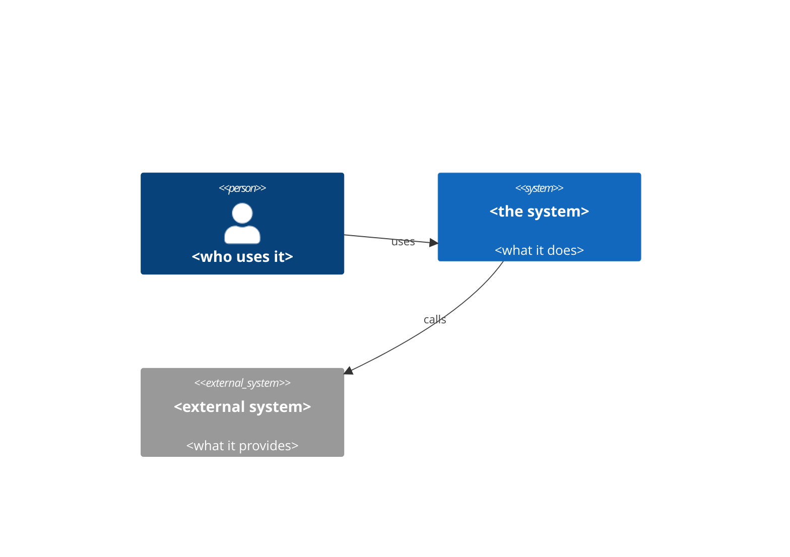
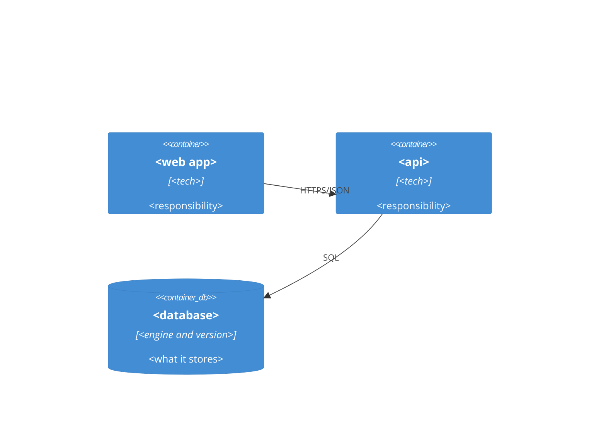

# System design

Saved as `docs/technical/system-design.md`. It describes the system as it is today, not the path: the first
card of a repo writes it, every card that adds a surface, a store, an integration or infrastructure updates it
(criteria P14, O14, S21; the plan declares `- System design: unchanged — <why>` when nothing changes). It does
not repeat what lives elsewhere: decisions and alternatives are in `docs/adr/`, prices in
`docs/technical/infra-cost.md`, deployment commands in `docs/technical/runbook.md`, rules and their checks in
`reference/database.md` (module data) and the other topic references.

## Context and containers (C4)

Diagrams as code (Mermaid C4 or the repo's tool), in two levels.

## Modules and libraries

One folder per feature (`src/modules/<feature>/`; layer folders inside only for a module with business rules worth isolating, a CRUD has none) and a small `shared/` kernel; no top-level layer folders. Public index of each module is its only door.

| Module | What it owns | Public index exports |
|---|---|---|

| Category | Library (the repo's own, else the stack's default) | Where it lives |
|---|---|---|
| Persistence and migrations | | the module's repository |
| Dependency injection | | the framework's, or constructor parameters |
| Validation | | edge of `interface/` |
| Authentication, dates, HTTP client, queues | | |

A category hand-rolled instead of using a library is an `ASM-NN` here with the reason.

## Data

| Entity | Relations and cardinality | Owner module | Volume today | Growth per month |
|---|---|---|---|---|

**Table → owner module.** Read by the architecture test (C8): no other module reads or writes a table that is
not its own.

| Table | Owner module |
|---|---|

**Main queries and their index**

| Query (what it answers) | Table | Index | EXPLAIN at the card's volume |
|---|---|---|---|

- **Migrations:** expand, migrate, contract; engine and version; who runs them (the pipeline, never by hand); a migration of main is never edited; how the upgrade from main's last state is tested with seeded data.
- **Retention and archiving:** per table or store, how long and what happens after.
- **Backups:** frequency, where, encrypted; RPO and RTO; date of the last restore test.

## Infrastructure

- **Deployment diagram:** nodes, networks, the managed services.
- **Environments:** local, staging, production: what differs and how each is reached.
- **Deploy and rollback:** one line each, linking the runbook; commands are not repeated here.
- **Expected scaling:** what scales, how, and the limit that comes first.
- **Secrets:** where they live per environment (inventory below).
- **Cost:** the link to `docs/technical/infra-cost.md`; no figures here.

## Observability

- **SLOs.** Objective, window and scope, never 100 %; coherent with the latency budget of O10.

| Service | SLI | Objective | Window | Error-budget policy (actions on exhaustion, approver) |
|---|---|---|---|---|

- **Signals per service:** RED per endpoint, USE for the pool and the queues, the business metrics the card
  implies; traces with OpenTelemetry (the backend is an option of the stack profile).
- **Log schema.** One JSON object per line, the same fields on every service:

| Field | Content |
|---|---|
| `timestamp` | UTC, ISO 8601 |
| `level` | from the level table below |
| `service`, `version`, `environment` | who emitted it |
| `trace_id`, `span_id` | the correlation id (W3C `traceparent`) |
| `tenant`, `user` | pseudonymized, never the raw identifier |
| `event` | stable event name |
| `message` | readable sentence, no personal data or secrets |

| Level | Meaning |
|---|---|
| `error` | user impact or an unhandled failure |
| `warn` | something unexpected that the system absorbed |
| `info` | a business event or a lifecycle step |
| `debug` | detail for diagnosis, off in production |

- **Alerts as code**, on symptoms or burn rate. Every alert carries: what is happening, impact, who is
  affected, since when, first step, `runbook_url` (a stable anchor of the runbook), `dashboard_url`, owner.
- **Dashboards:** where they are as code, if there are any; one per audience.

## Errors

The taxonomy of the repo: each error type, the layer it comes from, how it is translated at each boundary
(domain → application → HTTP, e.g. `application/problem+json`, RFC 9457) and what the user sees.

| Error | Class (domain, operational, bug) | Comes from | Translated to | What the user sees | Reference id |
|---|---|---|---|---|---|

## External dependencies

One row per external call; it is the evidence of D8 from production. Below it (mvp), D8 is one README decision line per dependency (timeout, retry, what the user sees).

| Dependency | Timeout | Retries (backoff, jitter, idempotent only) | Circuit breaker | Fallback | What happens if it fails |
|---|---|---|---|---|---|

## Threat model

One page per surface (a public endpoint, an integration, an upload, a role). Updated in the card that adds one
(criterion S21). The four questions: what are we building, what can go wrong, what do we do, was it enough.

**Surface:** `<name>` · **Enters:** `<data>` · **Trust boundary:** `<where it is crossed>`

| ID | STRIDE | Threat | Decision (mitigate, eliminate, transfer, accept) | Owner | Verified by (test or command) |
|---|---|---|---|---|---|
| T-01 | Spoofing | | | | |
| T-02 | Tampering | | | | |
| T-03 | Repudiation | | | | |
| T-04 | Information disclosure | | | | |
| T-05 | Denial of service | | | | |
| T-06 | Elevation of privilege | | | | |

Each `mitigate` names the test that verifies it; each `accept` has an owner and a reason.

## Secrets inventory

Names and places, never values (criterion S22). A new secret or sensitive variable is in this table and in
`.env.example` in the same diff.

| Name | Purpose | Consumer | Owner | Where it lives per environment | Privileges | Created | Rotation | Last rotation |
|---|---|---|---|---|---|---|---|---|

## Personal data

Inventory and classification (criterion P15). Context: Ley 25.326 (Argentina) and GDPR.

| Field | Of whom | Category (identifying, sensitive) | Purpose | Legal basis or consent | Where it lives (tables, logs, backups, third parties) | Retention | How it is deleted |
|---|---|---|---|---|---|---|---|

Encryption at rest and encrypted backups: how and with which key.
