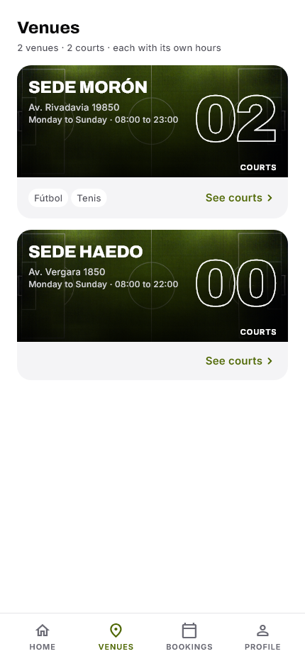
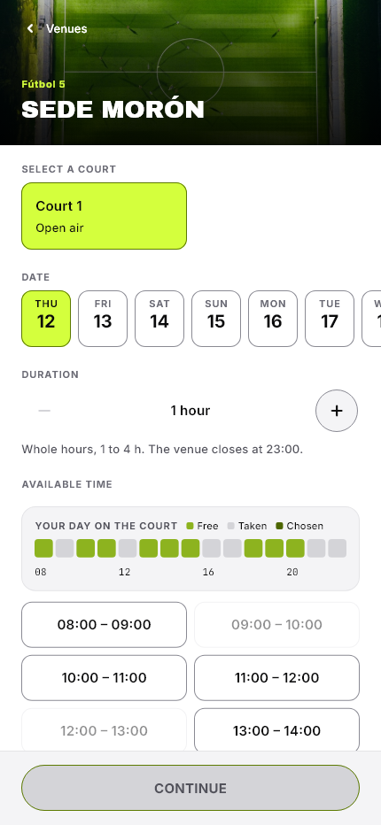

<p align="center"></p>

<h1 align="center">ClubNahuelMosse</h1>

<p align="center"><strong>Book a court in three steps, without calling or writing to the club.</strong><br>
Mobile app to book sports spaces, see their availability and get notifications. Electiva General, Universidad de Morón.</p>

<p align="center">
  
  
  
  
</p>

## What it does

- **Book in three steps:** venue, court and free time slot.
- **My bookings:** upcoming and history, with edit and cancel.
- **Push and email notifications:** a reminder one hour before and a cancellation notice.
- **Light and dark mode.**
- **Admin panel** so the club manages the bookings.
- **Password recovery by email.**

## What it is built with

| Part | Technology |
|---|---|
| Mobile app (`apps/mobile`) | Flutter, Android only |
| REST API (`apps/api`) | FastAPI and SQLAlchemy, with PostgreSQL |
| Accounts and push notifications | Firebase Authentication and Cloud Messaging |
| Email | Brevo |
| Deployment (`render.yaml`) | Render |

Each external service is described in [Integrations](docs/technical/integrations.md).

## How to run it

Each part is configured, run and deployed with its own README: [`apps/api/README.md`](apps/api/README.md) and
[`apps/mobile/README.md`](apps/mobile/README.md).

```sh
npm ci && npm run emuladores   # Firebase Auth emulator
sh scripts/test.sh             # checks and tests of the API and the app
cd docs-site && npm install && npm run build   # documentation site (Docusaurus)
```

## Documentation

- [Getting started](docs/getting-started.md): if you have never seen the repo, start here.
- [Architecture](docs/technical/architecture.md) and [code map](docs/technical/code-map.md).
- [System design](docs/technical/system-design.md) and [runbook](docs/technical/runbook.md).
- [Architecture decisions](docs/adr) and [infrastructure cost](docs/technical/infra-cost.md).
- [Accessibility](docs/business/accessibility.md) and [ASVS security matrix](specs/asvs.md).
- [Documentation assumptions](docs/documentation-assumptions.md) and review status.
