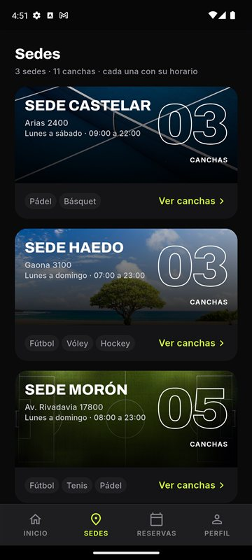
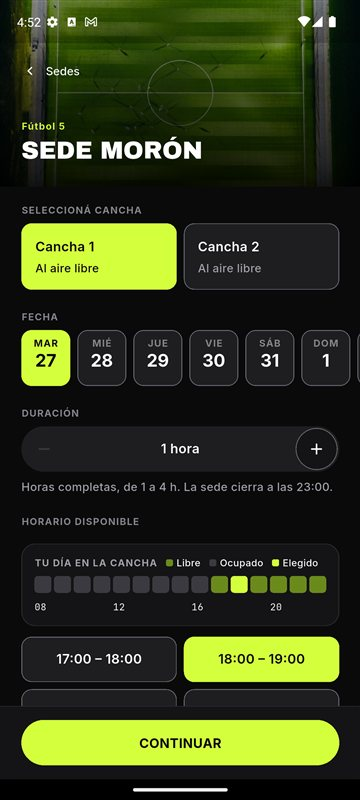

<p align="center"></p>

<h1 align="center">ClubNahuelMosse</h1>

<p align="center"><strong>Reservá la cancha en tres pasos, sin llamar ni escribir al club.</strong><br>
App móvil para reservar espacios deportivos, ver su disponibilidad y recibir avisos. Electiva General, Universidad de Morón.</p>

<p align="center">
  
  
  
  
</p>

## Qué hace

- **Reservar en tres pasos:** sede, cancha y horario libre.
- **Mis reservas:** próximas e historial, con modificar y cancelar.
- **Avisos por push y por correo:** recordatorio una hora antes y aviso de cancelación.
- **Modo claro y oscuro.**
- **Panel de administración** para que el club gestione las reservas.
- **Recuperación de contraseña por correo.**

## Con qué está hecha

| Parte | Tecnología |
|---|---|
| App móvil (`apps/mobile`) | Flutter, sólo Android |
| API REST (`apps/api`) | FastAPI y SQLAlchemy, con PostgreSQL |
| Cuentas y avisos push | Firebase Authentication y Cloud Messaging |
| Correo | Brevo |
| Despliegue (`render.yaml`) | Render |

Cada servicio externo está en [Integraciones](docs/technical/integraciones.md).

## Cómo correrla

Cada parte se configura, ejecuta y despliega con su README: [`apps/api/README.md`](apps/api/README.md) y
[`apps/mobile/README.md`](apps/mobile/README.md).

```sh
npm ci && npm run emuladores   # emulador de Firebase Auth
sh scripts/test.sh             # chequeos y pruebas de la API y la app
cd sitio-docs && npm install && npm run build   # sitio de documentación (Docusaurus)
```

## Documentación

- [Guía básica](docs/guia-basica.md): si nunca viste el repo, empezá por acá.
- [Arquitectura](docs/technical/arquitectura.md) y [mapa del código](docs/technical/mapa-del-codigo.md).
- [Diseño del sistema](docs/technical/system-design.md) y [runbook](docs/technical/runbook.md).
- [Decisiones de arquitectura](docs/adr) y [costo de la infraestructura](docs/technical/infra-cost.md).
- [Accesibilidad](docs/business/accessibility.md) y [matriz de seguridad ASVS](specs/asvs.md).
- [Supuestos de la documentación](docs/supuestos-de-la-documentacion.md) y estado de la revisión.
