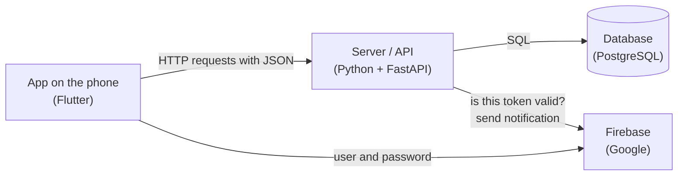
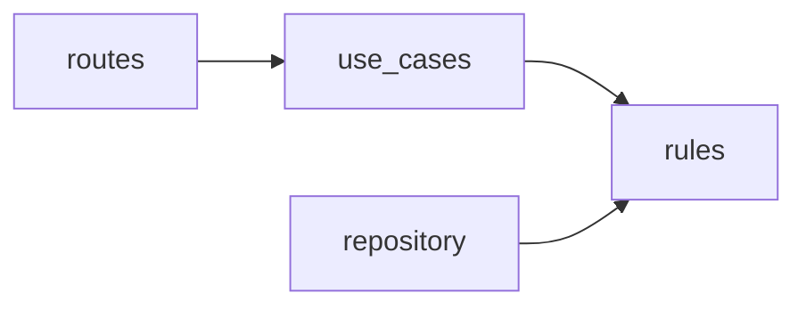

# Getting started

For whoever can program but does not know Flutter, FastAPI, Firebase or Render. It explains what each piece is, how they
connect and where to touch to change something. The fine detail is in [Architecture](technical/architecture.md) and in the
[Code map](technical/code-map.md); this is what you need to know before reading them.

## The idea in one line

A **phone app** asks a **server** (the API) for things, the server stores them in a **database**, and to
know who each person is a **Google service** (Firebase) is used.



It is the same shape as any web app with a backend: the phone is the "frontend", the API is the "backend".

## The technologies, one by one

| Name | What it is | If your background is… it looks like |
|---|---|---|
| **Dart** | The language of the app. Typed, with classes, `async`/`await` and explicit `null` (`String?`) | Java, C#, TypeScript |
| **Flutter** | The framework of the app. Everything you see is a *widget*: a class with a `build()` method that returns more widgets | React (components that compose) |
| **Python** | The language of the server | — |
| **FastAPI** | The web framework of the server. A function with `@router.post("/bookings")` serves that request | Express, Flask, Spring Boot |
| **PostgreSQL** | The relational database. Tables, SQL, constraints | MySQL, SQL Server |
| **SQLAlchemy** | Library to talk to the database from Python. Here it is used only to send hand-written SQL (`text("SELECT …")`), with no ORM | JDBC, a database driver |
| **Alembic** | The *migrations*: each change to the tables is a numbered file applied in order | Flyway, Rails migrations |
| **uv** | Installs the Python dependencies and runs commands (`uv run …`) | npm, Maven |
| **Firebase Authentication** | Google service that stores users and passwords and hands out a *token* on sign-in | Auth0, Cognito |
| **Firebase Cloud Messaging (FCM)** | Google service that delivers push notifications to the phone | — |
| **Render** | The cloud where the API and the database run | Heroku, Railway |
| **pytest** / **flutter test** | The test frameworks of each side | JUnit, Jest |

## What happens when someone books a court

Following a request end to end is the fastest way to understand the code.

1. **The person taps "Confirm"** on the screen `apps/mobile/lib/features/bookings/presentation/confirm_booking_screen.dart`.
2. **The screen asks the bookings repository** (`apps/mobile/lib/features/bookings/presentation/bookings.dart`) to book. Screens never
   talk directly to the server.
3. **The repository uses the HTTP client** (`apps/mobile/lib/api/api_client.dart`), which sends `POST /bookings` with a JSON and the session
   token in the `Authorization: Bearer …` header.
4. **The API receives the request** in `apps/api/app/modules/bookings/routes.py`. First it asks Firebase whether the token is
   valid and whose it is.
5. **The route calls the use case** `book` in `apps/api/app/modules/bookings/use_cases.py`, which applies the rules: it must be a user
   and not an admin, from 1 to 4 hours, within the next 7 days, within the opening hours of the venue.
6. **The pure rules** (compute slots, validate ranges) are in `apps/api/app/modules/bookings/rules.py` and `apps/api/app/modules/availability/rules.py`. They touch
   neither the database nor the network, so they are easy to test.
7. **The SQL repository** (`apps/api/app/modules/bookings/repository.py`) does the `INSERT`. If two people book the same court
   at the same time, the database rejects the second with a constraint, and the API answers **409**.
8. **The response comes back** as JSON with code **201**, and the app shows the booking confirmed screen.

## Where everything is

```
apps/
  api/                    the server
    app/
      modules/            one folder per feature (bookings, availability, venues, spaces, users,
                          session, password_recovery, notifications): its routes, use cases, rules and SQL
      shared/             what several use: database, errors, time zone, Firebase, configuration
      main.py             builds the application
    migrations/versions/  the table changes, numbered 0001, 0002…
    tests/                server tests
  mobile/                 the app
    lib/
      main.dart           entry point
      router.dart         all the navigation routes (which screen goes at each address)
      features/           one folder per topic (session, users, home, venues, spaces, bookings,
                          notifications, admin): its screens and its repository
      api/                the HTTP client
      common/             reusable visual pieces: buttons, dialogs, the day line…
      theme/              colors (tokens.dart) and typefaces
    test/                 app tests
docs/                     this documentation
specs/                    the requirements, one per folder
render.yaml               how it is deployed on Render
```

The API is organized **by feature**, and inside each one the arrows always point inwards:



The rules know nothing about HTTP or SQL; a test (`apps/api/tests/unit/test_architecture_features.py`) fails if someone
breaks it.

## How to change something typical

| I want to… | I touch |
|---|---|
| Change a text of a screen | The screen in `apps/mobile/lib/features/<topic>/presentation/*_screen.dart` and the texts in `apps/mobile/lib/l10n/app_en.arb` (and `app_es.arb`); search for the text with the editor search |
| Change a color | `apps/mobile/lib/theme/tokens.dart`. No screen writes colors by hand |
| Add a business rule (for example, a maximum of hours) | `rules.py` of the feature in `apps/api/app/modules/` and its test in `apps/api/tests/unit/` |
| Add a field to a table | A new migration in `apps/api/migrations/versions/` (copy the shape of the last one), the SQL of `repository.py` and the route in `routes.py`, both in the feature folder |
| Add a screen | A `*_screen.dart` file in the feature folder and its route in `apps/mobile/lib/router.dart` |
| Add an API route | The function in `app/modules/<feature>/routes.py`, register it in `apps/mobile/lib/api/rutas.dart` of the app and regenerate `openapi.json` (see the API README) |

## How to try it on your machine

The minimum to see the app running against the cloud:

```sh
cd apps/mobile
flutter run --dart-define-from-file=definiciones.json
```

`definiciones.json` (not in git) has the address of the API and the Firebase data; `definiciones.example.json`
shows the shape. With an Android emulator open or a phone connected by USB, the app installs and starts.

To work fully locally (server, database and a fake Firebase on your machine) the complete steps are in the READMEs of
[the API](../apps/api/README.md) and of [the app](../apps/mobile/README.md). In short:

1. A local PostgreSQL database.
2. The Firebase emulator: `npm ci` and `npm run emulators` at the root of the repo.
3. The API: `cd apps/api`, `uv sync`, `uv run alembic upgrade head` and `uv run uvicorn app.main:app` with the variables from the
   README.
4. The app pointing to `http://10.0.2.2:8000`, which is how the Android emulator sees your machine.

The tests:

```sh
cd apps/mobile && flutter test        # the app; needs no server
cd apps/api && uv run pytest          # the server; needs the test database and the Firebase emulator
```

## How it works in the cloud

- **Render** runs the API and the database. Each `git push` to `main` deploys by itself: it installs, applies the migrations and starts.
  The configuration is in `render.yaml` and the secrets in the Render dashboard, *Environment* section.
- **Firebase** stores the accounts and sends the notifications. The API identifies itself to Google with a "service
  account", which is a secret JSON loaded in Render.
- **Free plan**: the API sleeps after 15 minutes of no use and takes a minute to wake up; an external monitor hits it
  every 5 minutes to keep it awake. The free database expires after 30 days: back it up first (see the
  [Runbook](technical/runbook.md)).

## The repo's own vocabulary

| Word | What it means |
|---|---|
| **Card** | A requirement, in `specs/<ID>-<name>/card.md`: the use case copied as is, its scenarios and its tasks |
| **Scenario** (`S1`, `S2`…) | A sentence of the requirement that can be checked |
| **Tag** (`@CU-09-S2`) | Goes in the name of a test and says which scenario it tests. With it you go from the requirement to the test and back ([Traceability](../specs/TRAZABILIDAD.md)) |
| **Assumption** (`ASM`) | Something the requirement did not say and was decided, noted with its test |
| **Replacement** (`replaces:`) | A test already in `main` is not edited; if it came out wrong, a new one is written and noted in the card |
| **Screenshot** (`test/screenshots/`) | Images of each screen in two phone sizes and in light and dark mode, to look at by eye |
| **Migration** | A file that changes the tables; they are applied in order and never edited once in `main` |

## What to read next

1. [Architecture](technical/architecture.md): the same as this guide, with all the detail.
2. [Code map](technical/code-map.md): when you look for a specific file.
3. The READMEs of [the API](../apps/api/README.md) and of [the app](../apps/mobile/README.md): to run, test and deploy.
