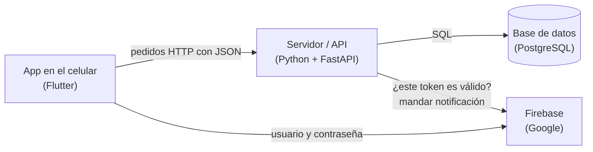
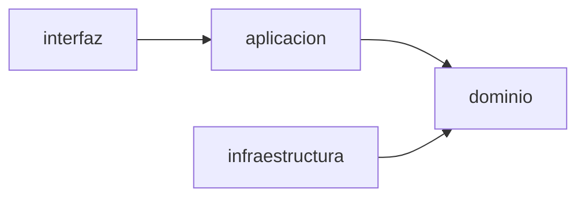

# Guía básica

Para quien sabe programar pero no conoce Flutter, FastAPI, Firebase ni Render. Explica qué es cada pieza, cómo se
conectan y dónde tocar para cambiar algo. El detalle fino está en [Arquitectura](technical/arquitectura.md) y en el
[Mapa del código](technical/mapa-del-codigo.md); esto es lo que hay que saber antes de leerlos.

## La idea en una línea

Una **app de celular** le pide cosas a un **servidor** (la API), el servidor las guarda en una **base de datos**, y para
saber quién es cada persona se usa un **servicio de Google** (Firebase).



Es la misma forma que cualquier app web con backend: el celular es el «frontend», la API es el «backend».

## Las tecnologías, una por una

| Nombre | Qué es | Si lo tuyo es… se parece a |
|---|---|---|
| **Dart** | El lenguaje de la app. Tipado, con clases, `async`/`await` y `null` explícito (`String?`) | Java, C#, TypeScript |
| **Flutter** | El framework de la app. Todo lo que se ve es un *widget*: una clase con un método `build()` que devuelve más widgets | React (componentes que se componen) |
| **Python** | El lenguaje del servidor | — |
| **FastAPI** | El framework web del servidor. Una función con `@router.post("/reservas")` atiende ese pedido | Express, Flask, Spring Boot |
| **PostgreSQL** | La base de datos relacional. Tablas, SQL, restricciones | MySQL, SQL Server |
| **SQLAlchemy** | Librería para hablar con la base desde Python. Acá se usa sólo para mandar SQL escrito a mano (`text("SELECT …")`), sin ORM | JDBC, un driver de base |
| **Alembic** | Las *migraciones*: cada cambio en las tablas es un archivo numerado que se aplica en orden | Flyway, migraciones de Rails |
| **uv** | Instala las dependencias de Python y corre comandos (`uv run …`) | npm, Maven |
| **Firebase Authentication** | Servicio de Google que guarda usuarios y contraseñas y entrega un *token* al iniciar sesión | Auth0, Cognito |
| **Firebase Cloud Messaging (FCM)** | Servicio de Google que hace llegar notificaciones push al celular | — |
| **Render** | La nube donde corren la API y la base | Heroku, Railway |
| **pytest** / **flutter test** | Los frameworks de tests de cada lado | JUnit, Jest |

## Qué pasa cuando alguien reserva una cancha

Seguir un pedido de punta a punta es la forma más rápida de entender el código.

1. **La persona toca «Confirmar»** en la pantalla `apps/mobile/lib/reservas/pantalla_confirmar_reserva.dart`.
2. **La pantalla le pide al repositorio** de reservas (`lib/reservas/reservas.dart`) que reserve. Las pantallas nunca
   hablan directo con el servidor.
3. **El repositorio usa el cliente HTTP** (`lib/api/cliente_api.dart`), que manda `POST /reservas` con un JSON y el token
   de la sesión en el encabezado `Authorization: Bearer …`.
4. **La API recibe el pedido** en `apps/api/app/interfaz/reservas.py`. Primero le pregunta a Firebase si el token es
   válido y de quién es.
5. **La ruta llama al caso de uso** `reservar` en `app/aplicacion/reservas.py`, que aplica las reglas: que sea un usuario
   y no un admin, de 1 a 4 horas, dentro de los próximos 7 días, en el horario de la sede.
6. **Las reglas puras** (calcular horarios, validar rangos) están en `app/dominio/reservas.py` y `horarios.py`. No tocan
   la base ni la red, así que se prueban fácil.
7. **El repositorio SQL** (`app/infraestructura/reservas.py`) hace el `INSERT`. Si dos personas reservan la misma cancha
   a la misma hora, la base rechaza la segunda con una restricción, y la API responde **409**.
8. **La respuesta vuelve** como JSON con código **201**, y la app muestra la pantalla de reserva confirmada.

## Dónde está cada cosa

```
apps/
  api/                    el servidor
    app/
      interfaz/           las rutas HTTP: reciben el pedido y devuelven la respuesta
      aplicacion/         los casos de uso: reservar, cancelar, registrar…
      dominio/            las reglas del negocio, sin base ni red
      infraestructura/    el SQL, Firebase, el correo
      main.py             arma la aplicación
      config.py           la configuración (variables de entorno)
    migraciones/versions/ los cambios de tablas, numerados 0001, 0002…
    tests/                tests del servidor
  mobile/                 la app
    lib/
      main.dart           punto de entrada
      app.dart            todas las rutas de navegación (qué pantalla va en cada dirección)
      sesion/ usuarios/ inicio/ sedes/ reservas/ notificaciones/ admin/
                          una carpeta por tema: sus pantallas y su repositorio
      api/                el cliente HTTP
      comun/              piezas visuales reutilizables: botones, diálogos, la línea del día…
      tema/               colores (tokens.dart) y tipografías
    test/                 tests de la app
docs/                     esta documentación
specs/                    los requisitos, uno por carpeta
render.yaml               cómo se despliega en Render
```

La API está en **capas**, y la regla es que las flechas van siempre hacia adentro:



El dominio no sabe nada de HTTP ni de SQL; un test (`tests/unit/test_arquitectura.py`) falla si alguien lo rompe.

## Cómo se cambia algo típico

| Quiero… | Toco |
|---|---|
| Cambiar un texto de una pantalla | La pantalla en `apps/mobile/lib/<tema>/pantalla_*.dart`; buscá el texto con el buscador del editor |
| Cambiar un color | `apps/mobile/lib/tema/tokens.dart`. Ninguna pantalla escribe colores a mano |
| Agregar una regla de negocio (por ejemplo, un máximo de horas) | `apps/api/app/dominio/` y su test en `apps/api/tests/unit/` |
| Agregar un dato a una tabla | Una migración nueva en `apps/api/migraciones/versions/` (copiá la forma de la última), el SQL del repositorio en `infraestructura/` y la ruta en `interfaz/` |
| Agregar una pantalla | Un archivo `pantalla_*.dart` en la carpeta del tema y su ruta en `lib/app.dart` |
| Agregar una ruta de la API | La función en `app/interfaz/<tema>.py`, registrarla en `lib/api/rutas.dart` de la app y regenerar `openapi.json` (ver el README de la API) |

## Cómo se prueba en tu máquina

Lo mínimo para ver la app andando contra la nube:

```sh
cd apps/mobile
flutter run --dart-define-from-file=definiciones.json
```

`definiciones.json` (no está en git) tiene la dirección de la API y los datos de Firebase; `definiciones.example.json`
muestra la forma. Con un emulador Android abierto o un celular conectado por USB, la app se instala y arranca.

Para trabajar todo en local (servidor, base y Firebase falso en tu máquina) están los pasos completos en los README de
[la API](../apps/api/README.md) y de [la app](../apps/mobile/README.md). En corto:

1. Una base PostgreSQL local.
2. El emulador de Firebase: `npm ci` y `npm run emuladores` en la raíz del repo.
3. La API: `cd apps/api`, `uv sync`, `uv run alembic upgrade head` y `uv run uvicorn app.main:app` con las variables del
   README.
4. La app apuntando a `http://10.0.2.2:8000`, que es cómo el emulador Android ve a tu máquina.

Los tests:

```sh
cd apps/mobile && flutter test        # la app; no necesita servidor
cd apps/api && uv run pytest          # el servidor; necesita la base de tests y el emulador de Firebase
```

## Cómo funciona en la nube

- **Render** corre la API y la base. Cada `git push` a `main` despliega solo: instala, aplica las migraciones y arranca.
  La configuración está en `render.yaml` y los secretos en el panel de Render, sección *Environment*.
- **Firebase** guarda las cuentas y manda las notificaciones. La API se identifica ante Google con una «cuenta de
  servicio», que es un JSON secreto cargado en Render.
- **Plan gratis**: la API se duerme a los 15 minutos sin uso y tarda un minuto en despertar; un monitor externo le pega
  cada 5 minutos para mantenerla despierta. La base gratis vence a los 30 días: hay que respaldarla antes (ver el
  [Runbook](technical/runbook.md)).

## El vocabulario propio del repo

| Palabra | Qué significa |
|---|---|
| **Card** | Un requisito, en `specs/<ID>-<nombre>/card.md`: el caso de uso copiado tal cual, sus escenarios y sus tareas |
| **Escenario** (`S1`, `S2`…) | Una frase del requisito que se puede comprobar |
| **Tag** (`@CU-09-S2`) | Va en el nombre de un test e indica qué escenario prueba. Con eso se va del requisito al test y al revés ([Trazabilidad](../specs/TRAZABILIDAD.md)) |
| **Supuesto** (`ASM`) | Algo que el requisito no decía y se decidió, anotado con su test |
| **Reemplazo** (`replaces:`) | Un test que ya está en `main` no se edita; si quedó mal, se escribe uno nuevo y se anota en la card |
| **Captura** (`test/capturas/`) | Imágenes de cada pantalla en dos tamaños de teléfono y en modo claro y oscuro, para mirar a ojo |
| **Migración** | Un archivo que cambia las tablas; se aplican en orden y nunca se editan una vez en `main` |

## Qué leer después

1. [Arquitectura](technical/arquitectura.md): lo mismo de esta guía, con todo el detalle.
2. [Mapa del código](technical/mapa-del-codigo.md): cuando busques un archivo puntual.
3. Los README de [la API](../apps/api/README.md) y de [la app](../apps/mobile/README.md): para correr, probar y desplegar.
