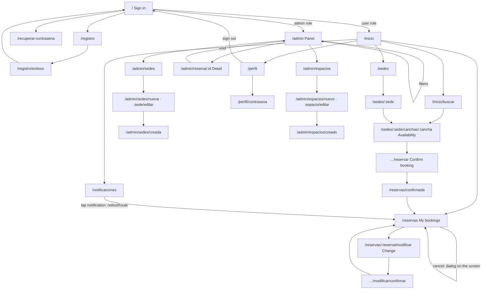

# App navigation

The mobile app uses **GoRouter**; all routes are in `apps/mobile/lib/router.dart`, grouped in one method per section, and `apps/mobile/lib/app.dart` only builds the router with them. A global `redirect`, the `redirectByRole` function in `apps/mobile/lib/redirect.dart`, is evaluated on every route change and every time the session changes (`refreshListenable: session`): every route under `/admin` requires the admin role, those of the user section (`/inicio`, `/perfil`, `/sedes`, `/reservas`, `/reservar`, `/notificaciones` and their children) require the user role, and the rest is public.

## Routes

Who gets in: **No session** = public; **User** / **Admin** = requires that role. The screens are in `apps/mobile/lib/features/<feature>/presentation/`; the route paths stay as the code spells them.

| Route | Screen (file) | Who gets in | What it shows |
|---|---|---|---|
| `/` | `LoginScreen` (`features/session/presentation/login_screen.dart`) | No session | Sign-in form |
| `/registro` | `RegistrationScreen` (`features/users/presentation/registration_screen.dart`) | No session | Sign-up of a user account |
| `/registro/exitoso` | `RegistrationDoneScreen` (`features/users/presentation/registration_done_screen.dart`) | No session | Registration confirmation, with a way back to the login |
| `/recuperar-contrasena` | `ForgotPasswordScreen` (`features/session/presentation/forgot_password_screen.dart`) | No session | Asks for the email to recover the password |
| `/recuperar?codigo=` | `NewPasswordScreen` (`features/session/presentation/new_password_screen.dart`) | No session | Sets the new password; it is where the email link opens (`clubnahuelmosse://app/recuperar`) |
| `/inicio` | `HomeScreen` (`features/home/presentation/home_screen.dart`) | User | Home: upcoming bookings, sports, venues |
| `/inicio/buscar?deporte=` | `SpaceSearchScreen` (`features/bookings/presentation/space_search_screen.dart`) | User | Court search by sport, venue and date |
| `/notificaciones` | `NotificationsScreen` (`features/notifications/presentation/notifications_screen.dart`) | User | List of notifications grouped by day; opened with the bell on the home |
| `/perfil` | `MyProfileScreen` (`features/users/presentation/my_profile_screen.dart`) | User | Account data, appearance and sign-out |
| `/perfil/contrasena` | `ChangePasswordScreen` (`features/users/presentation/change_password_screen.dart`) | User | Password change |
| `/sedes` | `VenuesScreen` (`features/venues/presentation/venues_screen.dart`) | User | List of venues |
| `/sedes/:sede` | `VenueScreen` (`features/venues/presentation/venue_screen.dart`) | User | A venue and its spaces |
| `/sedes/:sede/canchas/:cancha?fecha=&horas=&inicio=` | `AvailabilityScreen` (`features/bookings/presentation/availability_screen.dart`) | User | Available times of a court |
| `/sedes/:sede/canchas/:cancha/reservar` | `ConfirmBookingScreen` (`features/bookings/presentation/confirm_booking_screen.dart`) | User | Summary and confirmation of the booking; needs the choice made in the availability screen |
| `/reservas?reserva=&historial=1` | `MyBookingsScreen` (`features/bookings/presentation/my_bookings_screen.dart`) | User | My bookings (upcoming and history), with one booking highlighted |
| `/reservas/:reserva/modificar?desde=inicio` | `AvailabilityScreen` in modification mode | User | Pick another time for an existing booking |
| `/reservas/:reserva/modificar/confirmar` | `ConfirmChangeScreen` (`features/bookings/presentation/confirm_change_screen.dart`) | User | Confirms the time change |
| `/reservas/confirmada` | `BookingConfirmedScreen` (`features/bookings/presentation/booking_confirmed_screen.dart`) | User | Booking confirmed |
| `/reservar` | `ConfirmBookingScreen` | User | Resumes the booking that was pending when the session expired |
| `/admin` | `AdminPanelScreen` (`features/admin/presentation/admin_panel_screen.dart`) | Admin | Panel: global booking history with filters |
| `/admin/reserva/:id` | `BookingDetailScreen` (`features/admin/presentation/booking_detail_screen.dart`) | Admin | Detail of a booking; it is voided from here |
| `/admin/acceso-denegado` | `AccessDeniedScreen` (`features/session/presentation/access_denied_screen.dart`) | Anyone with a session | Notice that they have no permission for the panel |
| `/admin/sedes` | `AdminVenuesScreen` (`features/admin/presentation/admin_venues_screen.dart`) | Admin | Venue management (create, edit, delete) |
| `/admin/sedes/nueva` | `VenueFormScreen` (`features/admin/presentation/venue_form_screen.dart`) | Admin | New venue |
| `/admin/sedes/:sede/editar` | `VenueFormScreen` (edit mode) | Admin | Venue edit |
| `/admin/sedes/creada` | `VenueCreatedScreen` (`features/admin/presentation/venue_created_screen.dart`) | Admin | Venue saved |
| `/admin/espacios` | `AdminSpacesScreen` (`features/admin/presentation/admin_spaces_screen.dart`) | Admin | Space management (create, edit, delete) |
| `/admin/espacios/nuevo` | `NewSpaceScreen` (`features/admin/presentation/new_space_screen.dart`) | Admin | New space |
| `/admin/espacios/:espacio/editar` | `EditSpaceScreen` (`features/admin/presentation/edit_space_screen.dart`) | Admin | Space edit |
| `/admin/espacios/creado` | `SpaceCreatedScreen` (`features/admin/presentation/space_created_screen.dart`) | Admin | Space saved |

Several child routes carry data in `extra` (the choice, the booking, the venue). Without it, their own `redirect` goes back to the list or the screen they came from (`/reservas`, `/inicio`, `/admin`, `/admin/sedes`, `/admin/espacios`, or the court), for example when a direct link is opened.

## Navigation map

## Redirects

- **No session** on a protected route (user or admin): goes to `/`. The same for `/admin/acceso-denegado`.
- **Wrong role**: a user who asks for anything under `/admin` goes to `/admin/acceso-denegado`; an admin who asks for a user route goes to their home (`/admin`). The home of each role comes from `profile.home`: `/admin` for admin, `/inicio` for user.
- **After signing in**: goes to `profile.home`; if there was a pending booking from that same email, it goes to `/reservar` with that choice.
- **Expired session**: when the API stops recognizing the session, the screen shows the "Your session expired" dialog (it cannot be dismissed) and, once accepted, signs out. Since the router listens to the session, the `redirect` sends the user to `/`. In the admin panel the applied filters are saved to be recovered on re-entry; the pending booking choice is saved and resumed at `/reservar`.
- **Notification tapped** (`noticeRoute` in `features/notifications/domain/app_notification.dart`), from the list, the pop-up panel or the system tray (with the app open or opened through the notification): navigates with `go` to `/reservas?reserva=<id>`. If it is a cancellation (by the club or the user's own) it adds `historial=1` to open the history tab. Without a `bookingId` it goes to `/reservas`. If the session is an admin's, the global redirect takes it to `/admin`.

## Bottom bars

Defined in `common/bottom_bar.dart`; they navigate with `go`.

- **User** (`BottomBar`): HOME (`/inicio`), VENUES (`/sedes`), BOOKINGS (`/reservas`), PROFILE (`/perfil`). It is on the home, venues (and a venue), bookings and profile screens.
- **Admin** (`AdminBar`): BOOKINGS (`/admin`), VENUES (`/admin/sedes`), SPACES (`/admin/espacios`). It is on the panel and on the venue and space lists.
- The form, confirmation and result screens carry no bar.
