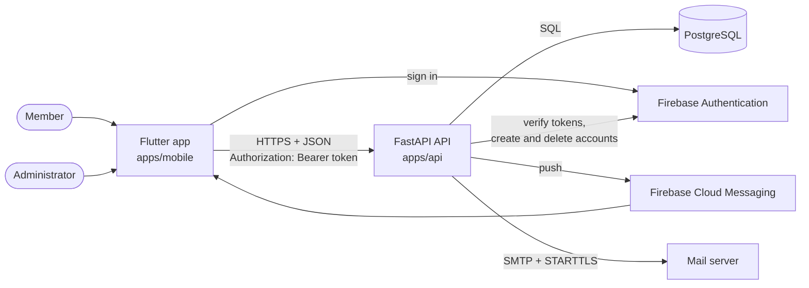
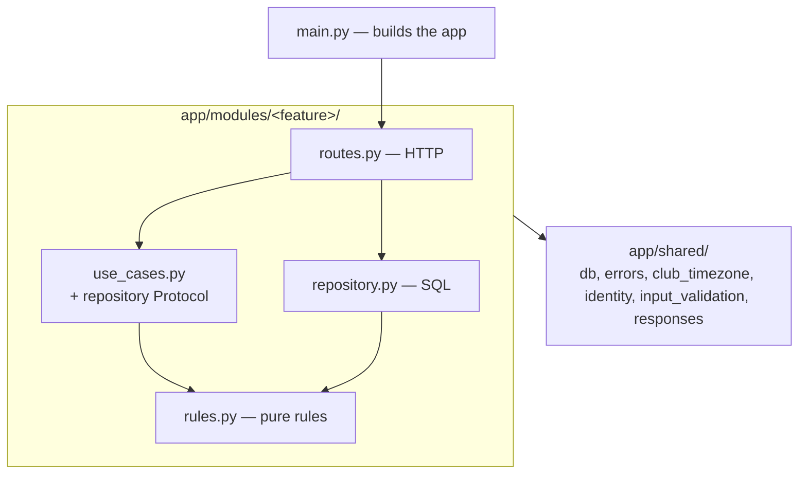
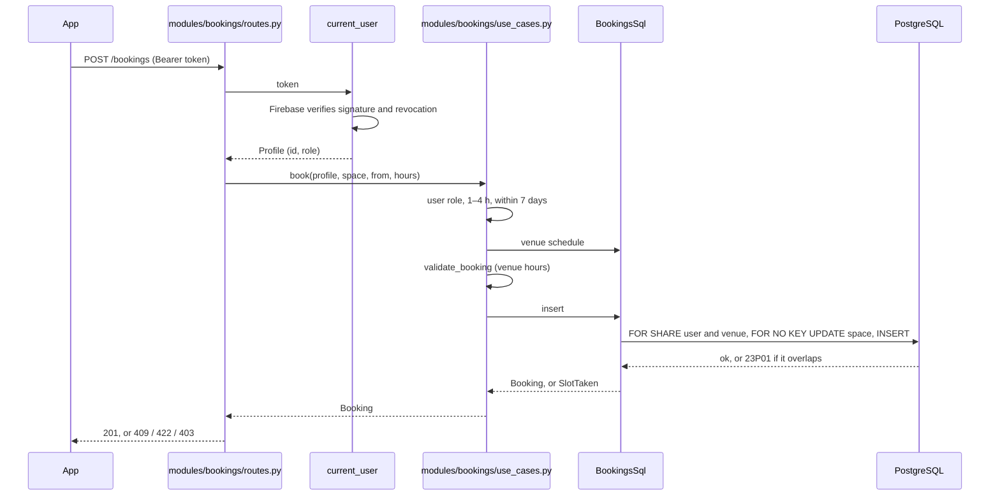
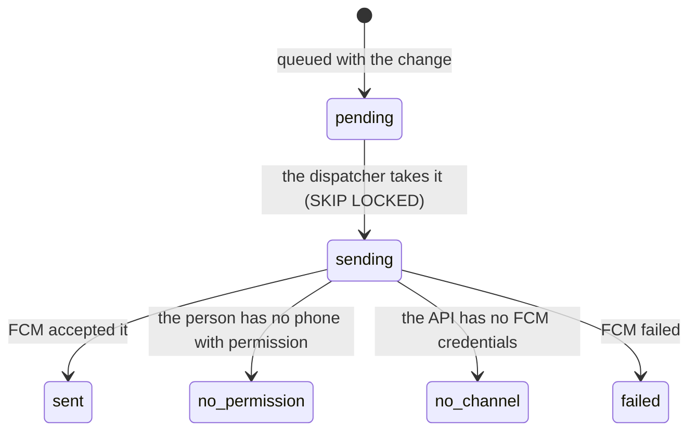
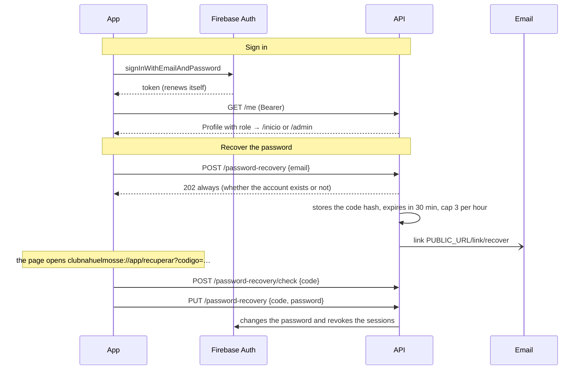
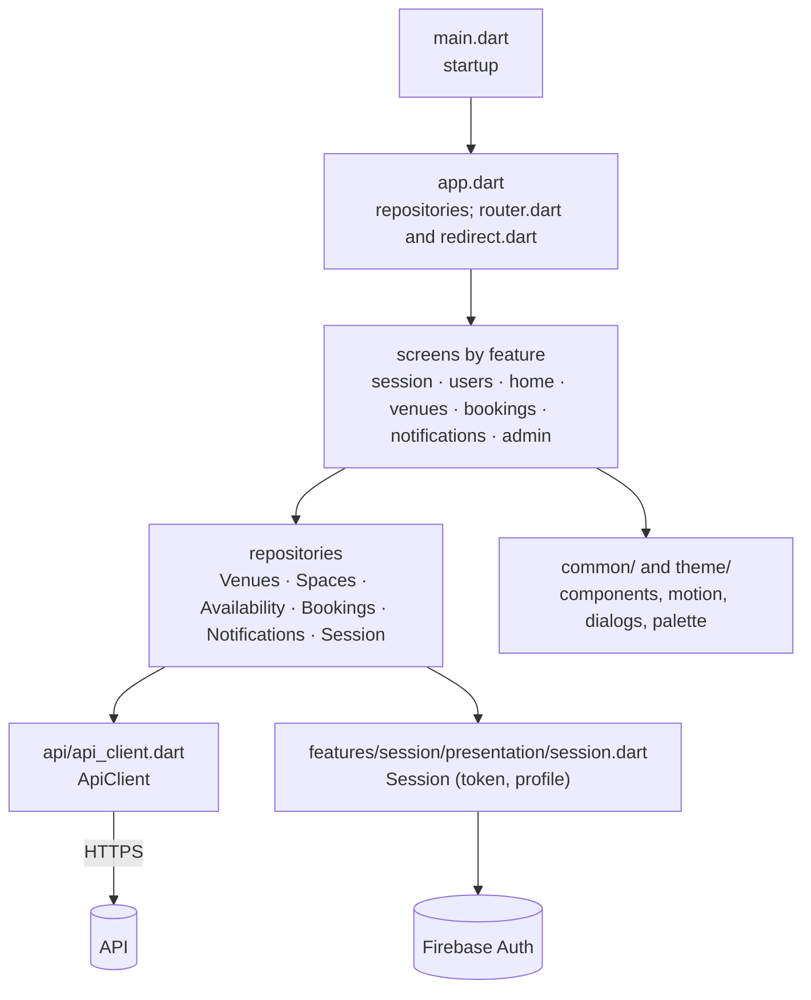
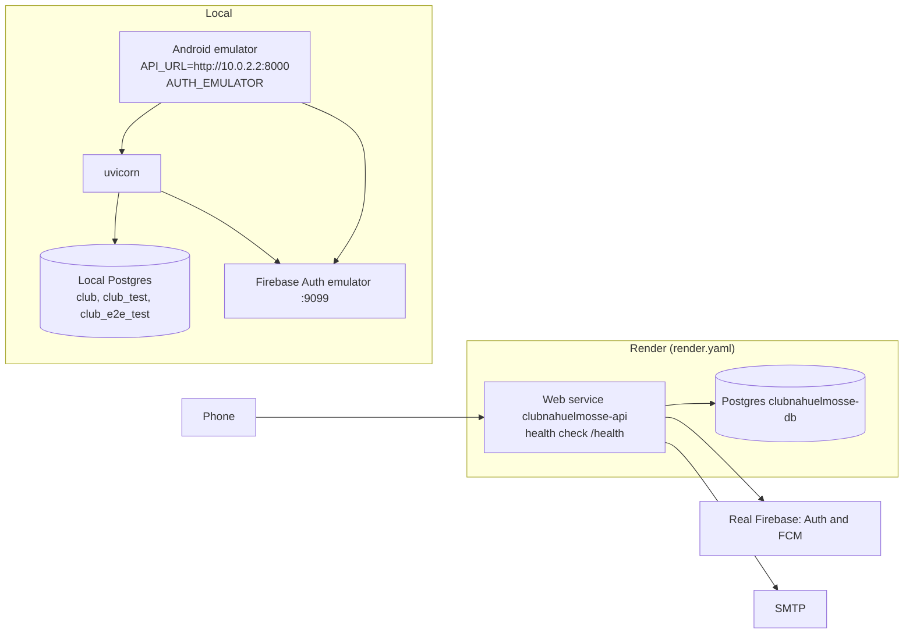

# Architecture · ClubNahuelMosse

How the app is built: the pieces, how they talk to each other, the main flows and the decisions that explain the shape of
the code. To locate a file, [`code-map.md`](code-map.md). For the data model column by column, the threats, the secrets
and the personal data, [`system-design.md`](system-design.md). To operate it, the [runbook](runbook.md). The external
services and where each one is integrated are in [`integrations.md`](integrations.md).

## What it is

An Android app for the members of a club to book courts at different venues, see the availability and receive
notifications, and for an administrator to manage venues, spaces and bookings. It has three own pieces and two outside
services:

| Piece | Technology | Responsibility |
|---|---|---|
| App | Flutter (Dart 3.11), `go_router`, `http`, `firebase_auth`, `firebase_messaging` | screens, session, notifications; it decides no business rules |
| API | Python 3.12, FastAPI, SQLAlchemy Core (hand-written SQL, no ORM), Alembic, pydantic-settings | all the rules: who can do what, schedules, overlap, notifications |
| Database | PostgreSQL with `btree_gist` | the truth of the system; the hard constraints live here |
| Firebase Authentication | external service | accounts and passwords; it issues the token the API verifies |
| Firebase Cloud Messaging | external service | delivers push notifications to the phone |

The reasons for the stack are in [ADR-0001](../adr/0001-stack.md) and those for the hosting in [ADR-0002](../adr/0002-hosting-on-render.md).

## Principles that shape the code

1. **The API decides, the app shows.** The role, the availability, the limits of a booking and who sees what are resolved
   in the API. The app's `redirect` only hides screens; if the app skipped a rule, the API would still reject it.
2. **The database is the last defense.** What can never happen is written as a constraint: two active bookings of the
   same space do not overlap (`EXCLUDE USING gist`), nothing is deleted (`forbid_delete` trigger, removals are
   logical), the email of an account and the identity of a space do not change (immutability triggers), a reminder
   is not duplicated (unique index).
3. **Layers with arrows in one direction**, in the API and in the app, watched by tests.
4. **The clock and the club's time zone are explicit.** Every business date is computed in `America/Argentina/Buenos_Aires`
   (`shared/club_timezone.py` in the API, `common/club_timezone.dart` in the app), and the clock is injected so tests can fix it.
5. **Nothing is lost silently.** Notifications are queued in the same transaction as the change that causes them and a
   dispatcher delivers them afterwards; if the process dies midway, the notification stays in the queue.

## The API

### Features

The API is organized by feature: each folder of `app/modules/` (`bookings`, `availability`, `venues`, `spaces`,
`users`, `session`, `password_recovery`, `notifications`) has its routes, its use cases, its rules and its repository.
What several use goes in `app/shared/`. The file-by-file detail is in [`code-map.md`](code-map.md).

- **`rules.py`** knows no HTTP, SQL or SDK: it holds functions and `dataclass`es that validate and compute. Example:
  `validate_booking` decides whether a range fits the venue's schedule and the duration limits.
- **`use_cases.py`** orchestrates: it asks for data through a `Protocol` ("something that knows how to insert a booking"),
  applies the rules and raises business errors (`Forbidden`, `SlotTaken`, `InvalidData`…). It does not know FastAPI or
  Postgres exist, which is why its tests use in-memory doubles.
- **`repository.py`** fulfils that `Protocol` without inheriting it: `BookingsSql`, `ProfilesSql`, etc. write SQL with
  `text()` on the request's connection. Each repository writes only its own tables.
- **`routes.py`** translates HTTP to use cases and errors to status codes: it builds the repository with the request's
  connection, calls the use case and turns `Forbidden` into 403, `NotFound` into 404, `InvalidData` into 422 with
  `{"errors": {field: message}}`, and conflicts into 409.
- **A feature enters another only through its `__init__.py`**; `shared/` imports none.

The tests `apps/api/tests/unit/test_architecture_features.py`, `test_layers_features.py` and
`test_layers_integration_features.py` fail if anyone breaks these arrows.

FastAPI always publishes `/docs`, `/redoc` and `/openapi.json`.

### A request end to end

Details that matter:

- **Concurrency.** The `INSERT` takes `FOR SHARE` on the user (so a simultaneous account removal does not leave an
  orphan booking) and on the venue (so a schedule change cannot sneak in), and `FOR NO KEY UPDATE` on the space
  (to serialize the bookings of one court). If the schedule changed between validation and `INSERT`, the use
  case revalidates up to three times (`_with_current_hours`). The database exclusion constraint catches any
  overlap that gets through anyway.
- **Repeated request.** If the same person sends the same booking within five minutes (a double tap, a retry
  after a drop), the API returns the booking that already exists instead of failing.
- **One connection per request.** `connection()` (`shared/db.py`) lends a connection from the pool and the repository
  commits explicitly; whatever was not committed is discarded when it is returned.

### Cross-cutting concerns

| Topic | How it is solved | Where |
|---|---|---|
| Authentication | Firebase token in `Authorization: Bearer`; the API verifies it with `check_revoked=True` and looks up the active profile in `app_user` | `modules/session/current_user.py`, `shared/identity.py` |
| Authorization | by role, inside each use case (`profile.role`); by owner in the queries (`WHERE user_id = …`): someone else's booking gives 404 | `modules/*/use_cases.py` |
| Input validation | pydantic types; a body that is not JSON gives 400 without echoing it | `shared/input_validation.py` |
| Errors | business errors → 403, 404, 409 and 422 with `{"errors": …}` | `main.py`, `shared/http_errors.py`, `shared/responses.py` |
| Health | `/health` says the process is alive | `health.py` |
| Database | SQLAlchemy connection pool with `pool_pre_ping` | `shared/db.py` |
| Time | `CLUB_TIMEZONE` and `datetime.now(CLUB_TIMEZONE)`; the columns are `timestamptz` | `shared/club_timezone.py` |

## Notifications

There are three kinds of notification: the **reminder** one hour before a booking, the **confirmation** of a cancellation made
by the person and the **forced cancellation** when an admin voids a booking. A venue or a space with upcoming bookings
cannot be deactivated (`HasFutureBookings`): those bookings are voided first. All of them
go through the `notification` table, which is both the send queue and the notification center the person sees.

- **Cancellation and voiding.** `BookingsSql.cancel` and `BookingsSql.void` change the booking and queue the notification in the
  same transaction. When responding, the route adds a background task (`dispatch_for`) that delivers that person's
  pending ones. If a person has another booking voided while holding an unread voiding notice, a new notice is opened
  with the total count and the previous one is replaced (`replaced_by`); `notification_booking` links each booking
  to the notice that informed it.
- **Reminders.** The sweep (`modules/notifications/sweep.py`) runs inside the web process every `REMINDERS_EVERY`
  seconds: it first dispatches the pending ones and then looks for the active bookings that start within the next hour
  and have no reminder. The unique index `notification_reminder_unique` prevents a duplicate even if two sweeps
  cross. The same sweep exists as a one-pass command (`python -m app.modules.notifications.sweep --una-vez`) for a cron.
- **On the phone.** `NotificationCenter` registers the FCM token with `PUT /devices` on sign-in, removes it
  on sign-out, polls `GET /notifications` every 20 s while the app is open and in the foreground, and takes the user
  to the booking when a notice is tapped (`noticeRoute`). With the app closed, the system tray shows the notice.

## Accounts and passwords

- **Registration** (`POST /register`) creates the account in Firebase and the row in `app_user`; if the row fails, it deletes the
  Firebase account so as not to leave it orphaned.
- **Account removal** (`DELETE /me`) cancels the future bookings, marks the user inactive and deletes the
  Firebase account. The history stays in the database.
- The recovery code travels after the `#`, so it reaches no server log. The database stores only its
  hash.
- The app does not keep the profile on the phone: when opened, it resumes the Firebase session and asks for `GET /me` again.

## The app

### Structure

- **State.** There is no Provider, Riverpod or Bloc. `App` creates one repository per feature and passes it by constructor; each
  screen is a `StatefulWidget` that asks for data with a `Future` and repaints with `setState`. `Session`,
  `NotificationCenter` and `Appearance` are `ChangeNotifier`s because they change on their own, and the router listens to
  `Session` to redirect when it is closed.
- **Navigation.** The routes are in `router.dart`, one section per method, and the global `redirect`, in `redirect.dart`, decides by role; the routes that need data in `extra`
  (confirm a booking, the admin detail) go back to their list if opened without it.
- **Network errors.** `ApiClient` cuts every request at 30 s. Screens use `handleNetworkError` to show the matching dialog (no connection, expired session, server
  error with its reference) and offer to retry. If the session expires in the middle of a booking, the choice is
  kept in memory (`PendingBooking`) and, if the person signs back in with the same account without closing the app, it continues
  at `/reservar`.
- **Unexpected errors.** `unhandled_errors.dart` hooks `FlutterError.onError` and `PlatformDispatcher.onError`.
- **Allowed routes list.** `api/rutas.dart` declares the API routes the app may request. In debug mode (and
  in tests) a request to an undeclared route fails before leaving; in `release` it is not checked.

### The design

- **Tokens.** `theme/tokens.dart` defines the `Palette` (electric green `#D4FF3D` as the accent over neutral blacks, roles
  for backgrounds, texts, borders and states) in dark and light; no screen writes a color by hand. There are own tokens for
  text over photos (`textOnMedia`, `accentOnMedia`).
- **Brand components** in `common/`: logo mark, marker, sport tile, member card, day line, bib and
  die-cut. Their relation to the redesign's Figma is in `specs/RED-02-componentes-identidad/`.
- **Motion** in `common/motion.dart` and `common/transitions.dart`: tabs change without animation, going forward
  enters from the right, results fade; animations run once, on the transition, and are switched off with the
  system option to remove animations.
- **Accessibility.** Semantics labels on the controls, touch sizes and contrast watched by tests
  (`test/accesibilidad_*`, `test/interfaz_accesible*`); the statement is in
  [`docs/business/accessibility.md`](../business/accessibility.md).

## Environments and deployment

| | Local | Render |
|---|---|---|
| API | `uvicorn app.main:app --reload` | build: `uv sync` and `alembic upgrade head`; start: `uvicorn` |
| Database | Postgres on the machine or in Docker | Render Postgres, free plan |
| Firebase | Auth emulator, simulated push | real project, with a service account |
| Email | `EMAIL_MODE=outbox` (table `outgoing_email`) | SMTP |

There is no staging. The API and the database run on Render; the accounts, the secrets and the first deployment are in the runbook.

**Free plan limits that shape the design:** the service sleeps after 15 minutes without traffic (hence
the app's 30 s cut), the reminder sweep does not run while it sleeps (hence the one-pass command
for a cron), and the database expires after 30 days.

## How it is tested

| Level | Where | What it ensures |
|---|---|---|
| API unit tests | `apps/api/tests/unit` | the rules of each feature, use cases with doubles, the layer rules |
| API integration | `apps/api/tests/integration` | each route against Postgres and the Auth emulator; the database constraints |
| API scenarios | `apps/api/tests/scenarios` | every scenario of every card, with its tag; the published OpenAPI contract; migrations; `render.yaml` |
| App widgets | `apps/mobile/test` | screens and flows against a fake API, with the clock fixed; accessibility; motion |
| Captures | `apps/mobile/test/screenshots` | the screens at two widths and two themes, to compare with the Figma |
| End to end | `apps/mobile/integration_test` | the real app on the Android emulator against the real API |

`scripts/test.sh` runs the first four levels with their linters (ruff, strict mypy, `flutter analyze`,
`dart format`); `scripts/e2e.sh` runs the last one.

## How we work

Each feature is born as a card in `specs/`: the requirement copied as is from the use case, the scenarios that make it
verifiable, the assumptions taken when something was ambiguous, and the tasks with the tests that prove them. Each test
carries in its name the tag of the scenario it covers, so from a requirement you reach its test and back
(`specs/TRAZABILIDAD.md`). A test that already entered `main` is not edited: if it must change, a new one is written that
replaces it and it is noted on the card.
