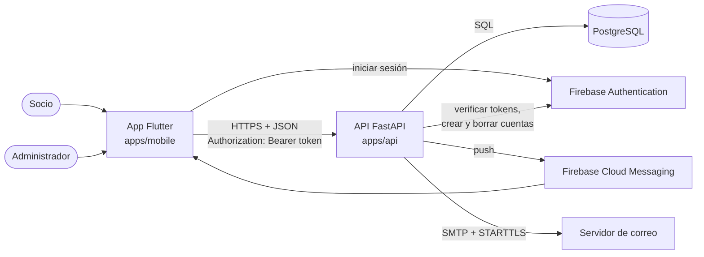
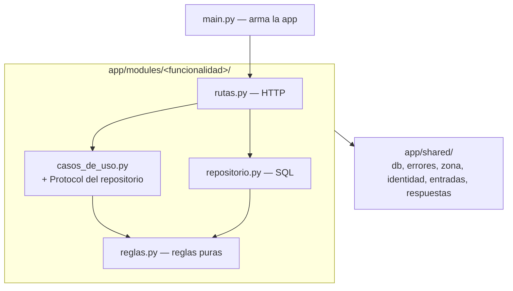
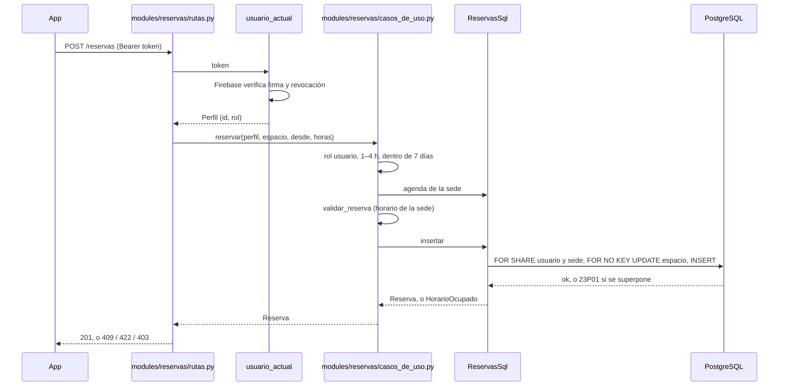
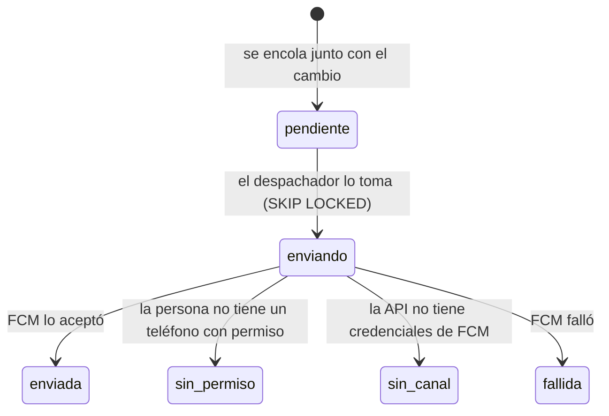
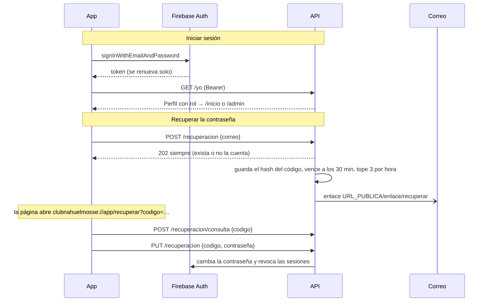
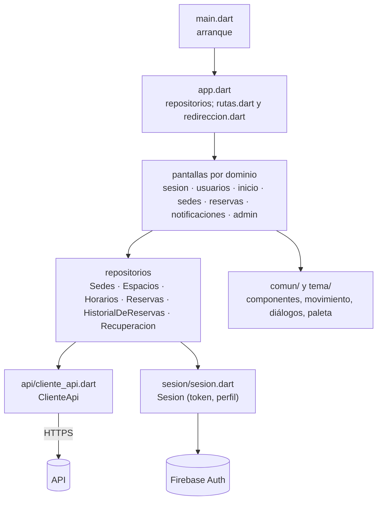
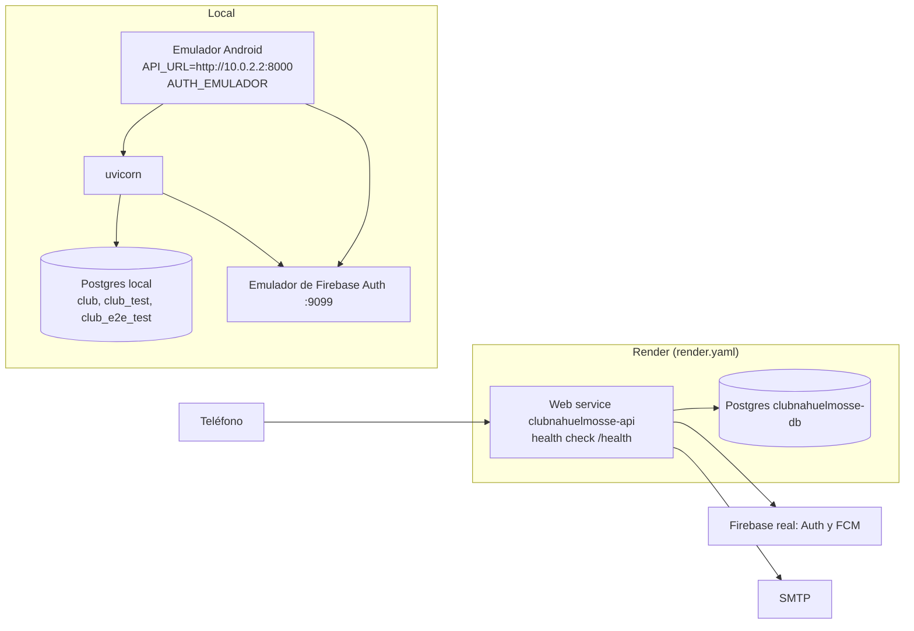

# Arquitectura · ClubNahuelMosse

Cómo está hecha la app: las piezas, cómo se hablan, los flujos principales y las decisiones que explican la forma del
código. Para ubicar un archivo, [`mapa-del-codigo.md`](mapa-del-codigo.md). Para el modelo de datos columna por columna,
las amenazas, los secretos y los datos personales, [`system-design.md`](system-design.md). Para operar, el
[runbook](runbook.md). Los servicios externos y dónde se integra cada uno, en
[`integraciones.md`](integraciones.md).

## Qué es

Una app Android para que los socios de un club reserven canchas en distintas sedes, vean la disponibilidad y reciban
avisos, y para que un administrador gestione sedes, espacios y reservas. Tiene tres piezas propias y dos servicios de
afuera:

| Pieza | Tecnología | Responsabilidad |
|---|---|---|
| App | Flutter (Dart 3.9), `go_router`, `http`, `firebase_auth`, `firebase_messaging` | pantallas, sesión, avisos; no decide reglas de negocio |
| API | Python 3.12, FastAPI, SQLAlchemy Core (SQL a mano, sin ORM), Alembic, pydantic-settings | todas las reglas: quién puede qué, horarios, superposición, avisos |
| Base | PostgreSQL con `btree_gist` | la verdad del sistema; las restricciones duras viven acá |
| Firebase Authentication | servicio externo | cuentas y contraseñas; emite el token que la API verifica |
| Firebase Cloud Messaging | servicio externo | entrega los avisos push al teléfono |

Las razones del stack están en [ADR-0001](../adr/0001-stack.md) y las del hosting en [ADR-0002](../adr/0002-hosting-en-render.md).

## Principios que dan forma al código

1. **La API decide, la app muestra.** El rol, la disponibilidad, los límites de una reserva y quién ve qué se resuelven
   en la API. El `redirect` de la app sólo esconde pantallas; si la app se salteara una regla, la API igual la rechaza.
2. **La base es la última defensa.** Lo que no puede pasar nunca está escrito como restricción: dos reservas activas del
   mismo espacio no se superponen (`EXCLUDE USING gist`), nada se borra (trigger `prohibir_borrado`, las bajas son
   lógicas), el correo de una cuenta y la identidad de un espacio no cambian (triggers de inmutabilidad), un recordatorio
   no se duplica (índice único).
3. **Capas con flechas en un solo sentido**, en la API y en la app, vigiladas por tests.
4. **El reloj y la zona del club son explícitos.** Toda fecha de negocio se calcula en `America/Argentina/Buenos_Aires`
   (`shared/zona.py` en la API, `comun/zona_club.dart` en la app), y el reloj se inyecta para poder fijarlo en los tests.
5. **Nada se pierde en silencio.** Los avisos se encolan en la misma transacción que el cambio que los origina y un
   despachador los entrega después; si el proceso cae a mitad de camino, el aviso queda en la cola.

## La API

### Funcionalidades

La API se organiza por funcionalidad: cada carpeta de `app/modules/` (`reservas`, `horarios`, `sedes`, `espacios`,
`usuarios`, `sesion`, `recuperacion`, `notificaciones`) tiene sus rutas, sus casos de uso, sus reglas y su repositorio.
Lo que usan varias va en `app/shared/`. El detalle archivo por archivo está en [`mapa-del-codigo.md`](mapa-del-codigo.md).

- **`reglas.py`** no conoce HTTP, SQL ni SDK: son funciones y `dataclass` que validan y calculan. Ejemplo:
  `validar_reserva` decide si un rango entra en el horario de la sede y en los límites de duración.
- **`casos_de_uso.py`** orquesta: pide datos por un `Protocol` («algo que sepa insertar una reserva»), aplica las reglas
  y lanza errores del negocio (`Prohibido`, `HorarioOcupado`, `DatosInvalidos`…). No sabe que existe FastAPI ni
  Postgres, y por eso sus tests usan dobles en memoria.
- **`repositorio.py`** cumple ese `Protocol` sin heredarlo: `ReservasSql`, `UsuariosSql`, etc. escriben SQL con
  `text()` sobre la conexión del pedido. Cada repositorio escribe sólo sus tablas.
- **`rutas.py`** traduce HTTP a casos de uso y errores a códigos: arma el repositorio con la conexión del pedido, llama
  al caso de uso y convierte `Prohibido` en 403, `NoEncontrada` en 404, `DatosInvalidos` en 422 con
  `{"errores": {campo: mensaje}}`, los conflictos en 409.
- **Una funcionalidad sólo entra en otra por su `__init__.py`**; `shared/` no importa ninguna.

Los tests `tests/unit/test_arquitectura_funcionalidades.py`, `test_capas_funcionalidades.py` y
`test_capas_integracion_funcionalidades.py` fallan si alguien rompe estas flechas.

FastAPI publica siempre `/docs`, `/redoc` y `/openapi.json`.

### Un pedido de punta a punta

Detalles que importan:

- **Concurrencia.** El `INSERT` toma `FOR SHARE` sobre el usuario (para que una baja de cuenta simultánea no deje una
  reserva huérfana) y sobre la sede (para que un cambio de horario no se cuele), y `FOR NO KEY UPDATE` sobre el espacio
  (para serializar las reservas de una misma cancha). Si la agenda cambió entre la validación y el `INSERT`, el caso de
  uso revalida hasta tres veces (`_con_la_agenda_vigente`). La restricción de exclusión de la base atrapa cualquier
  superposición que pase igual.
- **Pedido repetido.** Si la misma persona manda la misma reserva dentro de cinco minutos (un doble toque, un reintento
  tras un corte), la API devuelve la reserva que ya existe en lugar de fallar.
- **Una conexión por pedido.** `conexion()` (`shared/db.py`) presta una conexión del pool y el repositorio
  confirma explícitamente; lo que no se confirmó se descarta al devolverla.

### Lo transversal

| Tema | Cómo está resuelto | Dónde |
|---|---|---|
| Autenticación | token de Firebase en `Authorization: Bearer`; la API lo verifica con `check_revoked=True` y busca el perfil activo en `usuario` | `modules/sesion/usuario_actual.py` (`usuario_actual`), `shared/identidad.py` |
| Autorización | por rol, dentro de cada caso de uso (`perfil.rol`); por dueño en las consultas (`WHERE usuario_id = …`): una reserva ajena da 404 | `modules/*/casos_de_uso.py` |
| Validación de entrada | tipos de pydantic; un cuerpo que no es JSON da 400 sin repetirlo | `shared/entradas.py` |
| Errores | errores del negocio → 403, 404, 409 y 422 con `{"errores": …}` | `main.py`, `shared/errores_http.py`, `shared/respuestas.py` |
| Salud | `/health` dice que el proceso vive | `salud.py` |
| Base | pool de conexiones de SQLAlchemy con `pool_pre_ping` | `shared/db.py` |
| Hora | `ZONA_CLUB` y `datetime.now(ZONA_CLUB)`; las columnas son `timestamptz` | `shared/zona.py` |

## Los avisos

Hay tres tipos de aviso: el **recordatorio** una hora antes de una reserva, la **confirmación** de una cancelación hecha
por la persona y la **cancelación forzosa** cuando un admin anula una reserva. Una sede o un espacio con reservas por
delante no se pueden dar de baja (`ConReservasFuturas`): primero se anulan esas reservas. Todos
pasan por la tabla `notificacion`, que es a la vez la cola de envío y el centro de avisos que ve la persona.

- **Cancelación y anulación.** `ReservasSql.cancelar` y `ReservasSql.anular` cambian la reserva y encolan el aviso en la
  misma transacción. Al responder, la ruta agrega una tarea de fondo (`despachar_de`) que entrega los pendientes de esa
  persona. Si a una persona le anulan otra reserva mientras tiene un aviso de anulación sin leer, se abre un aviso nuevo
  con la cantidad total y el anterior queda reemplazado (`reemplazada_por`); `notificacion_reserva` liga cada reserva
  con el aviso que se la informó.
- **Recordatorios.** El barrido (`modules/notificaciones/barrido.py`) corre dentro del proceso web cada `RECORDATORIOS_CADA`
  segundos: primero despacha los pendientes y después busca las reservas activas que empiezan dentro de la próxima hora
  y no tienen recordatorio. El índice único `notificacion_recordatorio_unico` impide el duplicado aunque dos barridos se
  crucen. El mismo barrido existe como comando de una pasada (`python -m app.modules.notificaciones.barrido --una-vez`) para un cron.
- **En el teléfono.** `CentroDeNotificaciones` registra el token de FCM con `PUT /dispositivos` al iniciar sesión, lo da
  de baja al cerrarla, consulta `GET /notificaciones` cada 20 s mientras la app está abierta y en primer plano, y lleva
  a la reserva cuando se toca un aviso (`rutaDelAviso`). Con la app cerrada, el aviso lo muestra la bandeja del sistema.

## Cuentas y contraseñas

- El **registro** (`POST /registro`) crea la cuenta en Firebase y la fila en `usuario`; si la fila falla, borra la
  cuenta de Firebase para no dejarla huérfana.
- La **baja de la cuenta** (`DELETE /yo`) cancela las reservas futuras, marca el usuario inactivo y borra la cuenta de
  Firebase. El historial queda en la base.
- El código de recuperación viaja después del `#`, así que no llega a ningún log de servidor. La base sólo guarda su
  hash.
- La app no guarda el perfil en el teléfono: al abrirse, retoma la sesión de Firebase y vuelve a pedir `GET /yo`.

## La app

### Estructura

- **Estado.** No hay Provider, Riverpod ni Bloc. `App` crea un repositorio por dominio y lo pasa por constructor; cada
  pantalla es un `StatefulWidget` que pide datos con `Future` y repinta con `setState`. `Sesion`,
  `CentroDeNotificaciones` y `Apariencia` son `ChangeNotifier` porque cambian por su cuenta, y el router escucha a
  `Sesion` para redirigir cuando se cierra.
- **Navegación.** Las rutas están en `rutas.dart`, una sección por método, y el `redirect` global, en `redireccion.dart`, decide por rol; las rutas que necesitan datos en `extra`
  (confirmar una reserva, el detalle de admin) vuelven a su listado si se abren sin ellos.
- **Errores de red.** `ClienteApi` corta cada pedido a los 30 s. Las pantallas usan `atenderErrorDeRed` para mostrar el diálogo que corresponde (sin conexión, sesión vencida, error
  del servidor con su referencia) y ofrecer reintentar. Si la sesión vence en medio de una reserva, la elección queda
  guardada en memoria (`ReservaPendiente`) y, si la persona vuelve a entrar con la misma cuenta sin cerrar la app, sigue
en `/reservar`.
- **Errores no previstos.** `errores_no_manejados.dart` engancha `FlutterError.onError` y `PlatformDispatcher.onError`.
- **Lista de rutas permitidas.** `api/rutas.dart` declara las rutas de la API que la app puede pedir. En modo debug (y
  en los tests) un pedido a una ruta no declarada falla antes de salir; en `release` no se comprueba.

### El diseño

- **Tokens.** `tema/tokens.dart` define la `Paleta` (verde eléctrico `#D4FF3D` de acento sobre negros neutros, roles
  para fondos, textos, bordes y estados) en oscuro y claro; ninguna pantalla escribe un color a mano. Hay tokens propios para
  texto sobre fotos (`textOnMedia`, `accentOnMedia`).
- **Componentes de marca** en `comun/`: isotipo, marcador, tile de deporte, ficha de socio, línea del día, dorsal y
  troquel. Su relación con el Figma del rediseño está en `specs/RED-02-componentes-identidad/`.
- **Movimiento** en `comun/movimiento.dart` y `comun/transiciones.dart`: las pestañas cambian sin animación, avanzar
  entra desde la derecha, los resultados funden; las animaciones corren una vez, en la transición, y se apagan con la
  opción del sistema de quitar animaciones.
- **Accesibilidad.** Etiquetas de semántica en los controles, tamaños táctiles y contraste vigilados por tests
  (`test/accesibilidad_*`, `test/interfaz_accesible*`); la declaración está en
  [`docs/business/accessibility.md`](../business/accessibility.md).

## Entornos y despliegue

| | Local | Render |
|---|---|---|
| API | `uvicorn app.main:app --reload` | build: `uv sync` y `alembic upgrade head`; start: `uvicorn` |
| Base | Postgres en la máquina o en Docker | Postgres de Render, plan free |
| Firebase | emulador de Auth, push simulado | proyecto real, con cuenta de servicio |
| Correo | `CORREO_MODO=buzon` (tabla `correo_saliente`) | SMTP |

No hay staging. La API y la base corren en Render; las cuentas, los secretos y el primer despliegue están en el runbook.

**Limitaciones del plan gratuito que condicionan el diseño:** el servicio se duerme a los 15 minutos sin tráfico (de ahí
el corte de 30 s de la app), el barrido de recordatorios no corre mientras duerme (por eso existe el comando de una
pasada para un cron), y la base vence a los 30 días.

## Cómo se prueba

| Nivel | Dónde | Qué asegura |
|---|---|---|
| Unitarios de la API | `apps/api/tests/unit` | reglas de cada funcionalidad, casos de uso con dobles, las reglas de capas |
| Integración de la API | `apps/api/tests/integracion` | cada ruta contra Postgres y el emulador de Auth; las restricciones de la base |
| Escenarios de la API | `apps/api/tests/escenarios` | cada escenario de cada card, con su tag; el contrato OpenAPI publicado; migraciones; `render.yaml` |
| Widgets de la app | `apps/mobile/test` | pantallas y flujos contra una API falsa, con el reloj fijo; accesibilidad; movimiento |
| Capturas | `apps/mobile/test/capturas` | las pantallas en dos anchos y dos temas, para comparar con el Figma |
| De punta a punta | `apps/mobile/integration_test` | la app real en el emulador Android contra la API real |

`scripts/test.sh` corre los cuatro primeros niveles con sus linters (ruff, mypy estricto, `flutter analyze`,
`dart format`); `scripts/e2e.sh` corre el último.

## Cómo se trabaja

Cada funcionalidad nace como una card en `specs/`: el requisito copiado tal cual del caso de uso, los escenarios que lo
hacen verificable, los supuestos tomados cuando algo era ambiguo, y las tareas con los tests que las prueban. Cada test
lleva en el nombre el tag del escenario que cubre, así que desde un requisito se llega a su test y al revés
(`specs/TRAZABILIDAD.md`). Un test que ya entró en `main` no se edita: si hace falta cambiarlo, se escribe uno nuevo que
lo reemplaza y se anota en la card.
