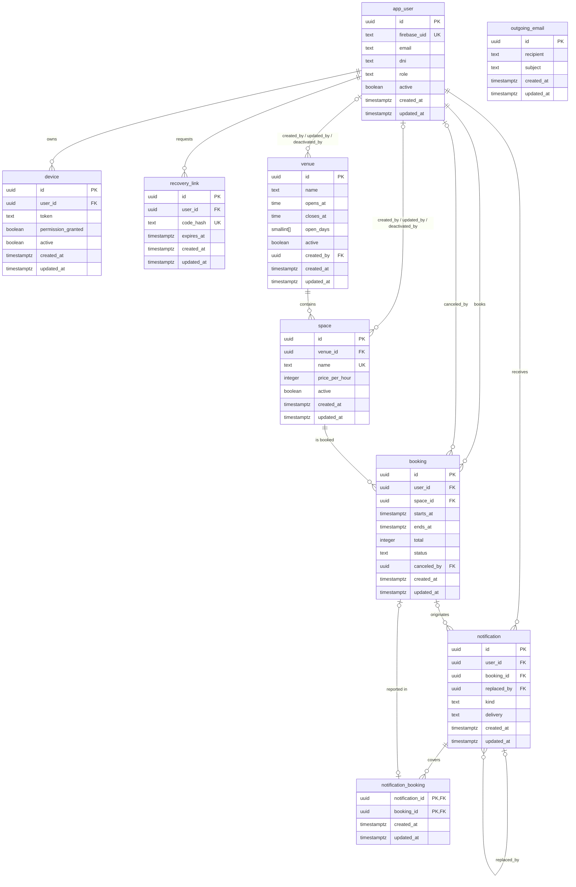
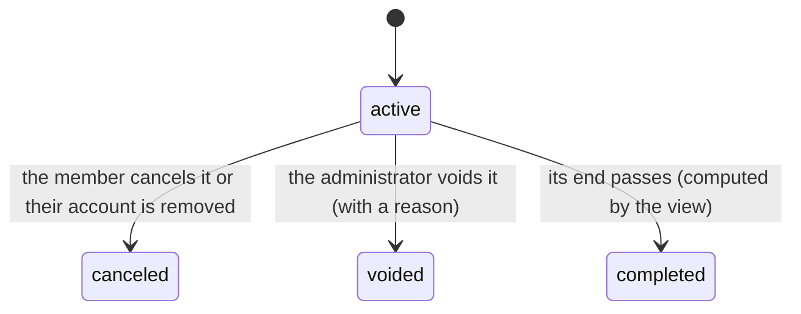
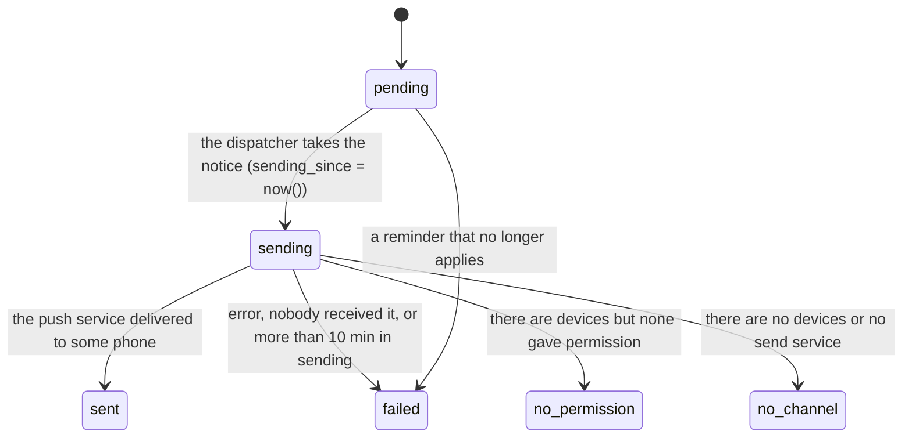

# Data model

The database is PostgreSQL (with the `btree_gist` extension). It has nine tables and one view, `booking_with_status`, which adds the
"completed" status to bookings. Accounts, venues, spaces and bookings are not deleted: their removals are logical and a
trigger blocks any `DELETE` on them. The business rules that could corrupt the data are enforced by the database itself, not only by the API.

All primary keys are `id uuid` with the default value `uuid_v7()`, a database function. A UUIDv7 carries the creation time
in milliseconds in its first bits, so new identifiers come out ordered by time. The
exception is `notification_booking`, which keeps its composite primary key. The references between tables (17 in total)
are `uuid`. Dates are `timestamptz`; the club's time zone is `America/Argentina/Buenos_Aires`.

## Diagram

`booking_with_status` is a view over `booking` with one extra column, `current_status`: it is `completed` when the booking
is `active` and its `ends_at` has already passed; otherwise it repeats `status`. `outgoing_email` is related to no table.

## Entities

All nine tables have `created_at` and `updated_at` (timestamptz, not null): when the row was created and when it last
changed. The `<table>_updated` triggers, one per table (for example `app_user_updated`), keep `created_at` and
update `updated_at` on every change.

### app_user

A person with an account: a member or an administrator. The password lives in Firebase; only its trace stays here.

- `firebase_uid` text, unique. `email` text. `first_name`, `last_name` text, not empty. `dni` text. `birth_date` date.
- `role` text: `user` (default) or `admin`.
- `active` boolean and `deactivated_at` timestamptz. `password_changed_at` timestamptz: when the password changed.
- `created_at`: when the account was registered. `updated_at`: the last change of the row (profile, role, removal).

Database rules: the DNI has 7 or 8 digits. Email (case-insensitive) and DNI are unique **only among active
accounts**: a deactivated account frees both. The email cannot be modified (trigger `app_user_email_immutable`).

### venue

A club location with its schedule.

- `name`, `street` text, not empty. `street_number` integer.
- `opens_at`, `closes_at` time. `open_days` smallint[]: days of the week it is open, 1 to 7.
- `active`, `deactivated_at`, `created_by`, `updated_by`, `deactivated_by` (the last three point to `app_user`).
- `created_at`: when the venue was created. `updated_at`: its last edit or its removal.

Rules: the name is unique among active venues (case-insensitive); `street_number` greater than 0; opening and closing on whole
hours, with `opens_at < closes_at` or `closes_at = 00:00` (midnight); `open_days` has 1 to 7 values between 1 and 7.

### space

A bookable court or room inside a venue.

- `venue_id` FK to `venue`. `sport`, `kind` text, not empty. `number` integer. `name` text.
- `covered`, `lit` boolean. `price_per_hour` integer.
- `active`, `deactivated_at` and the audit fields (`created_by`, `updated_by`, `deactivated_by`).
- `created_at`: when the space was created. `updated_at`: its last edit or its removal.

Rules: `name` unique across the whole table; `(venue_id, sport, kind, number)` unique; `number` and `price_per_hour` greater than
0. The identity of the space (`name`, `venue_id`, `sport`, `kind`, `number`) never changes (trigger
`space_name_immutable`, which runs `space_identity_immutable()`).

### booking

The time slot a member takes on a space.

- `user_id`, `space_id` FK. `starts_at`, `ends_at` timestamptz.
- `price_per_hour` integer: a copy of the price at booking time. `total` integer.
- `status` text: `active` (default), `canceled` or `voided`.
- `canceled_at`, `canceled_by` (FK to `app_user`), `reason` text.
- `created_at`: when the booking was made. `updated_at`: its last change (modification, cancellation or voiding).

Database rules:

- `starts_at` and `ends_at` fall on whole hours of the club's time zone.
- It lasts between 1 and 4 hours.
- `total = price_per_hour × hours`.
- A `voided` booking requires a non-empty `reason`.
- **No overlap:** `EXCLUDE USING gist (space_id WITH =, tstzrange(starts_at, ends_at) WITH &&) WHERE (status = 'active')`.
  Two active bookings of the same space cannot overlap; canceled or voided ones free the slot.

### recovery_link

A password recovery request.

- `user_id` FK. `code_hash` text, unique: only the hash is stored, never the code.
- `created_at` (default `clock_timestamp()`): when it was requested. `expires_at`, `used_at`, `invalidated_at`.
- `updated_at`: when it was last used or invalidated.

Rule: `expires_at > created_at`.

### outgoing_email

Mailbox of emails for development and tests (`CORREO_MODO=buzon`); in production the email goes out over SMTP and the table stays
empty. Columns: `recipient`, `subject`, `body` (text, not null), `created_at` and `updated_at`. No relations.

### device

A phone with the app installed, to send it push notifications.

- `user_id` FK. `token` text (FCM token), not empty. `platform` text: `android` or `ios`.
- `permission_granted` boolean: what the operating system answered about notifications.
- `active`, `created_at`, `updated_at`, `deactivated_at`.

Rule: an active `token` belongs to a single account; if another one signs in on that phone, the record moves to it.

### notification

A notice that the person sees in the notification center and that, if possible, also reaches the phone.

- `user_id` FK. `kind` text: `reminder`, `five_minute_reminder`, `forced_cancellation` or `user_cancellation`.
- `title`, `body` text, not empty. `booking_id` FK to `booking`; `booking_starts_at` timestamptz (the time it refers to).
- `delivery` text: send status (see below). `created_at`: when the notice was generated. `sent_at`, `read_at`.
- `updated_at`: the last change of the notice (send, read or replacement).
- `sending_since` timestamptz: when the notice was taken to be sent.
- `replaced_by` FK to `notification`; `count` integer greater than 0: how many bookings a grouped notice covers.

Rules: a reminder requires `booking_id` and `booking_starts_at`, and there is at most one per `(booking_id, booking_starts_at)`
(index `notification_reminder_unique`; the five-minute one has its own, `notification_five_minute_reminder_unique`); a
`user_cancellation` requires `booking_id` and there is at most one per booking (repeating the cancellation does not repeat the notice).
When voidings are grouped, a new notice is opened and the previous one is left with `replaced_by`: the center does not list it but
keeps how it went out.

### notification_booking

Joins a grouped voiding notice with the bookings it reports. Columns `notification_id` and `booking_id`, both `uuid` FKs,
plus `created_at` and `updated_at`. It has no `id` of its own: its primary key is composite over the two FKs; `booking_id` is
unique: a booking has at most one notice.

## States

### booking

`completed` is not stored: `booking_with_status` computes it (`current_status`). `canceled` and `voided` are final and leave
`canceled_at` / `canceled_by` (and `reason` on voiding) for traceability.

### notification.delivery

There are no retries: a send that fails stays `failed`. If the API goes down in the middle of a send, the notice stays in `sending`;
when dispatching, the one that has been in `sending` for more than 10 minutes since `sending_since` becomes `failed` and is logged as
"aviso_sin_enviar". `no_permission` and `no_channel` leave the notice only in the notification center. A `pending` reminder
whose booking was canceled, moved or has already started becomes `failed` without being sent.

## Logical removals and traceability

- **Accounts, venues, spaces and bookings are not deleted.** `app_user`, `venue`, `space` and `booking` have a
  `BEFORE DELETE` trigger (`<table>_no_delete`, which runs `forbid_delete()`) that rejects every `DELETE`.
- **Removal = flag + date.** `active` and `deactivated_at` always go together: a `CHECK` forces the
  flag to be true if and only if `deactivated_at` is null. The same holds for `device`.
- **Who did what.** `venue` and `space` store `created_by`, `updated_by` and `deactivated_by` (FK to `app_user`);
  `booking` stores `canceled_by`. When: `created_at` and `updated_at` on all nine tables (the second one maintained by the
  `<table>_updated` trigger) and `deactivated_at` where there is removal.
- **Removals free things up.** Since the uniques of email, DNI and venue name hold only among active ones, a deactivated record
  leaves its email, DNI or name free.
- Recovery links, emails and notices are neither deleted nor automatically expired.

## Indexes

Every primary key is an index and every foreign key (FK) points to the `id` of another table. The other indexes serve the
main queries:

| Query | Table | Index |
|---|---|---|
| Overlap when booking | `booking` | the gist exclusion constraint |
| Sweep: active bookings starting within the next hour | `booking` | `booking_active_starts_at` |
| Own history, `GET /bookings?when=history` | `booking` | `booking_by_user_starts_at` |
| The administrator's global history | `booking` | `booking_by_starts_at` |
| A person's notification center | `notification` | `notification_user` |
| Dispatch of the oldest pending one | `notification` | `notification_to_dispatch` |

The tests in `tests/scenarios/test_datos*.py` check that the history plans do not scan the whole table. The plan
of the other queries was not measured.

## Migrations, retention and backup

- **Migrations:** Alembic (`apps/api/alembic.ini`, `migrations/`), twelve linear revisions, 0001 to 0012. They run inside the
  Render build (`render.yaml`, `buildCommand`), each in its own transaction. `tests/scenarios/test_datos*.py` watches the
  round trip.
- **Retention:** there is no policy. No `DELETE` happens on the main tables and notices, links and emails do not expire.
- **Backup:** no automatic backups; the Render database is on the free plan, with no copies.

## Who writes each table

Each repository (`apps/api/app/modules/<feature>/repository.py`) writes only its own tables; the test `apps/api/tests/unit/test_layers_features.py` checks it.
If a case needs another table, it calls the owning repository (for example, removing an account cancels its bookings
through the bookings one).

| Table | Module |
|---|---|
| `app_user` | `users` |
| `venue` | `venues` |
| `space` | `spaces` |
| `booking` | `bookings` |
| `recovery_link` | `password_recovery` |
| `outgoing_email` | `password_recovery` |
| `device` | `notifications` |
| `notification` | `notifications` |
| `notification_booking` | `notifications` |
