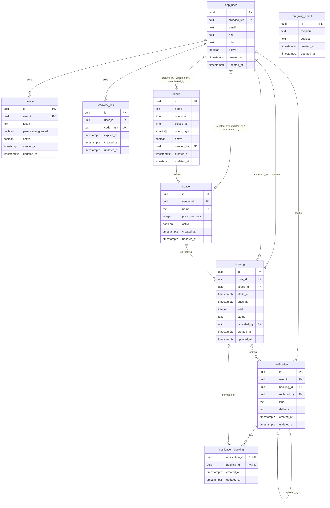
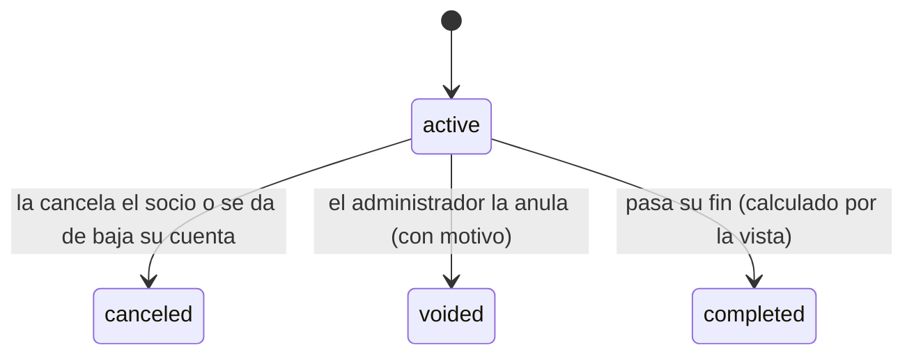
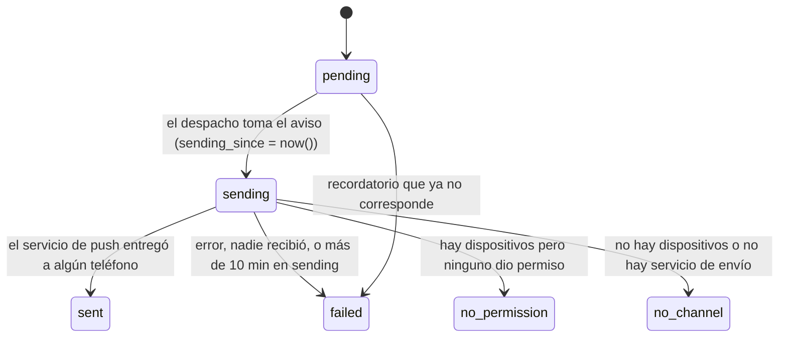

# Modelo de datos

La base es PostgreSQL (con la extensión `btree_gist`). Tiene nueve tablas y una vista, `booking_with_status`, que agrega el
estado «completada» a las reservas. Las cuentas, sedes, espacios y reservas no se borran: sus bajas son lógicas y un
trigger impide cualquier `DELETE` en ellas. Las reglas del negocio que pueden romper los datos las hace cumplir la propia base, no sólo la API.

Todas las claves primarias son `id uuid` con valor por defecto `uuid_v7()`, una función de la base. Un UUIDv7 lleva en sus
primeros bits la hora de creación en milisegundos, así que los identificadores nuevos salen ordenados por tiempo. La
excepción es `notification_booking`, que conserva su clave primaria compuesta. Las referencias entre tablas (17 en total)
son `uuid`. Las fechas son `timestamptz`; la zona del club es `America/Argentina/Buenos_Aires`.

## Diagrama

`booking_with_status` es una vista sobre `booking` con una columna extra, `current_status`: vale `completed` cuando la reserva
está `active` y su `ends_at` ya pasó; en los demás casos repite `status`. `outgoing_email` no se relaciona con ninguna tabla.

## Entidades

Las nueve tablas tienen `created_at` y `updated_at` (timestamptz, no nulos): cuándo se creó la fila y cuándo cambió por
última vez. Los triggers `<tabla>_updated`, uno por tabla (por ejemplo `app_user_updated`), conservan `created_at` y
actualizan `updated_at` en cada cambio.

### app_user

Una persona con cuenta: socio o administrador. La contraseña vive en Firebase; acá queda sólo el rastro.

- `firebase_uid` text, único. `email` text. `first_name`, `last_name` text, no vacíos. `dni` text. `birth_date` date.
- `role` text: `user` (por defecto) o `admin`.
- `active` boolean y `deactivated_at` timestamptz. `password_changed_at` timestamptz: cuándo cambió la contraseña.
- `created_at`: cuándo se registró la cuenta. `updated_at`: el último cambio de la fila (perfil, rol, baja).

Reglas de la base: el DNI tiene 7 u 8 dígitos. Correo (sin distinguir mayúsculas) y DNI son únicos **sólo entre cuentas
activas**: una cuenta dada de baja libera ambos. El correo no se puede modificar (trigger `app_user_email_immutable`).

### venue

Un local del club con su horario.

- `name`, `street` text, no vacíos. `street_number` integer.
- `opens_at`, `closes_at` time. `open_days` smallint[]: días de la semana abiertos, 1 a 7.
- `active`, `deactivated_at`, `created_by`, `updated_by`, `deactivated_by` (los tres últimos apuntan a `app_user`).
- `created_at`: cuándo se dio de alta la sede. `updated_at`: su última edición o su baja.

Reglas: el nombre es único entre sedes activas (sin distinguir mayúsculas); `street_number` mayor que 0; apertura y cierre en horas
completas, con `opens_at < closes_at` o `closes_at = 00:00` (medianoche); `open_days` tiene de 1 a 7 valores entre 1 y 7.

### space

Una cancha o sala reservable dentro de una sede.

- `venue_id` FK a `venue`. `sport`, `kind` text, no vacíos. `number` integer. `name` text.
- `covered`, `lit` boolean. `price_per_hour` integer.
- `active`, `deactivated_at` y los campos de auditoría (`created_by`, `updated_by`, `deactivated_by`).
- `created_at`: cuándo se dio de alta el espacio. `updated_at`: su última edición o su baja.

Reglas: `name` único en toda la tabla; `(venue_id, sport, kind, number)` único; `number` y `price_per_hour` mayores que
0. La identidad del espacio (`name`, `venue_id`, `sport`, `kind`, `number`) no cambia nunca (trigger
`space_name_immutable`, que ejecuta `space_identity_immutable()`).

### booking

El turno que un socio toma sobre un espacio.

- `user_id`, `space_id` FK. `starts_at`, `ends_at` timestamptz.
- `price_per_hour` integer: copia del precio al reservar. `total` integer.
- `status` text: `active` (por defecto), `canceled` o `voided`.
- `canceled_at`, `canceled_by` (FK a `app_user`), `reason` text.
- `created_at`: cuándo se hizo la reserva. `updated_at`: su último cambio (modificación, cancelación o anulación).

Reglas de la base:

- `starts_at` y `ends_at` caen en horas completas de la zona del club.
- Dura entre 1 y 4 horas.
- `total = price_per_hour × horas`.
- Una reserva `voided` exige `reason` no vacío.
- **Sin superposición:** `EXCLUDE USING gist (space_id WITH =, tstzrange(starts_at, ends_at) WITH &&) WHERE (status = 'active')`.
  Dos reservas activas del mismo espacio no pueden pisarse; las canceladas o anuladas liberan el horario.

### recovery_link

Un pedido de recuperar la contraseña.

- `user_id` FK. `code_hash` text, único: se guarda sólo el hash, nunca el código.
- `created_at` (por defecto `clock_timestamp()`): cuándo se pidió. `expires_at`, `used_at`, `invalidated_at`.
- `updated_at`: cuándo se usó o se invalidó por última vez.

Regla: `expires_at > created_at`.

### outgoing_email

Buzón de correos para desarrollo y pruebas (`CORREO_MODO=buzon`); en producción el correo sale por SMTP y la tabla queda
vacía. Columnas: `recipient`, `subject`, `body` (text, no nulos), `created_at` y `updated_at`. Sin relaciones.

### device

Un teléfono con la app instalada, para enviarle avisos push.

- `user_id` FK. `token` text (token de FCM), no vacío. `platform` text: `android` o `ios`.
- `permission_granted` boolean: lo que el sistema operativo contestó sobre las notificaciones.
- `active`, `created_at`, `updated_at`, `deactivated_at`.

Regla: un `token` activo pertenece a una sola cuenta; si otra inicia sesión en ese teléfono, el registro pasa a ella.

### notification

Un aviso que ve la persona en el centro de avisos y que, si puede, también llega al teléfono.

- `user_id` FK. `kind` text: `reminder`, `five_minute_reminder`, `forced_cancellation` o `user_cancellation`.
- `title`, `body` text, no vacíos. `booking_id` FK a `booking`; `booking_starts_at` timestamptz (el horario al que refiere).
- `delivery` text: estado del envío (ver más abajo). `created_at`: cuándo se generó el aviso. `sent_at`, `read_at`.
- `updated_at`: el último cambio del aviso (envío, lectura o reemplazo).
- `sending_since` timestamptz: cuándo se tomó el aviso para enviarlo.
- `replaced_by` FK a `notification`; `count` integer mayor que 0: cuántas reservas cubre un aviso agrupado.

Reglas: un recordatorio exige `booking_id` y `booking_starts_at`, y hay a lo sumo uno por `(booking_id, booking_starts_at)`
(índice `notification_reminder_unique`; el de cinco minutos tiene el suyo, `notification_five_minute_reminder_unique`); una
`user_cancellation` exige `booking_id` y hay a lo sumo una por reserva (repetir la cancelación no repite el aviso).
Cuando se agrupan anulaciones, se abre un aviso nuevo y el anterior queda con `replaced_by`: el centro no lo lista pero
conserva cómo salió.

### notification_booking

Une un aviso agrupado de anulación con las reservas que informa. Columnas `notification_id` y `booking_id`, ambas FK `uuid`,
más `created_at` y `updated_at`. No tiene `id` propio: su clave primaria es compuesta por las dos FK; `booking_id` es
único: una reserva tiene a lo sumo un aviso.

## Estados

### booking

`completed` no se guarda: la calcula `booking_with_status` (`current_status`). `canceled` y `voided` son finales y dejan
`canceled_at` / `canceled_by` (y `reason` en la anulación) para la trazabilidad.

### notification.delivery

No hay reintentos: un envío que falla queda `failed`. Si la API se cae a mitad de un envío, el aviso queda en `sending`;
al despachar, el que lleva más de 10 minutos desde `sending_since` pasa a `failed` y se registra en el log como
«aviso_sin_enviar». `no_permission` y `no_channel` dejan el aviso sólo en el centro de avisos. Un recordatorio `pending`
cuya reserva se canceló, se movió o ya empezó pasa a `failed` sin enviarse.

## Bajas lógicas y trazabilidad

- **Cuentas, sedes, espacios y reservas no se borran.** `app_user`, `venue`, `space` y `booking` tienen un trigger
  `BEFORE DELETE` (`<tabla>_no_delete`, que ejecuta `forbid_delete()`) que rechaza todo `DELETE`.
- **Baja = bandera + fecha.** `active` y `deactivated_at` van siempre juntos: un `CHECK` obliga a que la
  bandera sea verdadera si y sólo si `deactivated_at` es nulo. Lo mismo vale para `device`.
- **Quién hizo qué.** `venue` y `space` guardan `created_by`, `updated_by` y `deactivated_by` (FK a `app_user`);
  `booking` guarda `canceled_by`. Cuándo: `created_at` y `updated_at` en las nueve tablas (el segundo, mantenido por el
  trigger `<tabla>_updated`) y `deactivated_at` donde hay baja.
- **Las bajas liberan.** Como los únicos de correo, DNI y nombre de sede valen sólo entre activos, un registro dado de baja
  deja libre su correo, DNI o nombre.
- Los enlaces de recuperación, correos y avisos no se borran ni tienen vencimiento automático.

## Índices

Cada clave primaria es un índice y cada clave foránea (FK) apunta al `id` de otra tabla. Los demás índices sirven a las
consultas principales:

| Consulta | Tabla | Índice |
|---|---|---|
| Superposición al reservar | `booking` | la restricción de exclusión gist |
| Barrido: reservas activas que empiezan en la hora que viene | `booking` | `booking_active_starts_at` |
| Historial propio, `GET /reservas?cuando=historial` | `booking` | `booking_by_user_starts_at` |
| Historial global del administrador | `booking` | `booking_by_starts_at` |
| Centro de avisos de una persona | `notification` | `notification_user` |
| Despacho del pendiente más viejo | `notification` | `notification_to_dispatch` |

Los tests de `tests/escenarios/test_datos*.py` verifican que los planes del historial no recorren la tabla entera. El plan
del resto de las consultas no se midió.

## Migraciones, retención y respaldo

- **Migraciones:** Alembic (`apps/api/alembic.ini`, `migrations/`), doce revisiones lineales, 0001 a 0012. Corren dentro del
  build de Render (`render.yaml`, `buildCommand`), cada una en su transacción. `tests/escenarios/test_datos*.py` vigila la
  ida y vuelta.
- **Retención:** no hay política. Ningún `DELETE` pasa en las tablas principales y los avisos, enlaces y correos no vencen.
- **Respaldo:** sin backups automáticos; la base de Render es del plan gratuito, sin copias.

## Quién escribe cada tabla

Cada repositorio (`apps/api/app/modules/<funcionalidad>/repositorio.py`) escribe sólo sus tablas; el test `tests/unit/test_capas_funcionalidades.py` lo verifica.
Si un caso necesita otra tabla, llama al repositorio dueño (por ejemplo, dar de baja una cuenta cancela sus reservas
mediante el de reservas).

| Tabla | Módulo |
|---|---|
| `app_user` | `usuarios.py` |
| `venue` | `sedes.py` |
| `space` | `espacios.py` |
| `booking` | `reservas.py` |
| `recovery_link` | `enlaces.py` |
| `outgoing_email` | `correo.py` |
| `device` | `notificaciones.py` |
| `notification` | `notificaciones.py` |
| `notification_booking` | `notificaciones.py` |
