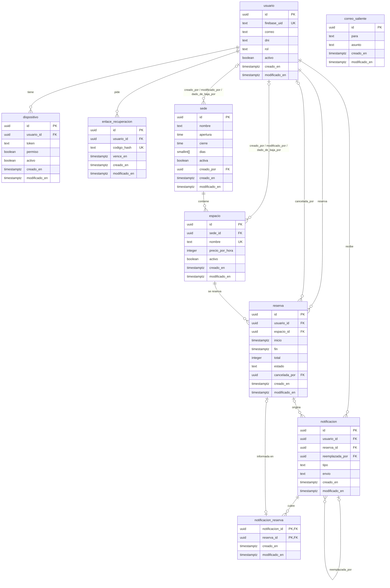
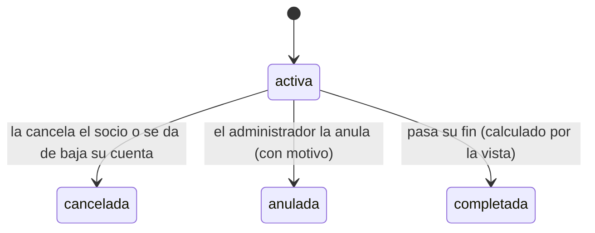
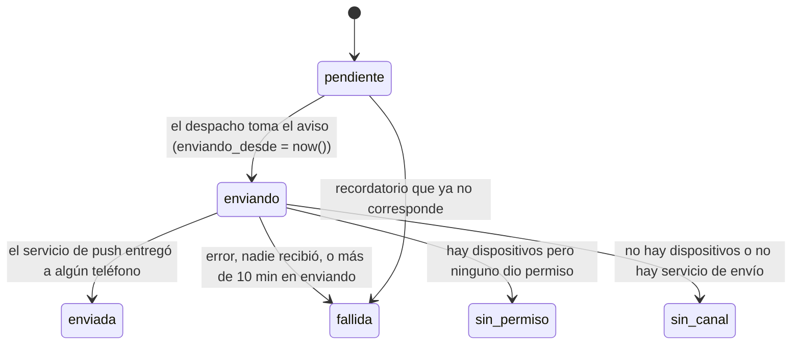

# Modelo de datos

La base es PostgreSQL (con la extensión `btree_gist`). Tiene nueve tablas y una vista, `reserva_con_estado`, que agrega el
estado «completada» a las reservas. Las cuentas, sedes, espacios y reservas no se borran: sus bajas son lógicas y un
trigger impide cualquier `DELETE` en ellas. Las reglas del negocio que pueden romper los datos las hace cumplir la propia base, no sólo la API.

Todas las claves primarias son `id uuid` con valor por defecto `uuid_v7()`, una función de la base. Un UUIDv7 lleva en sus
primeros bits la hora de creación en milisegundos, así que los identificadores nuevos salen ordenados por tiempo. La
excepción es `notificacion_reserva`, que conserva su clave primaria compuesta. Las referencias entre tablas (17 en total)
son `uuid`. Las fechas son `timestamptz`; la zona del club es `America/Argentina/Buenos_Aires`.

## Diagrama

`reserva_con_estado` es una vista sobre `reserva` con una columna extra, `estado_actual`: vale `completada` cuando la reserva
está `activa` y su `fin` ya pasó; en los demás casos repite `estado`. `correo_saliente` no se relaciona con ninguna tabla.

## Entidades

Las nueve tablas tienen `creado_en` y `modificado_en` (timestamptz, no nulos): cuándo se creó la fila y cuándo cambió por
última vez. Los triggers `<tabla>_modificado`, uno por tabla, conservan `creado_en` y actualizan `modificado_en` en cada
cambio.

### usuario

Una persona con cuenta: socio o administrador. La contraseña vive en Firebase; acá queda sólo el rastro.

- `firebase_uid` text, único. `correo` text. `nombre`, `apellido` text, no vacíos. `dni` text. `fecha_nacimiento` date.
- `rol` text: `usuario` (por defecto) o `admin`.
- `activo` boolean y `dado_de_baja_en` timestamptz. `contrasena_cambiada_en` timestamptz: cuándo cambió la contraseña.
- `creado_en`: cuándo se registró la cuenta. `modificado_en`: el último cambio de la fila (perfil, rol, baja).

Reglas de la base: el DNI tiene 7 u 8 dígitos. Correo (sin distinguir mayúsculas) y DNI son únicos **sólo entre cuentas
activas**: una cuenta dada de baja libera ambos. El correo no se puede modificar (trigger `usuario_correo_inmutable`).

### sede

Un local del club con su horario.

- `nombre`, `calle` text, no vacíos. `altura` integer.
- `apertura`, `cierre` time. `dias` smallint[]: días de la semana abiertos, 1 a 7.
- `activa`, `dado_de_baja_en`, `creado_por`, `modificado_por`, `dado_de_baja_por` (los tres últimos apuntan a `usuario`).
- `creado_en`: cuándo se dio de alta la sede. `modificado_en`: su última edición o su baja.

Reglas: el nombre es único entre sedes activas (sin distinguir mayúsculas); `altura` mayor que 0; apertura y cierre en horas
completas, con `apertura < cierre` o `cierre = 00:00` (medianoche); `dias` tiene de 1 a 7 valores entre 1 y 7.

### espacio

Una cancha o sala reservable dentro de una sede.

- `sede_id` FK a `sede`. `deporte`, `tipo` text, no vacíos. `numero` integer. `nombre` text.
- `techada`, `iluminada` boolean. `precio_por_hora` integer.
- `activo`, `dado_de_baja_en` y los campos de auditoría (`creado_por`, `modificado_por`, `dado_de_baja_por`).
- `creado_en`: cuándo se dio de alta el espacio. `modificado_en`: su última edición o su baja.

Reglas: `nombre` único en toda la tabla; `(sede_id, deporte, tipo, numero)` único; `numero` y `precio_por_hora` mayores que
0. La identidad del espacio (`nombre`, `sede_id`, `deporte`, `tipo`, `numero`) no cambia nunca (trigger
`espacio_nombre_inmutable`).

### reserva

El turno que un socio toma sobre un espacio.

- `usuario_id`, `espacio_id` FK. `inicio`, `fin` timestamptz.
- `precio_por_hora` integer: copia del precio al reservar. `total` integer.
- `estado` text: `activa` (por defecto), `cancelada` o `anulada`.
- `cancelada_en`, `cancelada_por` (FK a `usuario`), `motivo` text.
- `creado_en`: cuándo se hizo la reserva. `modificado_en`: su último cambio (modificación, cancelación o anulación).

Reglas de la base:

- `inicio` y `fin` caen en horas completas de la zona del club.
- Dura entre 1 y 4 horas.
- `total = precio_por_hora × horas`.
- Una reserva `anulada` exige `motivo` no vacío.
- **Sin superposición:** `EXCLUDE USING gist (espacio_id WITH =, tstzrange(inicio, fin) WITH &&) WHERE (estado = 'activa')`.
  Dos reservas activas del mismo espacio no pueden pisarse; las canceladas o anuladas liberan el horario.

### enlace_recuperacion

Un pedido de recuperar la contraseña.

- `usuario_id` FK. `codigo_hash` text, único: se guarda sólo el hash, nunca el código.
- `creado_en` (por defecto `clock_timestamp()`): cuándo se pidió. `vence_en`, `usado_en`, `invalidado_en`.
- `modificado_en`: cuándo se usó o se invalidó por última vez.

Regla: `vence_en > creado_en`.

### correo_saliente

Buzón de correos para desarrollo y pruebas (`CORREO_MODO=buzon`); en producción el correo sale por SMTP y la tabla queda
vacía. Columnas: `para`, `asunto`, `cuerpo` (text, no nulos), `creado_en` y `modificado_en`. Sin relaciones.

### dispositivo

Un teléfono con la app instalada, para enviarle avisos push.

- `usuario_id` FK. `token` text (token de FCM), no vacío. `plataforma` text: `android` o `ios`.
- `permiso` boolean: lo que el sistema operativo contestó sobre las notificaciones.
- `activo`, `creado_en`, `modificado_en`, `dado_de_baja_en`.

Regla: un `token` activo pertenece a una sola cuenta; si otra inicia sesión en ese teléfono, el registro pasa a ella.

### notificacion

Un aviso que ve la persona en el centro de avisos y que, si puede, también llega al teléfono.

- `usuario_id` FK. `tipo` text: `recordatorio`, `cancelacion_forzosa` o `cancelacion_usuario`.
- `titulo`, `cuerpo` text, no vacíos. `reserva_id` FK a `reserva`; `reserva_inicio` timestamptz (el horario al que refiere).
- `envio` text: estado del envío (ver más abajo). `creado_en`: cuándo se generó el aviso. `enviada_en`, `leida_en`.
- `modificado_en`: el último cambio del aviso (envío, lectura o reemplazo).
- `enviando_desde` timestamptz: cuándo se tomó el aviso para enviarlo.
- `reemplazada_por` FK a `notificacion`; `cantidad` integer mayor que 0: cuántas reservas cubre un aviso agrupado.

Reglas: un recordatorio exige `reserva_id` y `reserva_inicio`, y hay a lo sumo uno por `(reserva_id, reserva_inicio)`; una
`cancelacion_usuario` exige `reserva_id` y hay a lo sumo una por reserva (repetir la cancelación no repite el aviso).
Cuando se agrupan anulaciones, se abre un aviso nuevo y el anterior queda con `reemplazada_por`: el centro no lo lista pero
conserva cómo salió.

### notificacion_reserva

Une un aviso agrupado de anulación con las reservas que informa. Columnas `notificacion_id` y `reserva_id`, ambas FK `uuid`,
más `creado_en` y `modificado_en`. No tiene `id` propio: su clave primaria es compuesta por las dos FK; `reserva_id` es
único: una reserva tiene a lo sumo un aviso.

## Estados

### reserva

`completada` no se guarda: la calcula `reserva_con_estado` (`estado_actual`). `cancelada` y `anulada` son finales y dejan
`cancelada_en` / `cancelada_por` (y `motivo` en la anulación) para la trazabilidad.

### notificacion.envio

No hay reintentos: un envío que falla queda `fallida`. Si la API se cae a mitad de un envío, el aviso queda en `enviando`;
al despachar, el que lleva más de 10 minutos desde `enviando_desde` pasa a `fallida` y se registra en el log como
«aviso_sin_enviar». `sin_permiso` y `sin_canal` dejan el aviso sólo en el centro de avisos. Un recordatorio `pendiente`
cuya reserva se canceló, se movió o ya empezó pasa a `fallida` sin enviarse.

## Bajas lógicas y trazabilidad

- **Cuentas, sedes, espacios y reservas no se borran.** `usuario`, `sede`, `espacio` y `reserva` tienen un trigger
  `BEFORE DELETE` (`prohibir_borrado`) que rechaza todo `DELETE`.
- **Baja = bandera + fecha.** `activo` (o `activa`) y `dado_de_baja_en` van siempre juntos: un `CHECK` obliga a que la
  bandera sea verdadera si y sólo si `dado_de_baja_en` es nulo. Lo mismo vale para `dispositivo`.
- **Quién hizo qué.** `sede` y `espacio` guardan `creado_por`, `modificado_por` y `dado_de_baja_por` (FK a `usuario`);
  `reserva` guarda `cancelada_por`. Cuándo: `creado_en` y `modificado_en` en las nueve tablas (el segundo, mantenido por el
  trigger `<tabla>_modificado`) y `dado_de_baja_en` donde hay baja.
- **Las bajas liberan.** Como los únicos de correo, DNI y nombre de sede valen sólo entre activos, un registro dado de baja
  deja libre su correo, DNI o nombre.
- Los enlaces de recuperación, correos y avisos no se borran ni tienen vencimiento automático.

## Índices

Cada clave primaria es un índice y cada clave foránea (FK) apunta al `id` de otra tabla. Los demás índices sirven a las
consultas principales:

| Consulta | Tabla | Índice |
|---|---|---|
| Superposición al reservar | `reserva` | la restricción de exclusión gist |
| Barrido: reservas activas que empiezan en la hora que viene | `reserva` | `reserva_activa_inicio` |
| Historial propio, `GET /reservas?cuando=historial` | `reserva` | `reserva_por_usuario_inicio` |
| Historial global del administrador | `reserva` | `reserva_por_inicio` |
| Centro de avisos de una persona | `notificacion` | `notificacion_usuario` |
| Despacho del pendiente más viejo | `notificacion` | `notificacion_por_despachar` |

Los tests de `tests/escenarios/test_datos*.py` verifican que los planes del historial no recorren la tabla entera. El plan
del resto de las consultas no se midió.

## Migraciones, retención y respaldo

- **Migraciones:** Alembic (`apps/api/alembic.ini`, `migraciones/`), diez revisiones lineales, 0001 a 0010. Corren dentro del
  build de Render (`render.yaml`, `buildCommand`), cada una en su transacción. `tests/escenarios/test_datos*.py` vigila la
  ida y vuelta.
- **Retención:** no hay política. Ningún `DELETE` pasa en las tablas principales y los avisos, enlaces y correos no vencen.
- **Respaldo:** sin backups automáticos; la base de Render es del plan gratuito, sin copias.

## Quién escribe cada tabla

Cada repositorio (`apps/api/app/modules/<funcionalidad>/repositorio.py`) escribe sólo sus tablas; el test `tests/unit/test_capas_funcionalidades.py` lo verifica.
Si un caso necesita otra tabla, llama al repositorio dueño (por ejemplo, dar de baja una cuenta cancela sus reservas
mediante el de reservas).

| Tabla | Módulo |
|---|---|
| `usuario` | `usuarios.py` |
| `sede` | `sedes.py` |
| `espacio` | `espacios.py` |
| `reserva` | `reservas.py` |
| `enlace_recuperacion` | `enlaces.py` |
| `correo_saliente` | `correo.py` |
| `dispositivo` | `notificaciones.py` |
| `notificacion` | `notificaciones.py` |
| `notificacion_reserva` | `notificaciones.py` |
