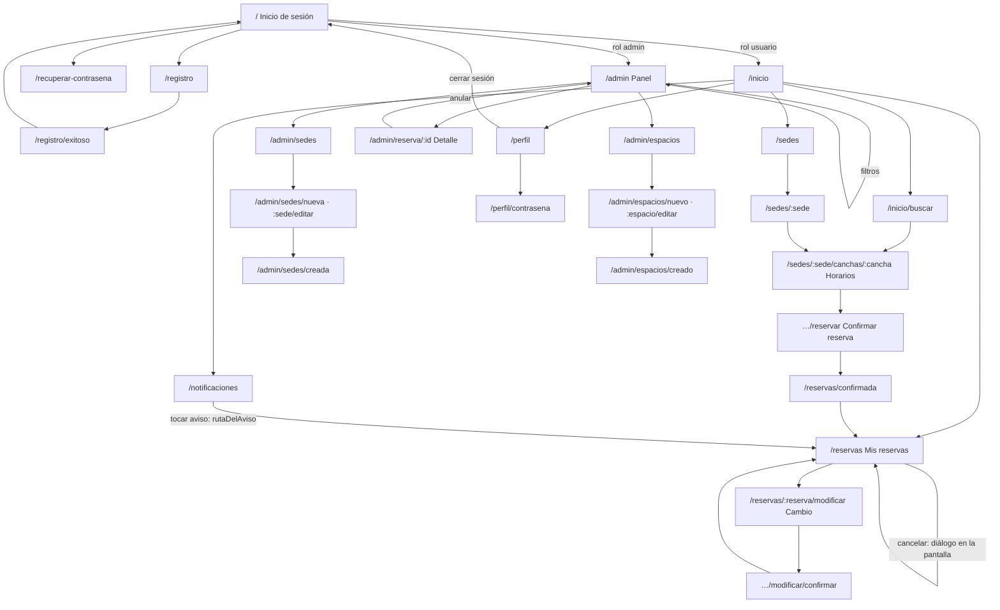

# Navegación de la app

La app móvil usa **GoRouter**; todas las rutas están en `apps/mobile/lib/app.dart`. Un `redirect` global se evalúa en cada cambio de ruta y cada vez que la sesión cambia (`refreshListenable: sesion`): toda ruta bajo `/admin` exige rol administrador, las de la sección de usuario (`/inicio`, `/perfil`, `/sedes`, `/reservas`, `/reservar`, `/notificaciones` y sus hijas) exigen rol usuario, y el resto es pública.

## Rutas

Quién entra: **Sin sesión** = pública; **Usuario** / **Admin** = exige ese rol. Las pantallas están en `apps/mobile/lib/<carpeta>/`.

| Ruta | Pantalla (archivo) | Quién entra | Qué muestra |
|---|---|---|---|
| `/` | `PantallaInicioSesion` (`sesion/pantalla_inicio_sesion.dart`) | Sin sesión | Formulario de inicio de sesión |
| `/registro` | `PantallaRegistro` (`usuarios/pantalla_registro.dart`) | Sin sesión | Alta de una cuenta de usuario |
| `/registro/exitoso` | `PantallaRegistroExitoso` (`usuarios/pantalla_registro_exitoso.dart`) | Sin sesión | Confirmación del registro, con vuelta al login |
| `/recuperar-contrasena` | `PantallaRecuperarContrasena` (`sesion/pantalla_recuperar_contrasena.dart`) | Sin sesión | Pide el correo para recuperar la contraseña |
| `/recuperar?codigo=` | `PantallaNuevaContrasena` (`sesion/pantalla_nueva_contrasena.dart`) | Sin sesión | Define la contraseña nueva; es adonde abre el enlace del correo (`clubnahuelmosse://app/recuperar`) |
| `/inicio` | `PantallaInicio` (`inicio/pantalla_inicio.dart`) | Usuario | Inicio: próximas reservas, deportes, sedes |
| `/inicio/buscar?deporte=` | `PantallaBuscarCancha` (`reservas/pantalla_buscar_cancha.dart`) | Usuario | Búsqueda de cancha por deporte, sede y fecha |
| `/notificaciones` | `PantallaNotificaciones` (`notificaciones/pantalla_notificaciones.dart`) | Usuario | Lista de avisos agrupados por día; se abre con la campana del inicio |
| `/perfil` | `PantallaMiPerfil` (`usuarios/pantalla_mi_perfil.dart`) | Usuario | Datos de la cuenta, apariencia y cierre de sesión |
| `/perfil/contrasena` | `PantallaCambiarContrasena` (`usuarios/pantalla_cambiar_contrasena.dart`) | Usuario | Cambio de contraseña |
| `/sedes` | `PantallaSedes` (`sedes/pantalla_sedes.dart`) | Usuario | Listado de sedes |
| `/sedes/:sede` | `PantallaSede` (`sedes/pantalla_sede.dart`) | Usuario | Una sede y sus espacios |
| `/sedes/:sede/canchas/:cancha?fecha=&horas=&inicio=` | `PantallaHorarios` (`reservas/pantalla_horarios.dart`) | Usuario | Horarios disponibles de una cancha |
| `/sedes/:sede/canchas/:cancha/reservar` | `PantallaConfirmarReserva` (`reservas/pantalla_confirmar_reserva.dart`) | Usuario | Resumen y confirmación de la reserva; necesita la elección hecha en horarios |
| `/reservas?reserva=&historial=1` | `PantallaMisReservas` (`reservas/pantalla_mis_reservas.dart`) | Usuario | Mis reservas (próximas e historial), con una reserva resaltada |
| `/reservas/:reserva/modificar?desde=inicio` | `PantallaHorarios` en modo modificación | Usuario | Elegir otro horario para una reserva existente |
| `/reservas/:reserva/modificar/confirmar` | `PantallaConfirmarCambio` (`reservas/pantalla_confirmar_cambio.dart`) | Usuario | Confirma el cambio de horario |
| `/reservas/confirmada` | `PantallaReservaConfirmada` (`reservas/pantalla_reserva_confirmada.dart`) | Usuario | Reserva confirmada |
| `/reservar` | `PantallaConfirmarReserva` | Usuario | Retoma la reserva que quedó pendiente al vencer la sesión |
| `/admin` | `PantallaPanelAdmin` (`admin/pantalla_panel_admin.dart`) | Admin | Panel: historial global de reservas con filtros |
| `/admin/reserva/:id` | `PantallaDetalleReserva` (`admin/pantalla_detalle_reserva.dart`) | Admin | Detalle de una reserva; desde acá se anula |
| `/admin/acceso-denegado` | `PantallaAccesoDenegado` (`sesion/pantalla_acceso_denegado.dart`) | Cualquiera con sesión | Aviso de que no tiene permiso para el panel |
| `/admin/sedes` | `PantallaSedesAdmin` (`admin/pantalla_sedes_admin.dart`) | Admin | ABM de sedes |
| `/admin/sedes/nueva` | `PantallaFormularioSede` (`admin/pantalla_formulario_sede.dart`) | Admin | Alta de sede |
| `/admin/sedes/:sede/editar` | `PantallaFormularioSede` (modo edición) | Admin | Edición de sede |
| `/admin/sedes/creada` | `PantallaSedeCreada` (`admin/pantalla_sede_creada.dart`) | Admin | Sede guardada |
| `/admin/espacios` | `PantallaEspaciosAdmin` (`admin/pantalla_espacios_admin.dart`) | Admin | ABM de espacios |
| `/admin/espacios/nuevo` | `PantallaAltaEspacio` (`admin/pantalla_alta_espacio.dart`) | Admin | Alta de espacio |
| `/admin/espacios/:espacio/editar` | `PantallaEditarEspacio` (`admin/pantalla_editar_espacio.dart`) | Admin | Edición de espacio |
| `/admin/espacios/creado` | `PantallaEspacioCreado` (`admin/pantalla_espacio_creado.dart`) | Admin | Espacio guardado |

Varias rutas hijas llevan datos en `extra` (la elección, la reserva, la sede). Sin ellos, su propio `redirect` vuelve al listado o pantalla de origen (`/reservas`, `/inicio`, `/admin`, `/admin/sedes`, `/admin/espacios`, o la cancha), por ejemplo si se abre un enlace directo.

## Mapa de navegación

## Redirecciones

- **Sin sesión** en una ruta protegida (usuario o admin): va a `/`. Lo mismo para `/admin/acceso-denegado`.
- **Rol equivocado**: un usuario que pide algo bajo `/admin` va a `/admin/acceso-denegado`; un admin que pide una ruta de usuario va a su inicio (`/admin`). El inicio de cada rol sale de `perfil.inicio`: `/admin` para admin, `/inicio` para usuario.
- **Después de iniciar sesión**: va a `perfil.inicio`; si había una reserva pendiente de ese mismo correo, va a `/reservar` con esa elección.
- **Sesión vencida**: cuando la API deja de reconocer la sesión, la pantalla muestra el diálogo «Tu sesión expiró» (no se puede descartar) y, al aceptarlo, cierra la sesión. Como el router escucha la sesión, el `redirect` manda a `/`. En el panel admin los filtros aplicados se guardan para recuperarlos al volver a entrar; la elección de reserva pendiente se guarda y se retoma en `/reservar`.
- **Aviso tocado** (`rutaDelAviso` en `notificaciones/notificacion.dart`), tanto desde la lista, el panel emergente o la bandeja del sistema (con la app abierta o al abrirla por el aviso): navega con `go` a `/reservas?reserva=<id>`. Si es una cancelación (del club o propia) agrega `historial=1` para abrir la pestaña de historial. Sin `reservaId` va a `/reservas`. Si la sesión es de admin, el redirect global lo lleva a `/admin`.

## Barras inferiores

Definidas en `comun/barra_inferior.dart`; navegan con `go`.

- **Usuario** (`BarraInferior`): INICIO (`/inicio`), SEDES (`/sedes`), RESERVAS (`/reservas`), PERFIL (`/perfil`). Está en inicio, sedes (y una sede), reservas y perfil.
- **Admin** (`BarraAdmin`): RESERVAS (`/admin`), SEDES (`/admin/sedes`), ESPACIOS (`/admin/espacios`). Está en el panel y en los listados de sedes y espacios.
- Las pantallas de formulario, confirmación y resultado no llevan barra.
