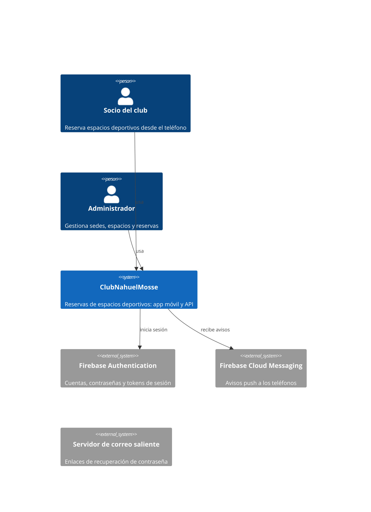
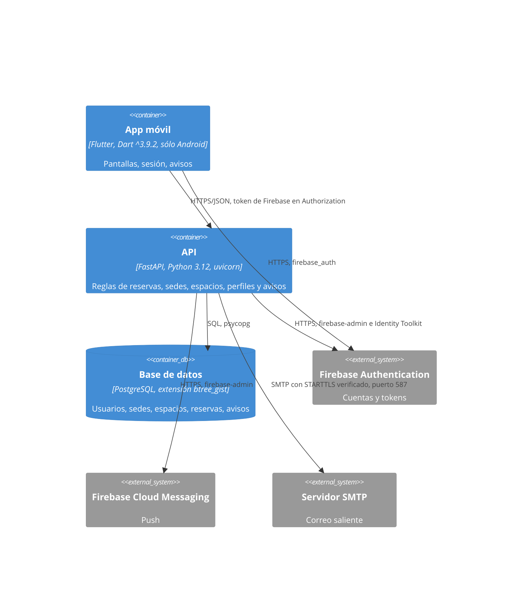
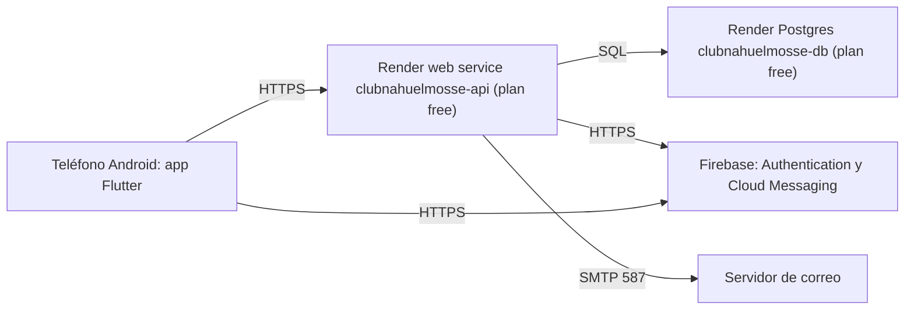

# Diseño del sistema · ClubNahuelMosse

Describe el sistema como está en `main`: modelo de datos, infraestructura, observabilidad, errores, dependencias externas,
amenazas, secretos, datos personales y presupuesto de rendimiento. Cada afirmación cita su archivo, un test o un comando;
lo que no se verificó dice `not verified`. Los números de hallazgo remiten a la revisión de la rama `kit-3`
(`specs/REVISION-kit3.md`); las cards `REV-01` a `REV-08` los corrigieron y lo que sigue abierto lo dice cada fila. La
arquitectura y los flujos están en [`arquitectura.md`](arquitectura.md), dónde está cada archivo en
[`mapa-del-codigo.md`](mapa-del-codigo.md), las decisiones en `docs/adr/`, los precios en
[`infra-cost.md`](infra-cost.md) y los pasos operativos en el [runbook](runbook.md).

## Context and containers (C4)

Dentro de la API (`apps/api/app`): `dominio` (reglas puras), `aplicacion` (casos de uso), `infraestructura`
(repositorios SQL, Firebase, correo) e `interfaz` (rutas FastAPI, middleware, comandos). La regla de capas la hacen
cumplir `tests/unit/test_arquitectura.py` y `tests/unit/test_capas.py`. El barrido de recordatorios corre como tarea de
fondo dentro del proceso web (`app/main.py`, `_ciclo_de_vida`) y también como comando de una pasada
(`python -m app.interfaz.barrido --una-vez`).

## Data

Motor: PostgreSQL con la extensión `btree_gist` (`migraciones/versions/0001_modelo_inicial.py`). Nueve tablas, creadas por
las migraciones 0001 a 0008, y una vista, `reserva_con_estado`, que agrega `estado_actual` («completada» cuando una reserva
activa ya terminó). Las claves primarias son `id bigint GENERATED ALWAYS AS IDENTITY`. Cada clave foránea apunta a `id` de
otra tabla y los índices se nombran en cada tabla. Las fechas son `timestamptz`; la zona del club es
`America/Argentina/Buenos_Aires` (`app/dominio/zona.py`).

| Entity | Relations and cardinality | Owner module | Volume today | Growth per month |
|---|---|---|---|---|
| `usuario` | 1 usuario : N `reserva`, N `dispositivo`, N `notificacion`, N `enlace_recuperacion` | usuarios | `not verified`: la base de Render no se desplegó | objetivo sin medir: 50 altas |
| `sede` | 1 sede : N `espacio`; `creado_por`, `modificado_por` y `dado_de_baja_por` apuntan a `usuario` | sedes | `not verified` | objetivo sin medir: 1 |
| `espacio` | N espacios : 1 `sede`; 1 espacio : N `reserva` | espacios | `not verified` | objetivo sin medir: 5 |
| `reserva` | N reservas : 1 `usuario`, N : 1 `espacio`; 1 reserva : 0..N `notificacion` | reservas | `not verified` | objetivo sin medir: 1 500 |
| `enlace_recuperacion` | N enlaces : 1 `usuario` | recuperacion | `not verified` | objetivo sin medir: 20 |
| `correo_saliente` | sin relaciones; sólo se escribe con `CORREO_MODO=buzon` (desarrollo y escenarios) | recuperacion | 0 en producción (`render.yaml` fija `CORREO_MODO=smtp`) | 0 |
| `dispositivo` | N dispositivos : 1 `usuario` | notificaciones | `not verified` | objetivo sin medir: 50 |
| `notificacion` | N avisos : 1 `usuario`; 0..1 : 1 `reserva`; `reemplazada_por` apunta a otra `notificacion` | notificaciones | `not verified` | objetivo sin medir: 3 000 |
| `notificacion_reserva` | une un aviso agrupado con las reservas que cubre (N : N; una reserva tiene a lo sumo un aviso) | notificaciones | `not verified` | objetivo sin medir: 100 |

**Table → owner module.** Cada repositorio escribe sólo sus tablas; `tests/unit/test_capas.py` (`TABLAS_PROPIAS`) lo
verifica. Cuando un caso necesita tocar otra tabla, llama al repositorio dueño (la baja de una cuenta cancela sus
reservas con `ReservasSql.cancelar_futuras_de`).

| Table | Owner module |
|---|---|
| `usuario` | usuarios |
| `sede` | sedes |
| `espacio` | espacios |
| `reserva` | reservas |
| `enlace_recuperacion` | recuperacion |
| `correo_saliente` | recuperacion |
| `dispositivo` | notificaciones |
| `notificacion` | notificaciones |
| `notificacion_reserva` | notificaciones |

### Columnas, claves y restricciones

Triggers comunes a `usuario`, `sede`, `espacio` y `reserva` (`0001_modelo_inicial.py`): `<tabla>_modificado`
(BEFORE UPDATE, función `marcar_modificado`: conserva `creado_en` y pone `modificado_en`) y `<tabla>_sin_borrado`
(BEFORE DELETE, función `prohibir_borrado`: ningún `DELETE` pasa; las bajas son lógicas). El test
`tests/integracion/test_restricciones.py` (`test_nada_se_borra`) lo verifica.

#### `usuario` (`0001`, `0002`)

| Columna | Tipo y restricción |
|---|---|
| `id` | bigint, clave primaria |
| `firebase_uid` | text, no nulo, único |
| `correo` | text, no nulo; único sin mayúsculas sólo entre cuentas activas |
| `nombre`, `apellido` | text, no nulos, no vacíos |
| `dni` | text, no nulo, 7 u 8 dígitos; único sólo entre cuentas activas |
| `fecha_nacimiento` | date, no nulo |
| `rol` | text, `usuario` o `admin`, por defecto `usuario` |
| `activo` | boolean, no nulo, por defecto verdadero; coincide con `dado_de_baja_en IS NULL` |
| `dado_de_baja_en` | timestamptz |
| `creado_en`, `modificado_en` | timestamptz, no nulos, por defecto `now()` |
| `contrasena_cambiada_en` | timestamptz (agregada en 0002; guarda el rastro, la contraseña vive en Firebase) |

Índices: `usuario_correo_unico` (`lower(correo)` donde `activo`), `usuario_dni_unico` (`dni` donde `activo`). Trigger
`usuario_correo_inmutable` (BEFORE UPDATE, `correo_inmutable`): el correo no cambia.

#### `sede` (`0001`, `0004`)

| Columna | Tipo y restricción |
|---|---|
| `id` | bigint, clave primaria |
| `nombre`, `calle` | text, no nulos, no vacíos |
| `altura` | integer, mayor que 0 |
| `apertura`, `cierre` | time, no nulos, en horas completas; `apertura < cierre` o `cierre = 00:00` |
| `dias` | smallint[], de 1 a 7 elementos con valores de 1 a 7 |
| `activa` | boolean, no nulo, por defecto verdadero; coincide con `dado_de_baja_en IS NULL` |
| `creado_por`, `modificado_por`, `dado_de_baja_por` | bigint, referencian `usuario (id)` |
| `dado_de_baja_en` | timestamptz |
| `creado_en`, `modificado_en` | timestamptz, no nulos |

Índice: `sede_nombre_activa_unico` (`lower(nombre)` donde `activa`). Las tres FK a `usuario` no tienen índice: sólo se
leen al mostrar la trazabilidad de una sede, nunca se busca por ellas.

#### `espacio` (`0001`)

| Columna | Tipo y restricción |
|---|---|
| `id` | bigint, clave primaria |
| `sede_id` | bigint, no nulo, referencia `sede (id)` |
| `deporte`, `tipo` | text, no nulos, no vacíos |
| `numero` | integer, mayor que 0 |
| `nombre` | text, no nulo, único |
| `techada`, `iluminada` | boolean, no nulos |
| `precio_por_hora` | integer, mayor que 0 |
| `activo` | boolean, no nulo, por defecto verdadero; coincide con `dado_de_baja_en IS NULL` |
| `creado_por`, `modificado_por`, `dado_de_baja_por` | bigint, referencian `usuario (id)` |
| `dado_de_baja_en` | timestamptz |
| `creado_en`, `modificado_en` | timestamptz, no nulos |

Restricción única `(sede_id, deporte, tipo, numero)`. Trigger `espacio_nombre_inmutable` (BEFORE UPDATE): la identidad del
espacio (`nombre`, `sede_id`, `deporte`, `tipo`, `numero`) no cambia.

#### `reserva` (`0001`, `0005`, `0008`)

| Columna | Tipo y restricción |
|---|---|
| `id` | bigint, clave primaria |
| `usuario_id` | bigint, no nulo, referencia `usuario (id)` |
| `espacio_id` | bigint, no nulo, referencia `espacio (id)` |
| `inicio`, `fin` | timestamptz, no nulos, en horas completas de la zona del club; `fin - inicio` entre 1 y 4 horas |
| `precio_por_hora` | integer, mayor que 0 |
| `total` | integer, no nulo; igual a `precio_por_hora` por las horas |
| `estado` | text, `activa`, `cancelada` o `anulada`, por defecto `activa` |
| `cancelada_en` | timestamptz |
| `cancelada_por` | bigint, referencia `usuario (id)` |
| `motivo` | text; obligatorio si `estado` es `anulada` |
| `creado_en`, `modificado_en` | timestamptz, no nulos |

Restricción de exclusión `EXCLUDE USING gist (espacio_id WITH =, tstzrange(inicio, fin) WITH &&) WHERE (estado = 'activa')`:
dos reservas activas del mismo espacio no se superponen. Índices: `reserva_activa_inicio` (`inicio` donde
`estado = 'activa'`, 0005), `reserva_por_usuario_inicio` (`usuario_id, inicio DESC, id DESC`), `reserva_por_inicio`
(`inicio DESC, id DESC`, la clave del cursor del historial global) y `reserva_por_cancelada_por` (parcial), los tres de
0008.

#### `enlace_recuperacion` (`0003`)

| Columna | Tipo y restricción |
|---|---|
| `id` | bigint, clave primaria |
| `usuario_id` | bigint, no nulo, referencia `usuario (id)` |
| `codigo_hash` | text, no nulo, único; sólo el hash del código |
| `emitido_en` | timestamptz, no nulo, por defecto `clock_timestamp()` |
| `vence_en` | timestamptz, no nulo, posterior a `emitido_en` |
| `usado_en`, `invalidado_en` | timestamptz |

Índice: `enlace_recuperacion_por_usuario` (`usuario_id`, `emitido_en`).

#### `correo_saliente` (`0003`)

| Columna | Tipo y restricción |
|---|---|
| `id` | bigint, clave primaria |
| `para`, `asunto`, `cuerpo` | text, no nulos |
| `creado_en` | timestamptz, no nulo, por defecto `clock_timestamp()` |

Sin índices propios. Con `CORREO_MODO=buzon` guarda los códigos en claro: sólo desarrollo y escenarios.

#### `dispositivo` (`0005`)

| Columna | Tipo y restricción |
|---|---|
| `id` | bigint, clave primaria |
| `usuario_id` | bigint, no nulo, referencia `usuario (id)` |
| `token` | text, no nulo, no vacío; el token de FCM |
| `plataforma` | text, `android` o `ios` |
| `permiso` | boolean, no nulo; lo que el sistema operativo contestó sobre las notificaciones |
| `activo` | boolean, no nulo, por defecto verdadero; coincide con `dado_de_baja_en IS NULL` |
| `registrado_en`, `actualizado_en` | timestamptz, no nulos |
| `dado_de_baja_en` | timestamptz |

Índices: `dispositivo_token_activo` (único, `token` donde `activo`), `dispositivo_usuario` (`usuario_id` donde `activo`).

#### `notificacion` (`0005`, `0006`, `0007`, `0008`)

| Columna | Tipo y restricción |
|---|---|
| `id` | bigint, clave primaria |
| `usuario_id` | bigint, no nulo, referencia `usuario (id)` |
| `tipo` | text, `recordatorio`, `cancelacion_forzosa` o `cancelacion_usuario` |
| `titulo`, `cuerpo` | text, no nulos, no vacíos |
| `reserva_id` | bigint, referencia `reserva (id)`; obligatorio en recordatorios y cancelaciones de usuario |
| `reserva_inicio` | timestamptz; el horario al que refiere un recordatorio |
| `envio` | text, `pendiente`, `enviando`, `enviada`, `sin_permiso`, `sin_canal` o `fallida` |
| `creada_en` | timestamptz, no nulo |
| `enviada_en`, `leida_en` | timestamptz |
| `reemplazada_por` | bigint, referencia `notificacion (id)` (0007) |
| `cantidad` | integer, mayor que 0 (0007): reservas que cubre un aviso agrupado |
| `tomada_en` | timestamptz (0008): cuándo lo tomó el despachador; un `enviando` con más de 5 minutos se retoma |
| `intentos` | integer, no nulo, por defecto 0 (0008): veces que se tomó; a las 3 queda `fallida` |

Índices: `notificacion_recordatorio_unico` (único, `reserva_id`, `reserva_inicio` donde `tipo = 'recordatorio'`),
`notificacion_usuario` (`usuario_id`, `creada_en` descendente), `notificacion_cancelacion_unica` (único, `reserva_id`
donde `tipo = 'cancelacion_usuario'`), `notificacion_forzosa_sin_leer` (`usuario_id`, `id` descendente, parcial),
`notificacion_por_despachar` (`id`, parcial: pendientes que no son recordatorios ni están reemplazados) y
`notificacion_por_reemplazada_por` (parcial, 0008).

#### `notificacion_reserva` (`0007`)

| Columna | Tipo y restricción |
|---|---|
| `notificacion_id` | bigint, no nulo, referencia `notificacion (id)` |
| `reserva_id` | bigint, no nulo, único, referencia `reserva (id)` |

Clave primaria compuesta (`notificacion_id`, `reserva_id`).

**Main queries and their index**

| Query (what it answers) | Table | Index | EXPLAIN at the card's volume |
|---|---|---|---|
| Superposición al reservar | `reserva` | la restricción de exclusión gist | `not verified` |
| Barrido: reservas activas que empiezan en la hora que viene | `reserva` | `reserva_activa_inicio` | `not verified` |
| Historial propio, `GET /reservas?cuando=historial` | `reserva` | `reserva_por_usuario_inicio` | verificado por `tests/escenarios/test_datos*.py` (que el plan no recorre la tabla entera) |
| Historial global del administrador, por cursor | `reserva` | `reserva_por_inicio` | verificado por `tests/escenarios/test_datos*.py`; el `OFFSET` queda sólo para el primer pedido sin cursor |
| Centro de avisos de una persona | `notificacion` | `notificacion_usuario` | `not verified` |
| Despacho del pendiente más viejo | `notificacion` | `notificacion_por_despachar` | `not verified` |

- **Migrations:** Alembic (`apps/api/alembic.ini`, `migraciones/`), ocho revisiones lineales 0001 a 0008. Corren dentro
  del build de Render con la versión anterior sirviendo (`render.yaml`, `buildCommand`), como el usuario dueño
  (`DATABASE_URL`); la API atiende con `club_app`, sin DDL, si `DATABASE_URL_APP` está cargada. Cada migración corre en
  su transacción (`migraciones/env.py`, `transaction_per_migration=True`). 0008 sigue expand/contract: columnas con valor
  por defecto, `SET lock_timeout` y `CREATE INDEX CONCURRENTLY` fuera de la transacción, y limpia un índice inválido si
  una corrida anterior se cortó. 0001 y 0007 se editaron después de entrar en main (hallazgo 12): no se corrige porque
  sería reescribir la historia. `tests/escenarios/test_datos*.py` vigila la ida y vuelta de las migraciones.
- **Retention and archiving:** no hay política. Las bajas son lógicas y ningún `DELETE` pasa (trigger `prohibir_borrado`),
  así que nada se borra ni se archiva: los avisos, los enlaces de recuperación y los correos no tienen vencimiento.
  Una persona tiene que fijar los plazos (ver `## Personal data`).
- **Backups:** sin backups automáticos. La base de Render es del plan `free`: no trae copias, vence a los 30 días y se
  borra 14 días después (`render.yaml`, `apps/api/README.md`). Lo que hay es `scripts/respaldo.py` (`guardar` y
  `restaurar` con `pg_dump` y `pg_restore`), a mano. RPO: el último respaldo manual. RTO: no definido; el restore se
  prueba en `tests/escenarios` contra una base local, nunca contra Render. Fecha del último restore en producción:
  ninguno.

## Infrastructure

- **Deployment diagram:**

- **Environments:** hay dos, local y Render; no hay staging.
  - **local:** la API con `uvicorn` contra una Postgres local y el emulador de Firebase Auth (`firebase.json`, puerto 9099,
    `npm run emuladores`), `CORREO_MODO=buzon`, sin credenciales de Firebase: el canal push es el nulo
    (`infraestructura/push.py`, `CanalNulo`). La app apunta a `http://10.0.2.2:8000` con `AUTH_EMULADOR`. Los tests usan
    una base `*_test` (`apps/api/README.md`, «Probar»). La API se niega a arrancar si el emulador está configurado junto
    con credenciales reales o un proyecto que no es `demo-` (`main.py`, `_exigir_emulador_aislado`).
  - **Render:** `render.yaml` define el web service Python `clubnahuelmosse-api` y la base `clubnahuelmosse-db`, ambos
    `plan: free`, y es la única fuente de la configuración del despliegue. El despliegue no se hizo todavía: el
    escenario RNF-01-H06-01 se saltea sin `API_URL_NUBE`. El health check es `/ready`, que comprueba la base y que el
    esquema esté en la última migración (`interfaz/salud.py`).
- **Deploy and rollback:** el despliegue sale solo con cada commit de la rama enlazada; la vuelta atrás de código es redeploy
  del commit anterior y la de datos es restaurar un respaldo de `scripts/respaldo.py`. Pasos en el runbook.
- **Expected scaling:** una instancia web sin escalado automático ni más de un proceso. Lo primero que se agota es el pool
  de conexiones: 5 más 5 de desborde, con 5 s de espera por una conexión (`infraestructura/db.py`); al agotarse la API
  responde 503 en lugar de colgarse. Antes pueden agotarse la CPU y la memoria del plan free (`not verified`: los límites
  de la instancia free no se consultaron). El barrido de recordatorios vive en el mismo proceso y se detiene cuando Render
  duerme el servicio; el comando `--una-vez` está listo para un cron, pero `render.yaml` no define ninguno (el plan free
  no tiene cron jobs).
- **Secrets:** inventario en `## Secrets inventory`; en Render viven como variables de entorno de `render.yaml` marcadas
  `sync: false`.
- **Cost:** [`infra-cost.md`](infra-cost.md).

## Observability

- **SLOs.** Son objetivos propuestos, sin medir: no hay medición en producción que los respalde. El de latencia es
  coherente con el p95 local de unos 55 ms con 4 filas (hallazgo 26). El de disponibilidad no se cumple con el plan free:
  el servicio se duerme a los 15 minutos sin tráfico y tarda alrededor de un minuto en despertar.

| Service | SLI | Objective | Window | Error-budget policy (actions on exhaustion, approver) |
|---|---|---|---|---|
| API | SLO de disponibilidad: pedidos que no terminan en 5xx sobre el total | 99,0 % | 30 días | pendiente de una persona: quién aprueba y qué se detiene al agotarlo |
| API | SLO de latencia: pedidos de lectura que responden en 300 ms o menos, medidos en el servidor, sin el arranque en frío | 95 % | 30 días | pendiente de una persona |

- **Signals per service:** `/metrics` (`interfaz/metricas.py`) publica en formato Prometheus las solicitudes por método,
  ruta y código (`solicitudes_total`), su duración, y el uso del pool (`pool_conexiones_en_uso`,
  `pool_conexiones_libres`). Pide `Authorization: Bearer <METRICAS_TOKEN>`; sin token configurado la ruta no existe. Nadie
  la consulta todavía: no hay un Prometheus ni un servicio de métricas configurado.
- **Log schema.** Una línea JSON por evento a la salida estándar (`interfaz/registro_errores.py`), con nivel, evento,
  referencia y versión. La referencia es el `X-Request-ID` del pedido (se respeta el que llega o se genera uno) y vuelve en
  la respuesta; un 500 se la muestra a la persona para que la pase a soporte. La línea de un pedido lleva método, ruta
  escapada, código y el `id` numérico del usuario. No lleva correo, DNI, query string (`_SinQuery` la saca también del
  access log de uvicorn), tokens ni contraseñas; SQLAlchemy oculta los parámetros (`hide_parameters=True`).
- **App:** `lib/comun/errores_no_manejados.dart` engancha `FlutterError.onError` y `PlatformDispatcher.onError` y los
  registra con `debugPrint`. No hay un servicio de reporte de fallos (Crashlytics u otro).
- **Alerts as code:** ninguna. **Dashboards:** ninguno.

## Errors

Taxonomía de la API. Las excepciones del dominio están en `app/dominio/errores.py` (reexportadas por
`app/aplicacion/errores.py`); las rutas las traducen a HTTP con `interfaz/respuestas.py`.

| Error | Class (domain, operational, bug) | Comes from | Translated to | What the user sees | Reference id |
|---|---|---|---|---|---|
| `DatosInvalidos`, `NoDisponible` | domain | casos de uso | 422 con `{"errores": {campo: mensaje}}` | el mensaje junto al campo | no |
| `Duplicado`, `HorarioOcupado`, `Cambiado`, `NumeroOcupado`, `ConReservasFuturas`, `ReservasAfuera` | domain | casos de uso | 409 con `{"errores": ...}` | el mensaje del conflicto | no |
| `Prohibido` | domain | casos de uso (`perfil.rol`) | 403 sin cuerpo | acceso denegado | no |
| `NoEncontrada` | domain | casos de uso | 404 sin cuerpo | no encontrado | no |
| `NoAutenticado` | domain | `perfil_autenticado` | 401 con `WWW-Authenticate: Bearer` | vuelve al inicio de sesión | no |
| `Demorado` | operational | Firebase (`TOO_MANY_ATTEMPTS`) | 429 | pedir que reintente más tarde | no |
| Demasiados pedidos | operational | `interfaz/limites.py` | 429 con `Retry-After` | pedir que espere | no |
| Cuerpo mayor que 64 KB, Host ajeno, JSON mal formado | operational | `interfaz/protecciones.py`, `interfaz/entradas.py` | 413 o 400, sin repetir lo recibido | error genérico | no |
| Entrada fuera de rango o con caracteres de control | domain | tipos acotados de `interfaz/entradas.py` | 422 | el mensaje junto al campo | no |
| Base caída, pool agotado | operational | SQLAlchemy | 503 (`main.py`, handlers de `OperationalError`, `InterfaceError` y `TimeoutError`) | «Revisá tu conexión» y reintentar | sí |
| Cualquier otra excepción | bug | cualquier capa | 500 con la referencia del pedido | «Ocurrió un error. Si le escribís a soporte, pasale esta referencia.» | sí |

## External dependencies

Una fila por llamada externa. Los tiempos salen del código; lo que el código no fija se declara así.

| Dependency | Timeout | Retries (backoff, jitter, idempotent only) | Circuit breaker | Fallback | What happens if it fails |
|---|---|---|---|---|---|
| PostgreSQL (`app/infraestructura/db.py`) | conexión 5 s (`connect_timeout`), espera por una conexión del pool 5 s, `statement_timeout` 10 s, `lock_timeout` 5 s | sin reintentos; `pool_pre_ping=True` comprueba la conexión antes de usarla | no | ninguno | si falla, el pedido responde 503 en segundos; `/ready` también da 503 y el health check de Render marca la instancia como no sana |
| Firebase Authentication: SDK de administración y API REST de Identity Toolkit (`identidad.py`) | SDK: `httpTimeout` de 4 s; REST: `timeout=4` s de `urllib`; la verificación de la firma de un token, `not verified` | SDK: el cliente de `firebase-admin` reintenta una vez ante errores de conexión o de lectura y hasta 4 veces ante 500 o 503, con espera exponencial; REST: ninguno | no | ninguno | si falla, un token inválido, vencido o revocado da 401; si Firebase no responde, el pedido da 500 con su referencia; `TOO_MANY_ATTEMPTS` da 429; crear cuenta o cambiar contraseña falla el pedido |
| Firebase Cloud Messaging (`push.py`) | `httpTimeout` de 10 s | el cliente de `firebase-admin` (arriba); el despachador retoma un aviso de cancelación varado en `enviando` a los 5 minutos, hasta 3 intentos; un `fallida` no se reintenta | no | sin credenciales, el canal nulo deja el aviso como `sin_canal` | si falla, el aviso queda `fallida` y la persona lo ve igual en el centro de avisos de la app; el token que FCM rechaza como inválido se da de baja; la reserva no cambia |
| SMTP (`app/infraestructura/correo.py`) | 10 s | sin reintentos | no | ninguno | si falla, el error va al log sin la dirección y la respuesta es la misma que para un correo sin cuenta; la persona no recibe el enlace y puede pedir otro. STARTTLS con `ssl.create_default_context()`: verifica certificado y nombre |
| Firebase Authentication desde la app (`firebase_auth`) | la app corta cada pedido a la API a los 60 s y avisa «despertando» a los 5 s (`lib/api/cliente_api.dart`); al retomar la sesión, 3 s (`lib/sesion/sesion.dart`) | ninguno automático; la pantalla de error de arranque y cada pantalla ofrecen reintentar | no | ninguno | si falla, se ve el aviso de error de red con reintento; retomar la sesión sin red no la cierra |

## Threat model

Cuatro superficies.

**Surface:** API HTTP · **Enters:** JSON de las rutas, cabecera `Authorization: Bearer <token de Firebase>` · **Trust boundary:** el borde de Render hacia el proceso `uvicorn`

| ID | STRIDE | Threat | Decision (mitigate, eliminate, transfer, accept) | Owner | Verified by (test or command) |
|---|---|---|---|---|---|
| T-01 | Spoofing | alguien se hace pasar por otra cuenta con un token falso, vencido, de otro proyecto o revocado | mitigate: `verify_id_token` con `check_revoked=True` (`identidad.py`); la API no arranca con el emulador junto a credenciales reales o un proyecto que no es de demo | autor del repo | `tests/integracion/test_sesion_api.py`, `tests/escenarios/test_seguridad_api.py` (`@REV-01-S18`) |
| T-02 | Tampering | pedido con cuerpo mal formado, campos de más, números fuera de rango o NUL en un texto | mitigate: límite de 64 KB, tipos acotados (`interfaz/entradas.py`), JSON inválido da 400 | autor del repo | `tests/integracion/test_protecciones_api.py`, `tests/escenarios/test_seguridad_cuerpo.py` |
| T-03 | Repudiation | una persona niega haber cancelado o anulado una reserva | mitigate: `cancelada_por`, `cancelada_en` y `motivo` en `reserva`; el log por pedido con el usuario y la referencia | autor del repo | `tests/integracion/test_anular_reserva_api.py` |
| T-04 | Information disclosure | consultar si un DNI o un correo ya están registrados, o leer reservas ajenas | mitigate lo segundo (las consultas filtran por dueño: una reserva ajena da 404); accept lo primero: `POST /registro` y `PUT /yo` responden 409 con el campo repetido, porque la persona necesita saber qué corregir, con límite de 10 pedidos por minuto por origen y de 10 ediciones por hora por cuenta | autor del repo | `tests/escenarios/test_seguridad_api.py`, `apps/mobile/test/limite_de_frecuencia_test.dart` |
| T-05 | Denial of service | ráfagas de pedidos; entradas que fuerzan errores y llenan el log | mitigate en parte: límite por origen en registro y recuperación, por cuenta en la edición de perfil (`interfaz/limites.py`, en memoria de cada instancia); las demás rutas no tienen límite | autor del repo | `tests/escenarios/test_seguridad_entradas*.py` |
| T-06 | Elevation of privilege | un usuario común llama a una ruta de administrador | mitigate: `perfil.rol` en cada caso de uso de admin; 403 en todas las rutas de administrador | autor del repo | `tests/integracion/test_rutas_protegidas.py` |

**Surface:** app móvil · **Enters:** lo que escribe la persona, los enlaces de recuperación, los avisos push · **Trust boundary:** el teléfono

| ID | STRIDE | Threat | Decision (mitigate, eliminate, transfer, accept) | Owner | Verified by (test or command) |
|---|---|---|---|---|---|
| T-07 | Spoofing | otra app abre el enlace de recuperación del correo | mitigate: el código va después del «#» y no llega al servidor; vigencia de 30 minutos y un solo uso (`aplicacion/recuperacion.py`) | autor del repo | `tests/integracion/test_recuperacion_api.py` |
| T-08 | Tampering | modificar el APK o las claves que lleva | accept: las `--dart-define` de Firebase son identificadores públicos del proyecto, no secretos; el APK `release` se firma con la clave de depuración mientras no se configure otra (`apps/mobile/README.md`) | autor del repo | `not verified` |
| T-09 | Repudiation | la app no deja rastro de sus fallos | mitigate en parte: `errores_no_manejados.dart` captura los errores no manejados, pero sólo los imprime en el teléfono | autor del repo | `apps/mobile/test/operacion_registro_test.dart` |
| T-10 | Information disclosure | datos de la sesión en el teléfono | mitigate: `shared_preferences` guarda sólo la apariencia, el permiso de avisos y el token de FCM; el perfil no se guarda; la sesión la guarda `firebase_auth` | autor del repo | `not verified` (no se inspeccionó el almacenamiento del teléfono) |
| T-11 | Denial of service | el servicio dormido hace fallar el primer uso del día | mitigate: la app espera hasta 60 s y avisa que el servidor se está despertando | autor del repo | `apps/mobile/test/reintento_tras_corte_test.dart` |
| T-12 | Elevation of privilege | la app muestra pantallas de administrador a quien no lo es | mitigate: el rol se decide en la API; la app sólo oculta | autor del repo | `lib/sesion/pantalla_acceso_denegado.dart`; `not verified` en un dispositivo |

**Surface:** base de datos · **Enters:** SQL parametrizado de los repositorios · **Trust boundary:** el proceso de la API hacia Postgres de Render

| ID | STRIDE | Threat | Decision (mitigate, eliminate, transfer, accept) | Owner | Verified by (test or command) |
|---|---|---|---|---|---|
| T-13 | Spoofing | alguien usa las credenciales de la base | mitigate: la URL llega por variables de Render, no está en el repo; la API atiende con `club_app` | autor del repo | revisión de la rama `kit-3` («Sin hallazgo»: sin secretos en los commits) |
| T-14 | Tampering | inyección SQL; edición o borrado directo de filas | mitigate: todo el SQL está parametrizado; triggers `prohibir_borrado` y de inmutabilidad; restricciones CHECK | autor del repo | `tests/integracion/test_restricciones.py` |
| T-15 | Repudiation | no queda quién creó o cambió una sede o un espacio | mitigate: columnas `creado_por`, `modificado_por`, `dado_de_baja_por` | autor del repo | `migraciones/versions/0001_modelo_inicial.py` |
| T-16 | Information disclosure | la base y sus datos personales se pierden o se filtran; el TLS hacia la base de Render no se probó | accept en parte: el DNI y el nacimiento se guardan en claro (sin cifrado de columnas); el cifrado en reposo es el de Render (`not verified`) | autor del repo | `not verified` |
| T-17 | Denial of service | un corte de red con la base cuelga los pedidos | mitigate: tiempos de conexión, de espera del pool, de sentencia y de lock; 503 en segundos | autor del repo | `tests/escenarios/test_operacion*.py` |
| T-18 | Elevation of privilege | el usuario de la app tiene DDL completo | mitigate: `club_app` sin DDL (`scripts/usuario_de_la_app.py`); depende de cargar `DATABASE_URL_APP` en Render, si no la API usa el dueño | autor del repo | `tests/escenarios/test_operacion*.py`; en Render, `not verified` |

**Surface:** correo de recuperación y avisos push (integraciones salientes) · **Enters:** el correo de la persona y el contenido del aviso · **Trust boundary:** el borde de la API hacia el servidor de correo y Firebase

| ID | STRIDE | Threat | Decision (mitigate, eliminate, transfer, accept) | Owner | Verified by (test or command) |
|---|---|---|---|---|---|
| T-19 | Spoofing | un servidor de correo falso recibe el usuario, la contraseña y los enlaces | mitigate: STARTTLS con verificación de certificado y nombre; con un certificado inválido no se entregan las credenciales | autor del repo | `tests/escenarios/test_seguridad_api.py` (`@REV-01-S1`) |
| T-20 | Tampering | alguien reutiliza o falsifica un enlace de recuperación | mitigate: sólo se guarda el hash SHA-256 del código; un solo uso; el código es `secrets.token_urlsafe(32)` | autor del repo | `tests/integracion/test_recuperacion_api.py` |
| T-21 | Repudiation | no queda registro de qué aviso salió | mitigate: `notificacion.envio`, `enviada_en`, `leida_en`, `intentos` | autor del repo | `migraciones/versions/0005_notificaciones.py` |
| T-22 | Information disclosure | el correo de una cuenta aparece en el log, o se averigua si existe | mitigate: la respuesta es la misma tenga cuenta o no; el log del correo lleva el asunto y el tipo de error, no la dirección | autor del repo | `tests/integracion/test_recuperacion_api.py`, `tests/escenarios/test_seguridad_api.py` (`@REV-01-S11`) |
| T-23 | Denial of service | pedir recuperación de la contraseña sin freno | mitigate: tope de 3 enlaces por hora y cuenta, y 10 pedidos por minuto por origen | autor del repo | `tests/integracion/test_recuperacion_api.py`, `tests/escenarios/test_seguridad_entradas*.py` |
| T-24 | Elevation of privilege | reasignar el dispositivo de otra persona con su token de FCM | mitigate: un token activo de otra cuenta no cambia de dueño; la baja de un token ajeno no hace nada | autor del repo | `tests/escenarios/test_seguridad_api.py` (`@REV-01-S19`) |

Cada `mitigate` nombra su test o su evidencia; cada `accept` tiene dueño y motivo. «Autor del repo» es el único dueño que el
repo tiene hoy; asignar a otra persona queda pendiente de una persona.

## Secrets inventory

Nombres y lugares, nunca valores. Quién es dueño de cada secreto, y las fechas de creación y de la última rotación, lo
decide una persona: quedan pendientes de una persona y no se inventan. Los pasos de rotación están en el runbook.

| Name | Purpose | Consumer | Owner | Where it lives per environment | Privileges | Created | Rotation | Last rotation |
|---|---|---|---|---|---|---|---|---|
| `DATABASE_URL` | conexión a la base como dueño; la usan las migraciones | API (build) | pendiente de una persona | local: `.env` (no se versiona) o el entorno; Render: la entrega la base por `fromDatabase` | dueño del esquema, con DDL | `not verified` | pendiente de una persona | `not verified` |
| `DATABASE_URL_APP` | conexión a la base como `club_app` | API | pendiente de una persona | local: opcional; Render: variable `sync: false` | lectura y escritura, sin DDL | `not verified` | pendiente de una persona | `not verified` |
| `FIREBASE_CREDENCIALES_JSON` | cuenta de servicio de Firebase: crear y borrar usuarios, verificar tokens, enviar push | API | pendiente de una persona | local: ausente, se usa el emulador; Render: variable `sync: false` | administración del proyecto de Firebase | `not verified` | pendiente de una persona | `not verified` |
| `GOOGLE_APPLICATION_CREDENTIALS` | ruta a la misma cuenta de servicio | API y comando de siembra | pendiente de una persona | sólo del entorno del proceso, nunca del `.env` | las mismas | `not verified` | pendiente de una persona | `not verified` |
| `FIREBASE_API_KEY` | clave web del proyecto para comprobar contraseñas | API | pendiente de una persona | Render: `sync: false` | identificador público del proyecto | `not verified` | pendiente de una persona | `not verified` |
| `METRICAS_TOKEN` | acceso a `/metrics` | quien consulte las métricas | pendiente de una persona | Render: `sync: false` | leer las métricas | `not verified` | pendiente de una persona | `not verified` |
| `SMTP_CONTRASENA` | contraseña de la cuenta de correo saliente | API | pendiente de una persona | Render: `sync: false` | enviar correo con la cuenta | `not verified` | pendiente de una persona | `not verified` |
| `SMTP_USUARIO`, `SMTP_HOST`, `CORREO_REMITENTE` | cuenta, servidor y remitente del correo | API | pendiente de una persona | Render: `sync: false` | no son secretos por sí solos | `not verified` | no aplica | `not verified` |
| `ADMIN_CONTRASENA` | contraseña de la cuenta de administrador, sólo para sembrarla | comando `sembrar_admin` | pendiente de una persona | el entorno de quien corre el comando; no vive en Render | cuenta de administrador | `not verified` | pendiente de una persona | `not verified` |
| `FIREBASE_API_KEY`, `FIREBASE_APP_ID`, `FIREBASE_SENDER_ID`, `FIREBASE_PROJECT_ID` de la app | datos de la app Android registrada en Firebase | app móvil | pendiente de una persona | `--dart-define` al construir; quedan dentro del APK | públicos por diseño de Firebase | `not verified` | no aplica | `not verified` |
| `URL_PUBLICA` | dirección pública de la API | API | pendiente de una persona | Render: `sync: false` | no es un secreto | `not verified` | no aplica | `not verified` |

`scripts/e2e.sh` trae una contraseña de administrador de prueba que sólo existe en el emulador de la corrida de
pantallas. `apps/api/.env.example` lista estas variables sin valores.

## Personal data

Contexto: Ley 25.326 de Protección de los Datos Personales (Argentina). La base legal y los plazos de retención los decide
una persona; lo que sigue es lo que el sistema hace hoy.

| Field | Of whom | Category (identifying, sensitive) | Purpose | Legal basis or consent | Where it lives (tables, logs, backups, third parties) | Retention | How it is deleted |
|---|---|---|---|---|---|---|---|
| nombre, apellido (`usuario.nombre`, `usuario.apellido`) | socios y administradores | identifying | identificar a la persona en el club | pendiente de una persona (consentimiento al registrarse: `not verified`) | `usuario`; Firebase no los guarda | sin plazo | no se borra: baja lógica |
| DNI (`usuario.dni`) | socios y administradores | identifying | impedir cuentas duplicadas y buscar socios | pendiente de una persona | `usuario`; el log no lo guarda (sin query string) | sin plazo; la baja libera el DNI para otra cuenta | no se borra: baja lógica |
| fecha de nacimiento (`usuario.fecha_nacimiento`) | socios y administradores | identifying | requisito del perfil del enunciado | pendiente de una persona | `usuario` | sin plazo | no se borra |
| correo (`usuario.correo`) | socios y administradores | identifying | iniciar sesión y recuperar la contraseña | pendiente de una persona | `usuario`, Firebase Authentication, el servidor de correo y `correo_saliente` en modo buzón; no va al log | sin plazo | la baja borra la cuenta de Firebase (`aplicacion/baja.py`); en la base queda |
| contraseña | socios y administradores | sensitive | autenticar | pendiente de una persona | sólo en Firebase Authentication; la base guarda `contrasena_cambiada_en` | la gestiona Firebase | la baja borra la cuenta de Firebase |
| token de dispositivo (`dispositivo.token`) | socios | identifying | enviar avisos | permiso del sistema operativo guardado en `dispositivo.permiso` | `dispositivo`; Firebase Cloud Messaging | sin plazo; se da de baja al cerrar sesión | baja lógica |
| reservas y avisos (`reserva`, `notificacion`) | socios | identifying | historial y recordatorios | pendiente de una persona | `reserva`, `notificacion`, `notificacion_reserva` | sin plazo; el historial se conserva a propósito | no se borra |
| código de recuperación | quien lo pide | sensitive | recuperar la cuenta | no aplica | `enlace_recuperacion.codigo_hash` (sólo el hash) | vence a los 30 minutos | no se borra la fila |

Hoy ningún dato personal se borra de la base: el trigger `prohibir_borrado` lo impide y el derecho de supresión de la
Ley 25.326 no tiene camino. Cómo resolverlo lo decide una persona.

Cifrado en reposo: lo da la plataforma de Render para la base (`not verified`: no se consultó su documentación). El DNI y el
nacimiento no tienen cifrado de columna. Los respaldos de `scripts/respaldo.py` son archivos de `pg_dump` sin cifrar: quien
los guarda decide dónde.

## Performance and capacity budget

Presupuesto de rendimiento y de capacidad. Son objetivos propuestos, sin medir: no hay prueba de carga del camino caliente
(hallazgo 26).

- **Presupuesto de latencia (p95):** 300 ms en el servidor para las lecturas (`GET /sedes`, `/espacios`, `/horarios`,
  `/reservas`) y 500 ms para las escrituras (`POST /reservas`, cancelaciones), sin contar el arranque en frío de Render. Lo
  único medido es un p95 local de unos 55 ms con 4 filas.
- **Capacidad objetivo:** 20 personas con sesión activa a la vez y 10 pedidos simultáneos, el tope del pool (5 más 5 de
  desborde). Con los índices de 0008, el historial propio y el global ya no recorren la tabla entera, así que el techo
  de 100 000 reservas que limitaba antes deja de ser el cuello: lo es el pool.
- **Operaciones costosas:** el historial global del administrador (dos `count(*)` por los contadores), el barrido de
  recordatorios cada 30 s y el envío de avisos por FCM, que corren en el mismo proceso web.
- **Qué falta:** una prueba de carga del camino caliente; mientras no exista, estos números no están respaldados por una
  medición.
