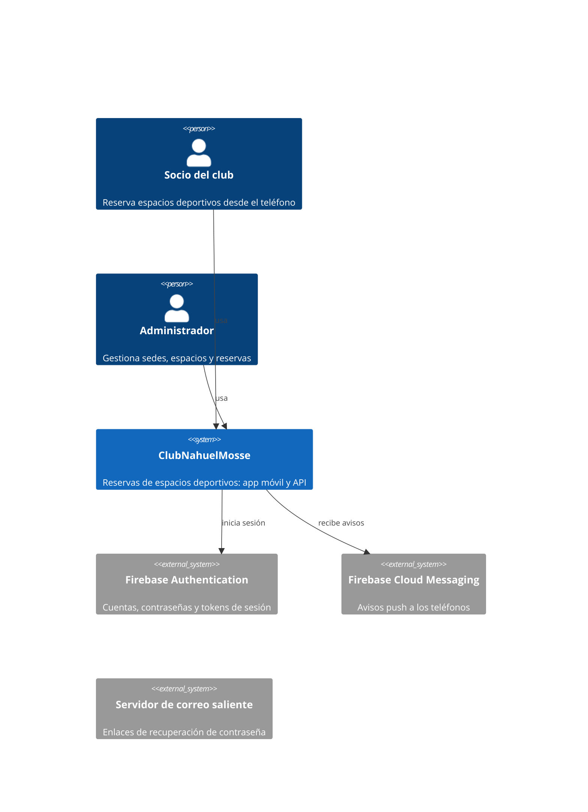
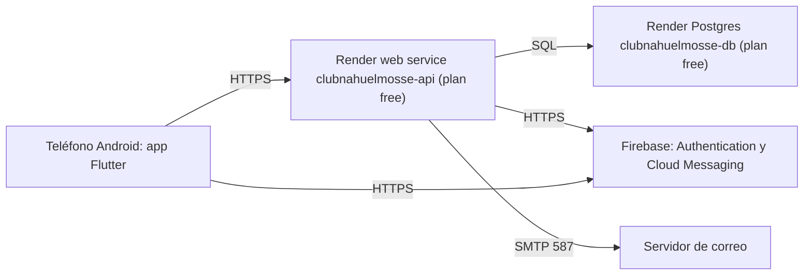

# Diseño del sistema · ClubNahuelMosse

Describe el sistema como está en la rama `kit-3` (commit 932cf77, revisado en `specs/REVISION-kit3.md`, de aquí en
adelante «la revisión»). Cada afirmación cita su archivo y línea, un test o un comando; lo que no se verificó dice
`not verified`. Lo que corrigen las cards REV-01 a REV-06 figura como está hoy, con el hallazgo de la revisión y la card
que lo corrige; al integrar esas cards se actualizan las filas (REV-07-ASM-05). Las decisiones y sus alternativas están en
`docs/adr/`, los precios en `docs/technical/infra-cost.md` y los pasos operativos en `docs/technical/runbook.md`.

## Context and containers (C4)

Dentro de la API (`apps/api/app`): `dominio` (reglas puras), `aplicacion` (casos de uso), `infraestructura`
(repositorios SQL, Firebase, correo) e `interfaz` (rutas FastAPI, middleware); la regla de capas está en
`.claude/rules/arquitectura.md`. El barrido de recordatorios corre como tarea de fondo dentro del mismo proceso web
(`app/main.py:26-38`, `app/interfaz/barrido.py:38-45`).

## Data

Motor: PostgreSQL con la extensión `btree_gist` (`migraciones/versions/0001_modelo_inicial.py:18`). Nueve tablas, creadas
por las migraciones 0001 a 0007, y una vista, `reserva_con_estado`, que agrega `estado_actual` («completada» cuando una
reserva activa ya terminó, `0001_modelo_inicial.py:187-195`). Las claves primarias son `id bigint GENERATED ALWAYS AS
IDENTITY`. Las fechas son `timestamptz`; la zona del club es `America/Argentina/Buenos_Aires`
(`0001_modelo_inicial.py:14`).

| Entity | Relations and cardinality | Owner module | Volume today | Growth per month |
|---|---|---|---|---|
| `usuario` | 1 usuario : N `reserva`, N `dispositivo`, N `notificacion`, N `enlace_recuperacion` | usuarios | `not verified`: la base de Render no se desplegó (revisión, «Cobertura sólo nominal») | objetivo sin medir: 50 altas |
| `sede` | 1 sede : N `espacio`; `creado_por`, `modificado_por` y `dado_de_baja_por` apuntan a `usuario` | sedes | `not verified` | objetivo sin medir: 1 |
| `espacio` | N espacios : 1 `sede`; 1 espacio : N `reserva` | espacios | `not verified` | objetivo sin medir: 5 |
| `reserva` | N reservas : 1 `usuario`, N : 1 `espacio`; 1 reserva : 0..N `notificacion` | reservas | `not verified` | objetivo sin medir: 1 500 |
| `enlace_recuperacion` | N enlaces : 1 `usuario` | recuperacion | `not verified` | objetivo sin medir: 20 |
| `correo_saliente` | sin relaciones; sólo se escribe con `CORREO_MODO=buzon` (desarrollo y escenarios) | recuperacion | 0 en producción (`config.py:21`, `render.yaml:32-33`) | 0 |
| `dispositivo` | N dispositivos : 1 `usuario` | notificaciones | `not verified` | objetivo sin medir: 50 |
| `notificacion` | N avisos : 1 `usuario`; 0..1 : 1 `reserva`; `reemplazada_por` apunta a otra `notificacion` | notificaciones | `not verified` | objetivo sin medir: 3 000 |
| `notificacion_reserva` | une un aviso agrupado con las reservas que cubre (N : N; una reserva tiene a lo sumo un aviso) | notificaciones | `not verified` | objetivo sin medir: 100 |

El volumen que mide la revisión es de prueba: 200 000 reservas sintéticas para el `EXPLAIN` (hallazgo 10) y 4 filas para la
latencia (hallazgo 26).

**Table → owner module.** La revisión encontró repositorios que escriben tablas ajenas
(`infraestructura/usuarios.py:112`, `reservas.py:300`, `sedes.py:180`; hallazgo 20, lo corrige REV-06); la tabla dice quién
debe ser el dueño.

| Table | Owner module |
|---|---|
| `usuario` | usuarios |
| `sede` | sedes |
| `espacio` | espacios |
| `reserva` | reservas |
| `enlace_recuperacion` | recuperacion |
| `correo_saliente` | recuperacion |
| `dispositivo` | notificaciones |
| `notificacion` | notificaciones |
| `notificacion_reserva` | notificaciones |

### Columnas, claves y restricciones

Triggers comunes a `usuario`, `sede`, `espacio` y `reserva` (`0001_modelo_inicial.py:176-184`): `<tabla>_modificado`
(BEFORE UPDATE, función `marcar_modificado`: conserva `creado_en` y pone `modificado_en`) y `<tabla>_sin_borrado`
(BEFORE DELETE, función `prohibir_borrado`: ningún `DELETE` pasa; las bajas son lógicas). El test
`tests/integracion/test_restricciones.py:122` (`test_nada_se_borra`) lo verifica.

**`usuario`** (`0001`, `0002`)

| Columna | Tipo y restricción |
|---|---|
| `id` | bigint, clave primaria |
| `firebase_uid` | text, no nulo, único |
| `correo` | text, no nulo; único sin mayúsculas sólo entre cuentas activas |
| `nombre`, `apellido` | text, no nulos, no vacíos |
| `dni` | text, no nulo, 7 u 8 dígitos; único sólo entre cuentas activas |
| `fecha_nacimiento` | date, no nulo |
| `rol` | text, `usuario` o `admin`, por defecto `usuario` |
| `activo` | boolean, no nulo, por defecto verdadero; coincide con `dado_de_baja_en IS NULL` |
| `dado_de_baja_en` | timestamptz |
| `creado_en`, `modificado_en` | timestamptz, no nulos, por defecto `now()` |
| `contrasena_cambiada_en` | timestamptz (agregada en 0002; guarda el rastro, la contraseña vive en Firebase) |

Índices: `usuario_correo_unico` (`lower(correo)` donde `activo`), `usuario_dni_unico` (`dni` donde `activo`). Trigger
`usuario_correo_inmutable` (BEFORE UPDATE, `correo_inmutable`): el correo no cambia.

**`sede`** (`0001`, `0004`)

| Columna | Tipo y restricción |
|---|---|
| `id` | bigint, clave primaria |
| `nombre`, `calle` | text, no nulos, no vacíos |
| `altura` | integer, mayor que 0 |
| `apertura`, `cierre` | time, no nulos, en horas completas; `apertura < cierre` o `cierre = 00:00` |
| `dias` | smallint[], de 1 a 7 elementos con valores de 1 a 7 |
| `activa` | boolean, no nulo, por defecto verdadero; coincide con `dado_de_baja_en IS NULL` |
| `creado_por`, `modificado_por`, `dado_de_baja_por` | bigint, referencian `usuario (id)` |
| `dado_de_baja_en` | timestamptz |
| `creado_en`, `modificado_en` | timestamptz, no nulos |

Índice: `sede_nombre_activa_unico` (`lower(nombre)` donde `activa`). Las tres FK a `usuario` no tienen índice (hallazgo 10).

**`espacio`** (`0001`)

| Columna | Tipo y restricción |
|---|---|
| `id` | bigint, clave primaria |
| `sede_id` | bigint, no nulo, referencia `sede (id)` |
| `deporte`, `tipo` | text, no nulos, no vacíos |
| `numero` | integer, mayor que 0 |
| `nombre` | text, no nulo, único |
| `techada`, `iluminada` | boolean, no nulos |
| `precio_por_hora` | integer, mayor que 0 |
| `activo` | boolean, no nulo, por defecto verdadero; coincide con `dado_de_baja_en IS NULL` |
| `creado_por`, `modificado_por`, `dado_de_baja_por` | bigint, referencian `usuario (id)` |
| `dado_de_baja_en` | timestamptz |
| `creado_en`, `modificado_en` | timestamptz, no nulos |

Restricción única `(sede_id, deporte, tipo, numero)`. Trigger `espacio_nombre_inmutable` (BEFORE UPDATE): la identidad del
espacio (`nombre`, `sede_id`, `deporte`, `tipo`, `numero`) no cambia.

**`reserva`** (`0001`, `0005`)

| Columna | Tipo y restricción |
|---|---|
| `id` | bigint, clave primaria |
| `usuario_id` | bigint, no nulo, referencia `usuario (id)`; sin índice (hallazgo 10, lo corrige REV-03) |
| `espacio_id` | bigint, no nulo, referencia `espacio (id)` |
| `inicio`, `fin` | timestamptz, no nulos, en horas completas de la zona del club; `fin - inicio` entre 1 y 4 horas |
| `precio_por_hora` | integer, mayor que 0 |
| `total` | integer, no nulo; igual a `precio_por_hora` por las horas |
| `estado` | text, `activa`, `cancelada` o `anulada`, por defecto `activa` |
| `cancelada_en` | timestamptz |
| `cancelada_por` | bigint, referencia `usuario (id)`; sin índice |
| `motivo` | text; obligatorio si `estado` es `anulada` |
| `creado_en`, `modificado_en` | timestamptz, no nulos |

Restricción de exclusión `EXCLUDE USING gist (espacio_id WITH =, tstzrange(inicio, fin) WITH &&) WHERE (estado = 'activa')`:
dos reservas activas del mismo espacio no se superponen. Índice parcial `reserva_activa_inicio` (`inicio` donde
`estado = 'activa'`, `0005_notificaciones.py:68`).

**`enlace_recuperacion`** (`0003`)

| Columna | Tipo y restricción |
|---|---|
| `id` | bigint, clave primaria |
| `usuario_id` | bigint, no nulo, referencia `usuario (id)` |
| `codigo_hash` | text, no nulo, único; sólo el hash del código |
| `emitido_en` | timestamptz, no nulo, por defecto `clock_timestamp()` |
| `vence_en` | timestamptz, no nulo, posterior a `emitido_en` |
| `usado_en`, `invalidado_en` | timestamptz |

Índice: `enlace_recuperacion_por_usuario` (`usuario_id`, `emitido_en`).

**`correo_saliente`** (`0003`)

| Columna | Tipo y restricción |
|---|---|
| `id` | bigint, clave primaria |
| `para`, `asunto`, `cuerpo` | text, no nulos |
| `creado_en` | timestamptz, no nulo, por defecto `clock_timestamp()` |

Sin índices propios. Con `CORREO_MODO=buzon` guarda los códigos en claro (`config.py:19-20`): sólo desarrollo.

**`dispositivo`** (`0005`)

| Columna | Tipo y restricción |
|---|---|
| `id` | bigint, clave primaria |
| `usuario_id` | bigint, no nulo, referencia `usuario (id)` |
| `token` | text, no nulo, no vacío; el token de FCM |
| `plataforma` | text, `android` o `ios` |
| `permiso` | boolean, no nulo; lo que el sistema operativo contestó sobre las notificaciones |
| `activo` | boolean, no nulo, por defecto verdadero; coincide con `dado_de_baja_en IS NULL` |
| `registrado_en`, `actualizado_en` | timestamptz, no nulos |
| `dado_de_baja_en` | timestamptz |

Índices: `dispositivo_token_activo` (único, `token` donde `activo`), `dispositivo_usuario` (`usuario_id` donde `activo`).

**`notificacion`** (`0005`, `0006`, `0007`)

| Columna | Tipo y restricción |
|---|---|
| `id` | bigint, clave primaria |
| `usuario_id` | bigint, no nulo, referencia `usuario (id)` |
| `tipo` | text, `recordatorio`, `cancelacion_forzosa` o `cancelacion_usuario` |
| `titulo`, `cuerpo` | text, no nulos, no vacíos |
| `reserva_id` | bigint, referencia `reserva (id)`; obligatorio en recordatorios y cancelaciones de usuario |
| `reserva_inicio` | timestamptz; el horario al que refiere un recordatorio |
| `envio` | text, `pendiente`, `enviando`, `enviada`, `sin_permiso`, `sin_canal` o `fallida` |
| `creada_en` | timestamptz, no nulo |
| `enviada_en`, `leida_en` | timestamptz |
| `reemplazada_por` | bigint, referencia `notificacion (id)` (agregada en 0007); sin índice |
| `cantidad` | integer, mayor que 0 (agregada en 0007): reservas que cubre un aviso agrupado |

Índices: `notificacion_recordatorio_unico` (único, `reserva_id`, `reserva_inicio` donde `tipo = 'recordatorio'`),
`notificacion_usuario` (`usuario_id`, `creada_en` descendente), `notificacion_cancelacion_unica` (único, `reserva_id`
donde `tipo = 'cancelacion_usuario'`), `notificacion_forzosa_sin_leer` (`usuario_id`, `id` descendente, parcial),
`notificacion_por_despachar` (`id`, parcial: pendientes que no son recordatorios ni están reemplazados).

**`notificacion_reserva`** (`0007`)

| Columna | Tipo y restricción |
|---|---|
| `notificacion_id` | bigint, no nulo, referencia `notificacion (id)` |
| `reserva_id` | bigint, no nulo, único, referencia `reserva (id)` |

Clave primaria compuesta (`notificacion_id`, `reserva_id`).

**Main queries and their index**

| Query (what it answers) | Table | Index | EXPLAIN at the card's volume |
|---|---|---|---|
| Superposición al reservar | `reserva` | la restricción de exclusión gist | `not verified` |
| Barrido: reservas activas que empiezan en la hora que viene (`infraestructura/notificaciones.py:137`) | `reserva` | `reserva_activa_inicio` | `not verified` |
| Historial propio, `GET /reservas?cuando=historial` | `reserva` | ninguno por `usuario_id` | Parallel Seq Scan con 200 000 reservas (hallazgo 10, lo corrige REV-03) |
| Historial global del administrador, paginado con `OFFSET` (`infraestructura/reservas.py:492-509`) | `reserva` | ninguno específico | 1,2 s en la página 500 con 200 000 reservas (hallazgo 10) |
| Centro de avisos de una persona | `notificacion` | `notificacion_usuario` | `not verified` |
| Despacho del pendiente más viejo | `notificacion` | `notificacion_por_despachar` | `not verified` |

- **Migrations:** Alembic (`apps/api/alembic.ini`, `migraciones/`), siete revisiones lineales 0001 a 0007. Corren dentro del
  build de Render, con la versión anterior sirviendo (`render.yaml:11`), como el mismo usuario `club` que atiende la app
  (hallazgo 8, lo corrige REV-02). No son expand/migrate/contract: ninguna lleva `lock_timeout`, los índices de tablas con datos se crean
  sin `CONCURRENTLY` y todo corre en una transacción (`migraciones/env.py:14-16`; hallazgo 13, lo corrige REV-03). 0001
  y 0007 se editaron después de entrar en main (hallazgo 12, declarado sin corrección: corregirlo reescribe la historia). La ida y vuelta
  0001 a 0007 con datos se midió una vez y ningún test la vigila (revisión, «Qué corrió»).
- **Retention and archiving:** no hay política. Las bajas son lógicas y ningún `DELETE` pasa (trigger `prohibir_borrado`),
  así que nada se borra ni se archiva: los avisos, los enlaces de recuperación y los correos no tienen vencimiento.
  Una persona tiene que fijar los plazos (ver `## Personal data`).
- **Backups:** ninguno. La base de Render es del plan `free`: sin backups, vence a los 30 días y se borra 14 días después
  (`render.yaml:45-49`, `apps/api/README.md:142`; hallazgo 4, lo corrige REV-02). RPO: no definido, equivale a perder todo lo
  posterior a la creación de la base. RTO: no definido; no hay restore probado. Fecha del último restore: ninguno.

## Infrastructure

- **Deployment diagram:**

- **Environments:** hay dos, local y Render; no hay staging (hallazgo 26, `lib/configuracion.dart:21-34`).
  - **local:** la API con `uvicorn` contra una Postgres local y el emulador de Firebase Auth (`firebase.json`, puerto 9099,
    `npm run emuladores`), `CORREO_MODO=buzon`, sin credenciales de Firebase: el canal push es el nulo
    (`infraestructura/push.py:79-84`). La app apunta a `http://10.0.2.2:8000` con `AUTH_EMULADOR`. Los tests usan una base
    `*_test` (`apps/api/README.md`, «Probar»).
  - **Render:** `render.yaml` define el web service Python `clubnahuelmosse-api` y la base `clubnahuelmosse-db`, ambos
    `plan: free`, y es la única fuente de la configuración del despliegue. El despliegue en Render no se hizo: el escenario
    RNF-01-H06-01 se saltea sin `API_URL_NUBE` (revisión, «Cobertura sólo nominal»). El health check es `/docs`
    (`render.yaml:14`).
- **Deploy and rollback:** el despliegue sale solo con cada commit de la rama enlazada; la vuelta atrás de código es redeploy
  del commit anterior y no hay vuelta atrás de datos. Pasos en `docs/technical/runbook.md`.
- **Expected scaling:** una instancia web sin escalado automático ni más de un proceso; lo primero que se agota es el pool
  de conexiones (5 + 10 de desborde, espera de 30 s por defecto de SQLAlchemy 2: verificado con `create_engine` en el
  entorno de la API) y, antes, la CPU y la memoria del plan free (`not verified`: los límites de la instancia free no se
  consultaron). El barrido de recordatorios vive en el mismo proceso y se detiene cuando Render duerme el servicio
  (hallazgo 3, lo corrige REV-02).
- **Secrets:** inventario en `## Secrets inventory`; en Render viven como variables de entorno de `render.yaml` marcadas
  `sync: false`.
- **Cost:** `docs/technical/infra-cost.md`.

## Observability

Hoy no hay observabilidad de producción (hallazgo 15, lo corrige REV-02): ni métricas, ni trazas, ni alertas, ni
tableros. Lo que existe es el log de texto de la API y el registro de errores por pedido
(`app/interfaz/registro_errores.py:9-59`).

- **SLOs.** Son objetivos propuestos, sin medir: no hay medición que los respalde (REV-07-ASM-01). El de latencia es
  coherente con lo medido en la revisión, p95 local de unos 55 ms con 4 filas (hallazgo 26). El de disponibilidad no
  se cumple con el plan free: el servicio se duerme a los 15 minutos sin tráfico y tarda alrededor de un minuto en despertar
  (`apps/api/README.md:139-141`).

| Service | SLI | Objective | Window | Error-budget policy (actions on exhaustion, approver) |
|---|---|---|---|---|
| API | SLO de disponibilidad: pedidos que no terminan en 5xx sobre el total | 99,0 % | 30 días | pendiente de una persona: quién aprueba y qué se detiene al agotarlo |
| API | SLO de latencia: pedidos de lectura que responden en 300 ms o menos, medidos en el servidor, sin el arranque en frío | 95 % | 30 días | pendiente de una persona |

- **Signals per service:** hoy sólo el log de errores. No hay RED por endpoint ni USE del pool; el barrido registra sus
  fallos con `_registro.exception` (`barrido.py:24`, `:35`, `:45`).
- **Log schema.** El formato real es una línea de texto, no JSON: `%(asctime)s %(levelname)s %(name)s %(message)s`
  (`registro_errores.py:15`), a la salida estándar, con la hora del proceso y sin zona. No hay `trace_id`: `X-Request-ID` y
  `traceparent` se ignoran (hallazgo 15). La línea de error de un pedido lleva `<método> <ruta> <código> usuario=<id>` con el
  `id` numérico de la base (`registro_errores.py:47-58`), y los niveles son los de `logging`: `ERROR` para excepciones y
  5xx, `WARNING` para 401, 403 y 409. El log guarda datos personales en dos casos (correo en `correo.py:42` y query
  string en el access log de uvicorn) y la ruta no se escapa (hallazgo 9, lo corrige REV-01).
- **Alerts as code:** ninguna. **Dashboards:** ninguno.

## Errors

Taxonomía de la API. Las excepciones del dominio y de la aplicación están en `app/aplicacion/errores.py`; las rutas las
traducen a HTTP (`interfaz/reservas.py:163-176`, `espacios.py:148-234`, `sesion.py:116-121`).

| Error | Class (domain, operational, bug) | Comes from | Translated to | What the user sees | Reference id |
|---|---|---|---|---|---|
| `DatosInvalidos`, `NoDisponible` | domain | casos de uso | 422 con `{"errores": {campo: mensaje}}` | el mensaje junto al campo | no |
| `Duplicado`, `HorarioOcupado`, `Cambiado`, `NumeroOcupado`, `ConReservasFuturas` | domain | casos de uso | 409 con `{"errores": ...}` | el mensaje del conflicto | no |
| `Prohibido` | domain | casos de uso (`perfil.rol != "admin"`) | 403 sin cuerpo | acceso denegado | no |
| `NoEncontrada` | domain | casos de uso | 404 sin cuerpo | no encontrado | no |
| `NoAutenticado` | domain | `perfil_autenticado` | 401 con `WWW-Authenticate: Bearer` | vuelve al inicio de sesión | no |
| `Demorado` | operational | Firebase (`TOO_MANY_ATTEMPTS`) | 429 | pedir que reintente más tarde | no |
| Cuerpo mayor que 64 KB | operational | `Protecciones` (`protecciones.py:28-42`) | 413 | error genérico | no |
| Entrada fuera de rango (`horas` enorme, NUL en un texto, `pagina` enorme) | bug | casos de uso, repositorios | 500 «Internal Server Error» (hallazgo 5, lo corrige REV-01) | error de servidor | no (hallazgo 14, lo corrige REV-02) |
| Falla de la base o de un proveedor sin atrapar | operational | repositorios, SDK | 500 «Internal Server Error», con traceback en el log | «Revisá tu conexión a internet» si el cliente cortó a los 15 s (hallazgo 14) | no |

## External dependencies

Una fila por llamada externa. Los tiempos salen del código; lo que el código no fija se declara así.

| Dependency | Timeout | Retries (backoff, jitter, idempotent only) | Circuit breaker | Fallback | What happens if it fails |
|---|---|---|---|---|---|
| PostgreSQL (`app/infraestructura/db.py:12`) | de conexión: ninguno (sin `connect_timeout`); espera de un hilo por una conexión del pool: 30 s, el valor por defecto; sin `statement_timeout` ni `lock_timeout`. Medido: con la base en una dirección sin ruta, `GET /reservas` tardó 131 s en dar 500 (hallazgo 2, lo corrige REV-02) | sin reintentos; `pool_pre_ping=True` sólo comprueba la conexión del pool antes de usarla | no | ninguno | si falla, cada pedido que la necesita termina en 500; el health check `/docs` no usa la base y sigue en verde, así que Render no reinicia la API |
| Firebase Authentication: SDK de administración y API REST de Identity Toolkit (`identidad.py:22-25`, `:86`) | SDK: `httpTimeout` de 4 s (`identidad.py:24`, `:38`); REST: `timeout=4` s de `urllib` (`identidad.py:86`); la verificación de la firma de un token, `not verified` | SDK: el cliente de `firebase-admin` 7.7.0 reintenta una vez ante errores de conexión o de lectura y hasta 4 veces ante 500 o 503, con espera exponencial de factor 0,5 (`firebase_admin/_http_client.py:39-47`); REST: ninguno | no | ninguno | un token que no se puede verificar da 401 o 500 según el error; `TOO_MANY_ATTEMPTS` da 429 (`identidad.py:92-93`); crear cuenta o cambiar contraseña falla el pedido |
| Firebase Cloud Messaging (`push.py:60-64`, `:67`) | `httpTimeout` de 10 s (`push.py:62`) | el mismo cliente de `firebase-admin` (arriba); el despacho no reintenta un aviso que quedó `fallida` ni uno que quedó `enviando` si el proceso cae (hallazgos 3 y 11, los corrige REV-02 y REV-03) | no | sin credenciales, el canal nulo deja el aviso como `sin_canal` (`push.py:17-23`, `:79-84`) | si falla, el aviso queda `fallida` y nadie se entera; el token que FCM rechaza como inválido se da de baja (`aplicacion/notificaciones.py:132`); la reserva no cambia |
| SMTP (`app/infraestructura/correo.py:30-33`) | 10 s (`timeout=10`, `correo.py:30`) | sin reintentos | no | ninguno | si falla, el error va al log (`correo.py:41-42`) y la respuesta es la misma que para un correo sin cuenta; la persona no recibe el enlace. La conexión STARTTLS no verifica el certificado del servidor (hallazgo 1, lo corrige REV-01) |
| Firebase Authentication desde la app (`firebase_auth`) | el cliente de la app corta cada pedido a la API a los 15 s (`lib/api/cliente_api.dart:28`); al retomar la sesión, a los 3 s (`lib/sesion/sesion.dart:128`) | ninguno propio | no | ninguno | con Render dormido se ve «Revisá tu conexión a internet» y retomar la sesión manda al login (hallazgo 14, lo corrige REV-02) |

## Threat model

Cuatro superficies. Hay un hallazgo de la revisión detrás de cada `fails`, con la card que lo corrige.

**Surface:** API HTTP · **Enters:** JSON de las rutas, cabecera `Authorization: Bearer <token de Firebase>` · **Trust boundary:** el borde de Render hacia el proceso `uvicorn`

| ID | STRIDE | Threat | Decision (mitigate, eliminate, transfer, accept) | Owner | Verified by (test or command) |
|---|---|---|---|---|---|
| T-01 | Spoofing | alguien se hace pasar por otra cuenta con un token falso, vencido, de otro proyecto o revocado | mitigate: `verify_id_token` con `check_revoked=True` (`identidad.py:72`); con `FIREBASE_AUTH_EMULATOR_HOST` definido el SDK acepta tokens sin firma, y sólo lo frena que `render.yaml` no defina la variable (hallazgo 25, lo corrige REV-01) | autor del repo | `tests/integracion/test_sesion_api.py:52`, revisión («Sin hallazgo») |
| T-02 | Tampering | pedido con cuerpo mal formado, campos de más, números fuera de rango o NUL en un texto | mitigate en parte: límite de 64 KB y validación de Pydantic; los números sin cota y el NUL dan 500 (hallazgo 5, lo corrige REV-01) | autor del repo | `tests/integracion/test_seguridad_api.py:12`, `:34`, `:39`, `:80` |
| T-03 | Repudiation | una persona niega haber cancelado o anulado una reserva | mitigate: `cancelada_por`, `cancelada_en` y `motivo` en `reserva`; el log de 401, 403 y 409 con el usuario | autor del repo | `tests/integracion/test_anular_reserva_api.py` |
| T-04 | Information disclosure | consultar si un DNI o un correo ya están registrados, o leer reservas ajenas | mitigate lo segundo (sin IDOR en la revisión); lo primero falla: `PUT /yo` y `/registro` responden 409 con «ya está registrado» (hallazgo 6, lo corrige REV-01) | autor del repo | revisión («Sin hallazgo» y hallazgo 6) |
| T-05 | Denial of service | ráfagas de pedidos sin límite de frecuencia; entradas que fuerzan 500 y llenan el log | accept hasta REV-01: no hay límite de frecuencia (`app/main.py:41-62`, hallazgo 6) | autor del repo | `not verified` |
| T-06 | Elevation of privilege | un usuario común llama a una ruta de administrador | mitigate: `perfil.rol != "admin"` en los casos de uso (`aplicacion/reservas.py:243`, `sedes.py:36`, `espacios.py:76`); 403 en las 10 rutas de administrador | autor del repo | revisión («Sin hallazgo»); `tests/integracion/test_rutas_protegidas.py:42` |

**Surface:** app móvil · **Enters:** lo que escribe la persona, los enlaces de recuperación, los avisos push · **Trust boundary:** el teléfono

| ID | STRIDE | Threat | Decision (mitigate, eliminate, transfer, accept) | Owner | Verified by (test or command) |
|---|---|---|---|---|---|
| T-07 | Spoofing | otra app abre el enlace de recuperación del correo | mitigate: el código va después del «#» y no llega al servidor; vigencia de 30 minutos y un solo uso (`aplicacion/recuperacion.py:17`, `:81-83`) | autor del repo | `tests/integracion/test_recuperacion_api.py:145` |
| T-08 | Tampering | modificar el APK o las claves que lleva | accept: las `--dart-define` de Firebase son identificadores públicos del proyecto, no secretos; el APK `release` se firma con la clave de depuración mientras no se configure otra (`apps/mobile/README.md:102-104`) | autor del repo | `not verified` |
| T-09 | Repudiation | la app no deja rastro de sus fallos | accept hasta REV-02: no instala `FlutterError.onError` ni `runZonedGuarded` (`lib/main.dart:15-46`, hallazgo 15) | autor del repo | `not verified` |
| T-10 | Information disclosure | datos de la sesión en el teléfono | mitigate: `shared_preferences` guarda sólo la apariencia, el permiso de avisos y el token de FCM (`lib/comun/apariencia.dart`, `lib/notificaciones/sistema.dart`); la sesión la guarda `firebase_auth` | autor del repo | `not verified` (no se inspeccionó el almacenamiento del teléfono) |
| T-11 | Denial of service | el servicio dormido hace fallar el primer uso del día | accept hasta REV-02: la app corta a los 15 s y Render tarda alrededor de un minuto (hallazgo 14) | autor del repo | `not verified` |
| T-12 | Elevation of privilege | la app muestra pantallas de administrador a quien no lo es | mitigate: el rol se decide en la API; la app sólo oculta | autor del repo | `lib/comun/pantalla_acceso_denegado.dart`; `not verified` en un dispositivo |

**Surface:** base de datos · **Enters:** SQL parametrizado de los repositorios · **Trust boundary:** el proceso de la API hacia Postgres de Render

| ID | STRIDE | Threat | Decision (mitigate, eliminate, transfer, accept) | Owner | Verified by (test or command) |
|---|---|---|---|---|---|
| T-13 | Spoofing | alguien usa las credenciales de la base | mitigate: la URL llega por `DATABASE_URL` de Render (`fromDatabase`), no está en el repo; un solo usuario migra y atiende la app (hallazgo 8, lo corrige REV-02) | autor del repo | revisión («Sin hallazgo»: sin secretos en los 327 commits) |
| T-14 | Tampering | inyección SQL; edición o borrado directo de filas | mitigate: todo el SQL está parametrizado; triggers `prohibir_borrado` y de inmutabilidad; restricciones CHECK | autor del repo | `tests/integracion/test_restricciones.py:122`, `:128` |
| T-15 | Repudiation | no queda quién creó o cambió una sede o un espacio | mitigate: columnas `creado_por`, `modificado_por`, `dado_de_baja_por` | autor del repo | `migraciones/versions/0001_modelo_inicial.py:89-91`, `:118-120` |
| T-16 | Information disclosure | la base y sus datos personales se pierden o se filtran; el TLS hacia la base de Render no se probó | accept en parte: el DNI y el nacimiento se guardan en claro (sin cifrado de columnas); el cifrado en reposo es el de Render (`not verified`) | autor del repo | `not verified` |
| T-17 | Denial of service | un corte de red con la base cuelga el pool 130 s | accept hasta REV-02 (hallazgo 2); consultas que crecen con la tabla (hallazgo 10, lo corrige REV-03) | autor del repo | medido en la revisión |
| T-18 | Elevation of privilege | el usuario de la app tiene DDL completo | accept hasta REV-02 (hallazgo 8) | autor del repo | revisión (hallazgo 8) |

**Surface:** correo de recuperación y avisos push (integraciones salientes) · **Enters:** el correo de la persona y el contenido del aviso · **Trust boundary:** el borde de la API hacia el servidor de correo y Firebase

| ID | STRIDE | Threat | Decision (mitigate, eliminate, transfer, accept) | Owner | Verified by (test or command) |
|---|---|---|---|---|---|
| T-19 | Spoofing | un servidor de correo falso recibe el usuario, la contraseña y los enlaces | accept hasta REV-01: `starttls()` sin `context` no verifica el certificado (`correo.py:30-32`, hallazgo 1, medido) | autor del repo | revisión (hallazgo 1) |
| T-20 | Tampering | alguien reutiliza o falsifica un enlace de recuperación | mitigate: sólo se guarda el hash SHA-256 del código; un solo uso; el código es `secrets.token_urlsafe(32)` (`recuperacion.py:63-64`, `:78`) | autor del repo | `tests/integracion/test_recuperacion_api.py:36`, `:129` |
| T-21 | Repudiation | no queda registro de qué aviso salió | mitigate: `notificacion.envio`, `enviada_en` y `leida_en` | autor del repo | `migraciones/versions/0005_notificaciones.py:42-60` |
| T-22 | Information disclosure | el correo de una cuenta aparece en el log, o se averigua si existe | mitigate lo segundo: la respuesta es la misma tenga cuenta o no (`recuperacion.py:1-4`); falla lo primero (`correo.py:42`, hallazgo 9, lo corrige REV-01) | autor del repo | `tests/integracion/test_recuperacion_api.py:61` |
| T-23 | Denial of service | pedir recuperación de la contraseña sin freno | mitigate en parte: tope de 3 enlaces por hora y cuenta (`recuperacion.py:18`); sin límite por origen: 30 pedidos en 0,9 s dieron 30 respuestas 202 (hallazgo 6, lo corrige REV-01) | autor del repo | `tests/integracion/test_recuperacion_api.py:84` |
| T-24 | Elevation of privilege | reasignar el dispositivo de otra persona con su token de FCM | accept hasta REV-01: `PUT /dispositivos` con el token ajeno lo reasigna; hace falta conocerlo (`infraestructura/notificaciones.py:294-297`, hallazgo 25) | autor del repo | revisión (hallazgo 25) |

Cada `mitigate` nombra su test o su evidencia; cada `accept` tiene dueño y motivo. «Autor del repo» es el único dueño que el
repo tiene hoy; asignar a otra persona queda pendiente de una persona.

## Secrets inventory

Nombres y lugares, nunca valores. Quién es dueño de cada secreto, y las fechas de creación y de la última rotación, lo
decide una persona: quedan pendientes de una persona y no se inventan. Los pasos de rotación están en
`docs/technical/runbook.md`.

| Name | Purpose | Consumer | Owner | Where it lives per environment | Privileges | Created | Rotation | Last rotation |
|---|---|---|---|---|---|---|---|---|
| `DATABASE_URL` | conexión a la base | API | pendiente de una persona | local: `.env` (no se versiona) o el entorno; Render: la entrega la base por `fromDatabase` (`render.yaml:18-21`) | usuario `club`: migra y atiende la app (hallazgo 8) | `not verified` | pendiente de una persona | `not verified` |
| `FIREBASE_CREDENCIALES_JSON` | cuenta de servicio de Firebase: crear y borrar usuarios, verificar tokens, enviar push | API | pendiente de una persona | local: ausente, se usa el emulador; Render: variable `sync: false` (`render.yaml:27`) | administración del proyecto de Firebase | `not verified` | pendiente de una persona | `not verified` |
| `GOOGLE_APPLICATION_CREDENTIALS` | ruta a la misma cuenta de servicio | API y comando de siembra | pendiente de una persona | sólo del entorno del proceso, nunca del `.env` | las mismas | `not verified` | pendiente de una persona | `not verified` |
| `FIREBASE_API_KEY` | clave web del proyecto para comprobar contraseñas | API | pendiente de una persona | Render: `sync: false` (`render.yaml:24`) | identificador público del proyecto | `not verified` | pendiente de una persona | `not verified` |
| `SMTP_CONTRASENA` | contraseña de la cuenta de correo saliente | API | pendiente de una persona | Render: `sync: false` (`render.yaml:40`) | enviar correo con la cuenta | `not verified` | pendiente de una persona | `not verified` |
| `SMTP_USUARIO`, `SMTP_HOST`, `CORREO_REMITENTE` | cuenta, servidor y remitente del correo | API | pendiente de una persona | Render: `sync: false` (`render.yaml:34-43`) | no son secretos por sí solos | `not verified` | no aplica | `not verified` |
| `ADMIN_CONTRASENA` | contraseña de la cuenta de administrador, sólo para sembrarla | comando `sembrar_admin` | pendiente de una persona | el entorno de quien corre el comando; no vive en Render | cuenta de administrador | `not verified` | pendiente de una persona | `not verified` |
| `FIREBASE_API_KEY`, `FIREBASE_APP_ID`, `FIREBASE_SENDER_ID`, `FIREBASE_PROJECT_ID` de la app | datos de la app Android registrada en Firebase | app móvil | pendiente de una persona | `--dart-define` al construir; quedan dentro del APK | públicos por diseño de Firebase | `not verified` | no aplica | `not verified` |
| `URL_PUBLICA` | dirección pública de la API | API | pendiente de una persona | Render: `sync: false` (`render.yaml:30-31`) | no es un secreto | `not verified` | no aplica | `not verified` |

`scripts/e2e.sh:25-26` trae una contraseña de administrador de prueba (`AdminE2e1`) que sólo existe en el emulador de la
corrida de pantallas. `.env.example` lista estas variables sin valores.

## Personal data

Contexto: Ley 25.326 de Protección de los Datos Personales (Argentina). El repo no la mencionaba antes de este documento
(hallazgo 4). La base legal y los plazos de retención los decide una persona; lo que sigue es lo que el sistema hace hoy.

| Field | Of whom | Category (identifying, sensitive) | Purpose | Legal basis or consent | Where it lives (tables, logs, backups, third parties) | Retention | How it is deleted |
|---|---|---|---|---|---|---|---|
| nombre, apellido (`usuario.nombre`, `usuario.apellido`) | socios y administradores | identifying | identificar a la persona en el club | pendiente de una persona (consentimiento al registrarse: `not verified`) | `usuario`; Firebase no los guarda | sin plazo | no se borra: baja lógica |
| DNI (`usuario.dni`) | socios y administradores | identifying | impedir cuentas duplicadas y buscar socios | pendiente de una persona | `usuario`; en el log si el administrador lo busca (query string, hallazgo 9) | sin plazo; la baja libera el DNI para otra cuenta | no se borra: baja lógica |
| fecha de nacimiento (`usuario.fecha_nacimiento`) | socios y administradores | identifying | requisito del perfil del enunciado | pendiente de una persona | `usuario` | sin plazo | no se borra |
| correo (`usuario.correo`) | socios y administradores | identifying | iniciar sesión y recuperar la contraseña | pendiente de una persona | `usuario`, Firebase Authentication, el servidor de correo, `correo_saliente` en modo buzón y el log (`correo.py:42`, access log) | sin plazo | la baja borra la cuenta de Firebase (`aplicacion/baja.py:30-37`); en la base queda |
| contraseña | socios y administradores | sensitive | autenticar | pendiente de una persona | sólo en Firebase Authentication; la base guarda `contrasena_cambiada_en` | la gestiona Firebase | la baja borra la cuenta de Firebase |
| token de dispositivo (`dispositivo.token`) | socios | identifying | enviar avisos | permiso del sistema operativo guardado en `dispositivo.permiso` | `dispositivo`; Firebase Cloud Messaging | sin plazo; se da de baja al cerrar sesión | baja lógica |
| reservas y avisos (`reserva`, `notificacion`) | socios | identifying | historial y recordatorios | pendiente de una persona | `reserva`, `notificacion`, `notificacion_reserva` | sin plazo; el historial se conserva a propósito (`sesion.py:187-189`) | no se borra |
| código de recuperación | quien lo pide | sensitive | recuperar la cuenta | no aplica | `enlace_recuperacion.codigo_hash` (sólo el hash) | vence a los 30 minutos | no se borra la fila |

Hoy ningún dato personal se borra de la base: el trigger `prohibir_borrado` lo impide y el derecho de supresión de la
Ley 25.326 no tiene camino. Cómo resolverlo lo decide una persona.

Cifrado en reposo: lo da la plataforma de Render para la base (`not verified`: no se consultó su documentación). El DNI y el
nacimiento no tienen cifrado de columna. No hay backups, así que no hay backups cifrados.

## Performance and capacity budget

Presupuesto de rendimiento y de capacidad. Son objetivos propuestos, sin medir (REV-07-ASM-01): no hay prueba de carga del
camino caliente (hallazgo 26).

- **Presupuesto de latencia (p95):** 300 ms en el servidor para las lecturas (`GET /sedes`, `/espacios`, `/horarios`,
  `/reservas`) y 500 ms para las escrituras (`POST /reservas`, cancelaciones), sin contar el arranque en frío de Render. Lo
  único medido es un p95 local de unos 55 ms con 4 filas (hallazgo 26).
- **Capacidad objetivo:** 20 personas con sesión activa a la vez y 5 pedidos simultáneos, con la base por debajo de 100 000
  reservas. Ese techo sale del pool de 15 conexiones (5 más 10 de desborde) y de la base de las pruebas: con 200 000 reservas,
  el historial propio hace un recorrido secuencial y el global tarda 1,2 s en la página 500 (hallazgo 10).
- **Operaciones costosas:** el historial global del administrador (`OFFSET`, dos `count(*)` y orden en disco), el barrido de
  recordatorios cada 30 s (`config.py:30`) y el envío de avisos por FCM, que corren en el mismo proceso web.
- **Qué falta:** una prueba de carga del camino caliente (hallazgo 26); mientras no exista, estos números no están
  respaldados por una medición.
