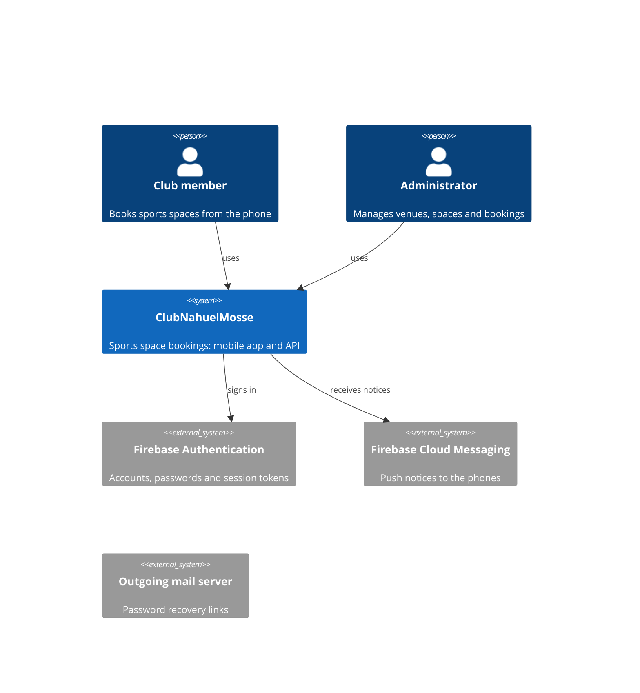
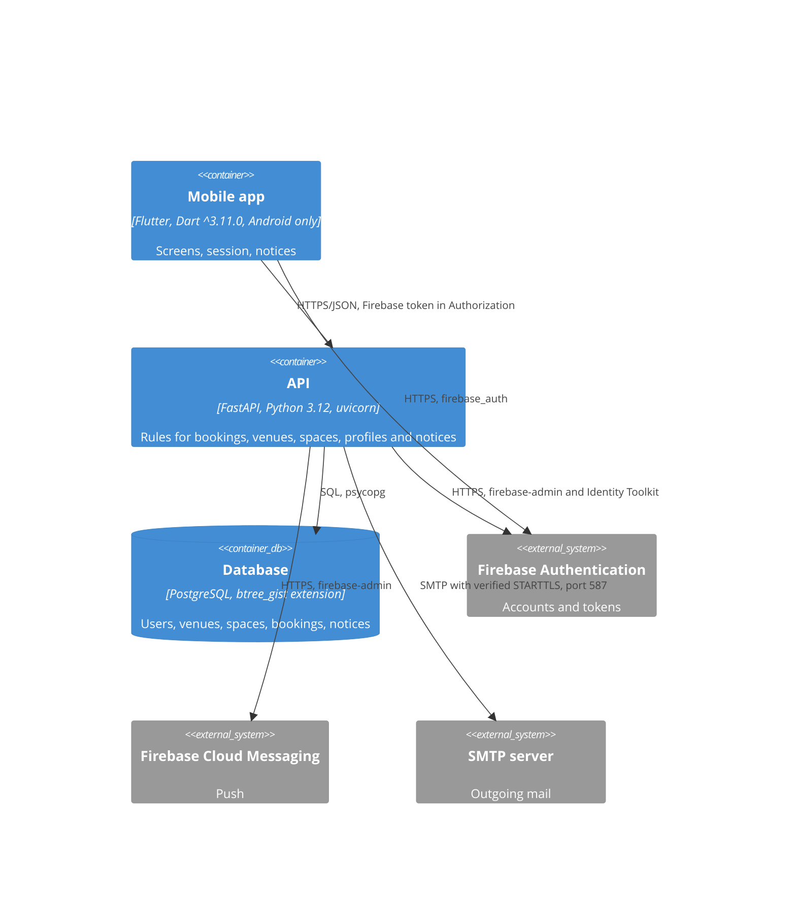
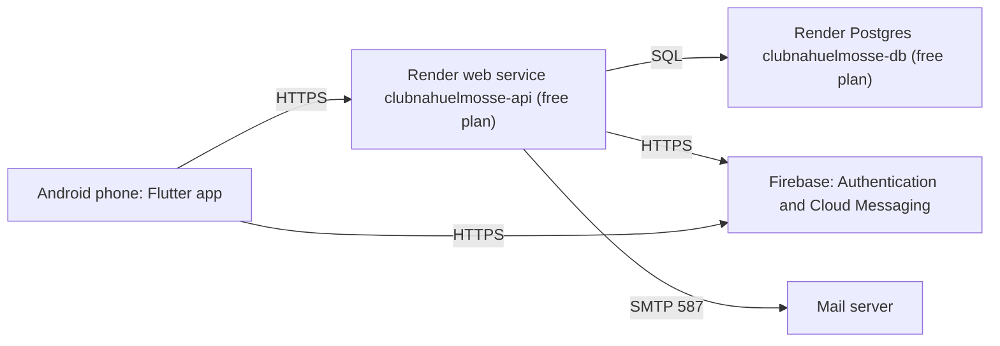

# System design · ClubNahuelMosse

Describes the system as it is on `main`: data model, infrastructure, observability, errors, external dependencies,
threats, secrets, personal data and the performance budget. Every claim cites its file, a test or a command;
what was not verified says `not verified`. Finding numbers refer to the review of the `kit-3` branch
(`specs/REVISION-kit3.md`); cards `REV-01` to `REV-08` fixed them and what is still open is stated in each row. The
architecture and the flows are in [`architecture.md`](architecture.md), where each file lives in
[`code-map.md`](code-map.md), the decisions in `docs/adr/`, the prices in
[`infra-cost.md`](infra-cost.md) and the operating steps in the [runbook](runbook.md). Each external service and where it is integrated: [`integrations.md`](integrations.md).

## Context and containers (C4)

Inside the API (`apps/api/app`): one folder per feature in `modules/` (each with `routes.py`,
`use_cases.py`, `rules.py` and `repository.py`) and `shared/` for what is common (database, errors, Firebase, time zone). The layer
rule is enforced by `apps/api/tests/unit/test_architecture_features.py` and
`apps/api/tests/unit/test_layers_features.py`. The reminder sweep runs as a background task
inside the web process (`apps/api/app/main.py`, `_lifespan`) and also as a one-pass command
(`python -m app.modules.notifications.sweep --una-vez`).

## Data

The data model (tables, columns, relations, states, indexes, migrations) lives in [data-model.md](data-model.md). PostgreSQL with `btree_gist`, nine tables and one view. No retention policy: deactivations are logical and notices, links and emails never expire (a person has to set the periods, see `## Personal data`). No automatic backups: the Render `free` database has no copies, expires after 30 days and is deleted 14 days later (`render.yaml`); RPO and RTO are not defined.

## Infrastructure

- **Deployment diagram:**

- **Environments:** there are two, local and Render; there is no staging.
  - **local:** the API with `uvicorn` against a local Postgres and the Firebase Auth emulator (`firebase.json`, port 9099,
    `npm run emulators`), `EMAIL_MODE=outbox`, no Firebase credentials: the push channel is the null one
    (`apps/api/app/modules/notifications/push.py`, `NullChannel`). The app points to `http://10.0.2.2:8000` with `AUTH_EMULATOR`. The tests use
    a `*_test` database (`apps/api/README.md`, "Run the tests").
  - **Render:** `render.yaml` defines the Python web service `clubnahuelmosse-api` and the database `clubnahuelmosse-db`, both
    `plan: free`, and it is the only source of the deployment configuration. The deployment has not been made yet: scenario
    RNF-01-H06-01 is skipped without `API_URL_NUBE`. The health check is `/health`, which touches neither the database nor Firebase (`apps/api/app/health.py`).
- **Deploy and rollback:** the deployment goes out by itself with each commit of the linked branch; rolling code back is a redeploy
  of the previous commit. Steps in the runbook.
- **Expected scaling:** one web instance with no autoscaling and no more than one process. The first thing to run out is the SQLAlchemy
  connection pool (5 plus 5 overflow, the defaults). CPU and memory of the free plan may run out earlier
  (`not verified`: the limits of the free instance were not consulted). The reminder sweep lives in the same process and stops when Render
  puts the service to sleep; the `--una-vez` command is ready for a cron, but `render.yaml` defines none (the free plan
  has no cron jobs).
- **Secrets:** inventory in `## Secrets inventory`; on Render they live as environment variables of `render.yaml` marked
  `sync: false`.
- **Cost:** [`infra-cost.md`](infra-cost.md).

## Observability

- **SLOs.** They are proposed objectives, unmeasured: no production measurement backs them. The latency one is
  consistent with the local p95 of about 55 ms with 4 rows (finding 26). The availability one is not met on the free plan:
  the service goes to sleep after 15 minutes without traffic and takes about a minute to wake up.

| Service | SLI | Objective | Window | Error-budget policy (actions on exhaustion, approver) |
|---|---|---|---|---|
| API | Availability SLO: requests that do not end in 5xx over the total | 99.0 % | 30 days | pending a person: who approves and what is stopped on exhaustion |
| API | Latency SLO: read requests that answer in 300 ms or less, measured on the server, without the cold start | 95 % | 30 days | pending a person |

- **Signals per service:** `/health` and the uvicorn log. There are no metrics and no service that queries them.
- **Log schema.** The uvicorn and `logging` module log to standard output. SQLAlchemy hides the parameters
  (`hide_parameters=True`), so they carry no email, national ID, tokens or passwords.
- **App:** `apps/mobile/lib/common/unhandled_errors.dart` hooks `FlutterError.onError` and `PlatformDispatcher.onError` and
  records them with `debugPrint`. There is no crash reporting service (Crashlytics or another).
- **Alerts as code:** none. **Dashboards:** none.

## Errors

Taxonomy of the API. The business exceptions are in `apps/api/app/shared/errors.py`; the routes translate them to HTTP with
`apps/api/app/shared/responses.py`.

| Error | Class (domain, operational, bug) | Comes from | Translated to | What the user sees | Reference id |
|---|---|---|---|---|---|
| `InvalidData`, `Unavailable` | domain | use cases | 422 with `{"errors": {field: message}}` | the message next to the field | no |
| `Duplicate`, `SlotTaken`, `ConcurrentChange`, `NumberTaken`, `HasFutureBookings`, `BookingsOutsideHours` | domain | use cases | 409 with `{"errors": ...}` | the conflict message | no |
| `Forbidden` | domain | use cases (`profile.role`) | 403 with no body | access denied | no |
| `NotFound` | domain | use cases | 404 with no body | not found | no |
| `NotAuthenticated` | domain | the authenticated profile dependency | 401 with `WWW-Authenticate: Bearer` | back to the sign-in screen | no |
| `RateLimited` | operational | Firebase (`TOO_MANY_ATTEMPTS`) | 429 | asked to try again later | no |
| Malformed JSON, out-of-range or missing data | domain | FastAPI validation (`apps/api/app/shared/input_validation.py`) | 422 with `{"errors": {field: message}}`, without repeating what was received | the message next to the field | no |
| Database down, any other exception | bug | any layer | 500 | "We could not process the operation right now. Try again later." | no |

## External dependencies

One row per external call. The times come from the code; what the code does not fix is declared as such.

| Dependency | Timeout | Retries (backoff, jitter, idempotent only) | Circuit breaker | Fallback | What happens if it fails |
|---|---|---|---|---|---|
| PostgreSQL (`apps/api/app/shared/db.py`) | the driver and pool defaults | no retries; `pool_pre_ping=True` checks the connection before using it | no | none | if it fails, the request answers 500 |
| Firebase Authentication: admin SDK and Identity Toolkit REST API (`apps/api/app/shared/identity.py`) | SDK: `httpTimeout` of 4 s; REST: `timeout=4` s of `urllib`; verifying a token signature, `not verified` | SDK: the `firebase-admin` client retries once on connection or read errors and up to 4 times on 500 or 503, with exponential wait; REST: none | no | none | if it fails, an invalid, expired or revoked token gives 401; if Firebase does not answer, the request gives 500; `TOO_MANY_ATTEMPTS` gives 429; creating an account or changing a password fails the request |
| Firebase Cloud Messaging (`apps/api/app/modules/notifications/push.py`) | `httpTimeout` of 10 s | the `firebase-admin` client (above); a `failed` notice is not retried | no | with no credentials, the null channel leaves the notice as `no_channel` | if it fails, the notice stays `failed` and the person sees it anyway in the notice center of the app; a token that FCM rejects as invalid is deactivated; the booking does not change |
| SMTP (`apps/api/app/shared/email.py`) | 10 s | no retries | no | none | if it fails, the error goes to the log without the address and the response is the same as for an email with no account; the person does not receive the link and can ask for another. STARTTLS with `ssl.create_default_context()`: verifies certificate and name |
| Firebase Authentication from the app (`firebase_auth`) | the app cuts each request to the API at 30 s (`apps/mobile/lib/api/api_client.dart`); when resuming the session, 3 s (`apps/mobile/lib/features/session/presentation/session.dart`) | none automatic; each screen offers a retry | no | none | if it fails, the network error notice with a retry is shown; resuming the session without network does not close it |

## Threat model

Four surfaces.

**Surface:** HTTP API · **Enters:** JSON of the routes, `Authorization: Bearer <Firebase token>` header · **Trust boundary:** the Render edge towards the `uvicorn` process

| ID | STRIDE | Threat | Decision (mitigate, eliminate, transfer, accept) | Owner | Verified by (test or command) |
|---|---|---|---|---|---|
| T-01 | Spoofing | someone impersonates another account with a fake, expired, other-project or revoked token | mitigate: `verify_id_token` with `check_revoked=True` (`apps/api/app/shared/identity.py`); the API does not start with the emulator next to real credentials or a project that is not a demo one | repo author | `apps/api/tests/integration/test_session_api.py`, `apps/api/tests/scenarios/test_security_api.py` (`@REV-01-S18`) |
| T-02 | Tampering | request with a malformed body, extra fields, out-of-range numbers or NUL in a text | mitigate: FastAPI and Pydantic validation, which answers 422 without repeating what was received (`apps/api/app/shared/input_validation.py`) | repo author | `apps/api/tests/scenarios/test_security_body.py` |
| T-03 | Repudiation | a person denies having canceled or voided a booking | mitigate: `canceled_by`, `canceled_at` and `reason` in `booking`; the per-request log with the user and the reference | repo author | `apps/api/tests/integration/test_void_booking_api.py` |
| T-04 | Information disclosure | checking whether a national ID or an email is already registered, or reading other people's bookings | mitigate the second (queries filter by owner: another person's booking gives 404); accept the first: `POST /register` and `PUT /me` answer 409 with the repeated field, because the person needs to know what to fix | repo author | `apps/api/tests/scenarios/test_security_api.py` |
| T-05 | Denial of service | request bursts | accept: the API does not limit the rate; only Firebase slows password attempts (`RateLimited`, 429) | repo author | `not verified` |
| T-06 | Elevation of privilege | a regular user calls an administrator route | mitigate: `profile.role` in each admin use case; 403 on every administrator route | repo author | `apps/api/tests/integration/test_routes_protected.py` |

**Surface:** mobile app · **Enters:** what the person types, recovery links, push notices · **Trust boundary:** the phone

| ID | STRIDE | Threat | Decision (mitigate, eliminate, transfer, accept) | Owner | Verified by (test or command) |
|---|---|---|---|---|---|
| T-07 | Spoofing | another app opens the recovery link from the email | mitigate: the code goes after the "#" and does not reach the server; valid for 30 minutes and one use (`apps/api/app/modules/password_recovery/use_cases.py`) | repo author | `apps/api/tests/integration/test_recovery_api.py` |
| T-08 | Tampering | modifying the APK or the keys it carries | accept: the Firebase `--dart-define` values are public project identifiers, not secrets; the `release` APK is signed with the debug key until another is configured (`apps/mobile/README.md`) | repo author | `not verified` |
| T-09 | Repudiation | the app leaves no trace of its failures | mitigate in part: `unhandled_errors.dart` captures unhandled errors, but only prints them on the phone | repo author | `not verified` |
| T-10 | Information disclosure | session data on the phone | mitigate: `shared_preferences` stores only the appearance, the notice permission and the FCM token; the profile is not stored; the session is stored by `firebase_auth` | repo author | `not verified` (the phone storage was not inspected) |
| T-11 | Denial of service | the sleeping service makes the first use of the day fail | accept: the app waits up to 30 s and offers a retry | repo author | `not verified` |
| T-12 | Elevation of privilege | the app shows administrator screens to someone who is not one | mitigate: the role is decided in the API; the app only hides | repo author | `apps/mobile/lib/features/session/presentation/access_denied_screen.dart`; `not verified` on a device |

**Surface:** database · **Enters:** parameterized SQL of the repositories · **Trust boundary:** the API process towards the Render Postgres

| ID | STRIDE | Threat | Decision (mitigate, eliminate, transfer, accept) | Owner | Verified by (test or command) |
|---|---|---|---|---|---|
| T-13 | Spoofing | someone uses the database credentials | mitigate: the URL arrives through Render variables, it is not in the repo | repo author | review of the `kit-3` branch ("No finding": no secrets in the commits) |
| T-14 | Tampering | SQL injection; direct editing or deleting of rows | mitigate: all SQL is parameterized; `forbid_delete` and immutability triggers; CHECK constraints | repo author | `apps/api/tests/integration/test_constraints.py` |
| T-15 | Repudiation | it is not recorded who created or changed a venue or a space | mitigate: columns `created_by`, `updated_by`, `deactivated_by` | repo author | `apps/api/migrations/versions/0001_modelo_inicial.py` |
| T-16 | Information disclosure | the database and its personal data are lost or leaked; TLS towards the Render database was not tested | accept in part: the national ID and birth date are stored in clear (no column encryption); encryption at rest is Render's (`not verified`) | repo author | `not verified` |
| T-17 | Denial of service | a network cut with the database hangs the requests | accept: no timeouts of its own; the driver and pool ones apply | repo author | `not verified` |
| T-18 | Elevation of privilege | the app user has full DDL | accept: the API uses the owner user of the database | repo author | `not verified` |

**Surface:** recovery email and push notices (outgoing integrations) · **Enters:** the person's email and the content of the notice · **Trust boundary:** the API edge towards the mail server and Firebase

| ID | STRIDE | Threat | Decision (mitigate, eliminate, transfer, accept) | Owner | Verified by (test or command) |
|---|---|---|---|---|---|
| T-19 | Spoofing | a fake mail server receives the user, the password and the links | mitigate: STARTTLS with certificate and name verification; with an invalid certificate the credentials are not delivered | repo author | `apps/api/tests/scenarios/test_security_api.py` (`@REV-01-S1`) |
| T-20 | Tampering | someone reuses or forges a recovery link | mitigate: only the SHA-256 hash of the code is stored; one use; the code is `secrets.token_urlsafe(32)` | repo author | `apps/api/tests/integration/test_recovery_api.py` |
| T-21 | Repudiation | there is no record of which notice went out | mitigate: `notification.delivery`, `sent_at`, `read_at` | repo author | `apps/api/migrations/versions/0005_notificaciones.py` |
| T-22 | Information disclosure | the email of an account shows up in the log, or whether it exists is found out | mitigate: the response is the same whether or not there is an account; the email log carries the subject and the error type, not the address | repo author | `apps/api/tests/integration/test_recovery_api.py`, `apps/api/tests/scenarios/test_security_api.py` (`@REV-01-S11`) |
| T-23 | Denial of service | asking for password recovery with no brake | mitigate: cap of 3 links per hour and account | repo author | `apps/api/tests/integration/test_recovery_api.py` |
| T-24 | Elevation of privilege | reassigning another person's device with their FCM token | mitigate: an active token of another account does not change owner; deactivating someone else's token does nothing | repo author | `apps/api/tests/scenarios/test_security_api.py` (`@REV-01-S19`) |

Each `mitigate` names its test or its evidence; each `accept` has an owner and a reason. "Repo author" is the only owner the
repo has today; assigning another person is pending a person.

## Secrets inventory

Names and places, never values. Who owns each secret, and the creation and last rotation dates, is
decided by a person: they stay pending a person and are not invented. The rotation steps are in the runbook.

| Name | Purpose | Consumer | Owner | Where it lives per environment | Privileges | Created | Rotation | Last rotation |
|---|---|---|---|---|---|---|---|---|
| `DATABASE_URL` | connection to the database as owner; used by the API and the migrations | API and build | pending a person | local: `.env` (not versioned) or the environment; Render: handed out by the database through `fromDatabase` | schema owner, with DDL | `not verified` | pending a person | `not verified` |
| `FIREBASE_CREDENTIALS_JSON` | Firebase service account: create and delete users, verify tokens, send push | API | pending a person | local: absent, the emulator is used; Render: `sync: false` variable | administration of the Firebase project | `not verified` | pending a person | `not verified` |
| `GOOGLE_APPLICATION_CREDENTIALS` | path to the same service account | API and seed command | pending a person | only from the process environment, never from `.env` | the same | `not verified` | pending a person | `not verified` |
| `FIREBASE_API_KEY` | web key of the project to check passwords | API | pending a person | Render: `sync: false` | public identifier of the project | `not verified` | pending a person | `not verified` |
| `SMTP_PASSWORD` | password of the outgoing mail account | API | pending a person | Render: `sync: false` | send email with the account | `not verified` | pending a person | `not verified` |
| `SMTP_USER`, `SMTP_HOST`, `EMAIL_SENDER` | account, server and sender of the email | API | pending a person | Render: `sync: false` | not secrets by themselves | `not verified` | not applicable | `not verified` |
| `ADMIN_PASSWORD` | password of the administrator account, only to seed it | `seed_admin` command | pending a person | the environment of whoever runs the command; it does not live on Render | administrator account | `not verified` | pending a person | `not verified` |
| `FIREBASE_API_KEY`, `FIREBASE_APP_ID`, `FIREBASE_SENDER_ID`, `FIREBASE_PROJECT_ID` of the app | data of the Android app registered in Firebase | mobile app | pending a person | `--dart-define` at build time; they end up inside the APK | public by Firebase design | `not verified` | not applicable | `not verified` |
| `PUBLIC_URL` | public address of the API | API | pending a person | Render: `sync: false` | not a secret | `not verified` | not applicable | `not verified` |

`scripts/e2e.sh` carries a test administrator password that only exists in the emulator of the screen run.
`apps/api/.env.example` lists these variables without values.

## Personal data

Context: Law 25.326 on the Protection of Personal Data (Argentina). The legal basis and the retention periods are decided by
a person; what follows is what the system does today.

| Field | Of whom | Category (identifying, sensitive) | Purpose | Legal basis or consent | Where it lives (tables, logs, backups, third parties) | Retention | How it is deleted |
|---|---|---|---|---|---|---|---|
| first name, last name (`app_user.first_name`, `app_user.last_name`) | members and administrators | identifying | identify the person in the club | pending a person (consent on registration: `not verified`) | `app_user`; Firebase does not store them | no period | not deleted: logical deactivation |
| national ID (`app_user.dni`) | members and administrators | identifying | prevent duplicate accounts and look up members | pending a person | `app_user`; the log does not store it (no query string) | no period; deactivation frees the ID for another account | not deleted: logical deactivation |
| birth date (`app_user.birth_date`) | members and administrators | identifying | profile requirement of the assignment | pending a person | `app_user` | no period | not deleted |
| email (`app_user.email`) | members and administrators | identifying | sign in and recover the password | pending a person | `app_user`, Firebase Authentication, the mail server and `outgoing_email` in outbox mode; it does not go to the log | no period | deactivation deletes the Firebase account (`apps/api/app/modules/users/deactivation.py`); it stays in the database |
| password | members and administrators | sensitive | authenticate | pending a person | only in Firebase Authentication; the database stores `password_changed_at` | managed by Firebase | deactivation deletes the Firebase account |
| device token (`device.token`) | members | identifying | send notices | operating system permission stored in `device.permission_granted` | `device`; Firebase Cloud Messaging | no period; deactivated on sign-out | logical deactivation |
| bookings and notices (`booking`, `notification`) | members | identifying | history and reminders | pending a person | `booking`, `notification`, `notification_booking` | no period; the history is kept on purpose | not deleted |
| recovery code | whoever requests it | sensitive | recover the account | not applicable | `recovery_link.code_hash` (only the hash) | expires after 30 minutes | the row is not deleted |

Today no personal data is deleted from the database: the `forbid_delete` trigger prevents it and the right of erasure of
Law 25.326 has no path. How to resolve it is decided by a person.

Encryption at rest: provided by the Render platform for the database (`not verified`: its documentation was not consulted). The national ID and the
birth date have no column encryption.

## Performance and capacity budget

Performance and capacity budget. They are proposed objectives, unmeasured: there is no load test of the hot path
(finding 26).

- **Latency budget (p95):** 300 ms on the server for reads (`GET /venues`, `/spaces`, `/spaces/{space_id}/slots`,
  `/bookings`) and 500 ms for writes (`POST /bookings`, cancellations), not counting the Render cold start. The
  only measurement is a local p95 of about 55 ms with 4 rows.
- **Target capacity:** 20 people with an active session at the same time and 10 simultaneous requests, the pool cap (5 plus 5
  overflow). With the indexes of 0008, the own history and the global one do not scan the whole table: the bottleneck is the pool.
- **Costly operations:** the administrator's global history (two `count(*)` for the counters), the reminder sweep
  every 30 s and the sending of notices through FCM, which run in the same web process.
- **What is missing:** a load test of the hot path; until it exists, these numbers are not backed by a
  measurement.
